# LUMEN 流明 · AI 影像工作台

一个支持 API 的 Vue 3 文生图 / 文生视频 / 图生图 / 图生视频 / 图组视频工作台。

> **当前阶段：前端已迁移到 Vue 3（Vue Router + Pinia + TypeScript）。**  
> 工作区 → 项目 → 创作台 → Agent 工作区、五种生成模式、自定义规格、动画模式、分镜表、token 计量均已实现；BFF 已接入 **Provider Adapter、加密密钥、素材上传、SQLite 持久化队列与轮询、FFmpeg 合成**，并提供 **项目 / 会话持久化与可执行的本地 Agent**（解析意图 → 计划 → 调用工具 → 真实生成 → 回写结果）。本地演示 Provider 可在无 Key 的情况下跑通完整链路。左侧导航的**作品库、素材库、API 与模型（模型目录 + 路由）**均为可用页面。

## 运行

```bash
npm install

# 同时启动 Web (5173) 与 BFF (8787)
npm run dev:all

# 或分两个终端
npm run dev          # Vite
npm run dev:server   # Hono BFF，默认 http://127.0.0.1:8787
```

打开 **http://127.0.0.1:5173**。Vite 会把 `/api` 与 `/media` 代理到 BFF。

当前 `vite.config.ts` 绑定 `0.0.0.0:5173`，同一局域网可通过 `http://<本机局域网IP>:5173` 访问（例如 `http://192.168.0.102:5173`）。BFF 仍只监听 `127.0.0.1:8787`，局域网浏览器经 Vite 代理访问；状态变更接口会校验同源 Host，跨站 Origin 仍返回 403。不要把 5173 直接暴露到公网。

生产构建与检查：

```bash
npm run build         # 前端类型检查 + Vite build
npm run typecheck     # 前端 + 服务端类型检查
npm run test:server   # AES-GCM / token 估算 / FFmpeg 合成测试
```

## 已实现的 BFF

| 能力 | 实现 |
| --- | --- |
| Provider Adapter | 火山方舟 Ark（Seedream / Seedance）、OpenAI 兼容（Images / Videos）、本地演示 Mock |
| 密钥存储 | `scrypt` 派生密钥 + **AES-256-GCM**；落盘 `v1:iv:tag:ciphertext`；接口仅返回掩码；文件 `0600` |
| 素材上传 | multipart、magic bytes 校验、PNG/JPEG/WebP、单图 20MB、内容去伪装、缩略图、EXIF 清理 |
| 任务队列 | 原子 JSON 持久化、并发 Worker、幂等键、状态机、取消、重试、失败错误归一化 |
| 轮询 | Provider 任务轮询、进度/阶段回写、超时、SSE 事件流（UI 默认 HTTP 轮询） |
| FFmpeg | 统一宽高/fps/码率、H.264 MP4、faststart、分镜静帧转视频、多段视频拼接、xfade 转场、封面缩略图 |
| Token | Provider `usage` 优先；缺失时服务端按分辨率/时长/动画/分镜估算，返回 `estimated/source` |
| 媒体服务 | `/media/*` 同源读取，支持视频 Range 206 拖动；路径穿越防护；SSRF / 私网拦截 |
| 持久化 | **SQLite（`node:sqlite`，WAL）**：Provider、项目、素材、生成任务、Agent 会话与消息；旧 JSON 自动导入 |
| 项目 | 项目 CRUD、项目统计（会话/素材/生成/tokens）、项目素材上传与展示 |
| Agent Runtime | 本地确定性编排：意图解析 → 执行计划 → 工具调用（inspect / plan / generate / compose）→ SSE 事件 → 结果写回会话 |
| 模型目录 | `/models` 真实目录：远程发现同步、手工添加、能力裁剪、启用状态、五种模式默认路由；生成前校验模型与模式匹配 |
| 作品库 | 任务成功自动物化为 `works` 快照（提示词/参数/模型/tokens/来源），历史回填与启动对账；筛选/收藏/批量/复用参数/另存为素材/下载 |
| 素材库 | 上传 SHA-256 去重提示、标签（≤8）、项目/来源/未使用筛选、引用关系（运行中阻止删除）、作品一键转素材、素材选择器直填创作台 |
| 本地单用户 | 无登录；Origin 白名单、接口限流、上传大小限制 |

### API 入口

```text
GET    /api/v1/health
GET    /api/v1/system
GET    /api/v1/providers
PUT    /api/v1/providers/:id
POST   /api/v1/providers/:id/test
POST   /api/v1/providers/:id/activate
GET    /api/v1/models?mode=...            # 模型目录（providerId / enabled 过滤）
GET    /api/v1/model-routes
PUT    /api/v1/model-routes/:mode
GET    /api/v1/providers/:id/models
POST   /api/v1/providers/:id/models/sync
POST   /api/v1/providers/:id/models/enable
POST   /api/v1/uploads
GET    /api/v1/assets                     # 素材库：标签/来源/未使用/游标分页
GET    /api/v1/assets/facets
PATCH  /api/v1/assets/:id
DELETE /api/v1/assets/:id[?force=1]
POST   /api/v1/assets/bulk
GET    /api/v1/assets/:id/usage
GET    /api/v1/assets/:id/download
GET    /api/v1/works                      # 作品库：筛选 + 游标分页
GET    /api/v1/works/facets
PATCH  /api/v1/works/:id
DELETE /api/v1/works/:id
POST   /api/v1/works/:id/save-to-assets
POST   /api/v1/works/bulk
GET    /api/v1/works/:id/download
POST   /api/v1/generations
GET    /api/v1/generations
GET    /api/v1/generations/:id
POST   /api/v1/generations/:id/cancel
POST   /api/v1/generations/:id/retry
GET    /api/v1/generations/:id/events   # SSE
GET    /api/v1/usage
GET    /api/v1/projects
POST   /api/v1/projects
GET    /api/v1/projects/:projectId
PATCH  /api/v1/projects/:projectId
DELETE /api/v1/projects/:projectId
GET    /api/v1/agent/sessions
POST   /api/v1/agent/sessions
GET    /api/v1/agent/sessions/:sessionId
POST   /api/v1/agent/sessions/:sessionId/messages
POST   /api/v1/agent/sessions/:sessionId/cancel
GET    /api/v1/agent/sessions/:sessionId/events   # SSE
GET    /media/{assets|outputs}/...
```

完整契约见 [docs/03-api-contract.yaml](./docs/03-api-contract.yaml)。

## 配置真实 Provider

打开顶栏 API 状态 → 选择 Provider → 填写 Base URL、API Key、图像/视频模型 → **保存并测试**。

| Provider | 默认 Base URL | 默认模型 |
| --- | --- | --- |
| 火山方舟 | `https://ark.cn-beijing.volces.com/api/v3` | `doubao-seedream-4-0-250828` / `doubao-seedance-1-0-pro-250528` |
| OpenAI 兼容 | `https://api.openai.com/v1` | `gpt-image-1` / `sora-2` |
| 自定义网关 | 自填 | 自填 |
| 本地演示 | `local://mock` | 无需 Key |

也可以复制 `.env.example` 为 `.env`，用 `ARK_API_KEY` / `ARK_IMAGE_MODEL` / `ARK_VIDEO_MODEL` 在首次启动时导入方舟配置。密钥只在 BFF 中解密，不会回传浏览器；浏览器提交的配置通过 `PUT /providers/:id` 加密后落盘。

**模型 ID 必须与你的账号/推理接入点一致。** 火山方舟控制台中可能是 `ep-...` 接入点 ID，也可能允许直接使用模型 ID；两者都由配置项传入，代码不写死。

## 数据目录

默认 `./data`（可用 `DATA_DIR` 修改，已加入 `.gitignore`）：

```text
data/
├── master.key        # 未设置 APP_SECRET 时自动生成，0600
├── lumen.db          # SQLite（WAL）：providers / projects / assets / generations / agent_sessions / agent_messages
├── assets/           # 上传素材 + 清理后的图片 + 缩略图
├── outputs/          # 生成图片 / MP4 / 封面
└── tmp/              # 合成中间文件
```

旧版本的 `providers.json` / `jobs.json` / `assets.json` 在首次启动时自动导入 SQLite，并重命名为 `*.migrated`（保留以便回查）。如需完全重置，删除整个 `data/` 即可。

`APP_SECRET` 变化会导致已存密钥无法解密；生产环境请固定该值。默认数据只属于本机，**不要直接把 8787 暴露到公网**；如确需暴露，请加反向代理访问控制，并设置 `PUBLIC_BASE_URL` 让 Provider 能访问本地素材。

## 生成链路

```text
Vue 创作台
  → 上传素材 POST /uploads
  → POST /generations（参数、分镜、素材、token 预估）
  → BFF 入队（持久化）
  → Worker：Provider Adapter 提交 → 轮询
  → 下载结果 / 转码 / FFmpeg 合成
  → 返回 MediaAsset + Provider usage
  → 前端轮询任务，写回画布、历史与 token
```

- **文生图 / 图生图**：Ark `POST /images/generations`；OpenAI `POST /images/generations` 或 `/images/edits`。
- **文生视频 / 图生视频**：Ark `POST /contents/generations/tasks` + 任务轮询（首尾帧用 base64 content）；OpenAI `POST /videos` + `/videos/:id` 轮询。
- **文生视频 · 分镜表**：逐镜生成视频 → FFmpeg 规范化 + xfade 合成。
- **图组视频**：分镜图（或逐镜生成静帧）→ Ken Burns 运镜 + 转场 + 统一码率 → MP4。
- **动画模式**：实拍 / 2D / 3D / 定格会转成提示词风格约束，并计入 token 系数。
- **本地演示**：不访问外网；素材与 FFmpeg 生成真实 MP4，用于无 Key 验证队列、轮询、存储与合成。

## 本地 Agent Runtime

Agent 工作区不是静态演示，而是一个**可执行的本地编排器**（不调用 LLM API）：

```text
用户一句话
 → workspace.inspect（读取项目、素材、Provider、FFmpeg）
 → intent.resolve / storyboard.plan（模式、镜头数、时长、比例、分辨率、码率、动画模式）
 → media.generate（创建真实生成任务，跟踪进度、取消、用量）
 → ffmpeg.compose（视频合成确认）
 → 结果写回会话消息 + SSE 事件
```

- 意图解析示例：`用这 2 张图做 3 镜图组视频，竖屏，每镜 2 秒，720p，10 Mbps` → 图组视频 / 3 镜 / 9:16 / 720p / 10 Mbps / 每镜 2s。
- 事件类型：`snapshot` / `status` / `plan` / `tool` / `progress` / `message` / `tokens` / `done` / `error`。
- 会话与消息持久化在 SQLite；刷新或重启后仍可回看计划、工具调用与输出。
- 执行中断（Provider 未配置、缺少首帧、FFmpeg 不可用、取消、超时）会写回一条失败消息并给出下一步入口。
- 同一会话同时只允许一个执行；`cancel` 幂等，会连同底层生成任务一起取消（Worker 每步重新读取取消状态）。

## 产品结构

```text
工作区 /                                顶层入口：项目列表
└── 项目 /projects/:projectId           项目概览、会话、素材
    └── 创作台 /projects/:projectId/studio
        ├── 文生图        prompt → 图片
        ├── 文生视频      prompt + 时长/运镜 + 清晰度/码率 → mp4
        ├── 图生图        参考图 + 强度 + 清晰度 → 图片
        ├── 图生视频      首帧（+尾帧）+ 运镜 + 动画模式 → mp4
        ├── 图组视频      2–9 张图 + 分镜 + 清晰度/码率 → 合成视频
        └── Agent 工作区  /projects/:projectId/agent（独立路由，保留创作台状态）
```

文生视频与图组视频提供 `成片 | 分镜表` 双视图：分镜表参考电影分镜表（镜号 / 画面 / 景别 / 运镜 / 画面描述 / 台词·音效 / 时长），支持增删改、复制、AI 拆镜、CSV 导出和逐镜上传。

图像输出支持 1K / 2K / 4K / 自定义宽高；视频输出支持 720p / 1080p / 4K / 自定义宽高 + 自动/8/16/自定义码率（2–80 Mbps）。图生视频额外提供实拍 / 2D / 3D / 定格动画模式。

**计量只使用 tokens**：顶栏显示会话累计，生成前显示 `≈` 预估，生成后优先显示 Provider 实际 usage；没有积分、余额或充值概念。本地单用户模式，无账号登录。

## 代码结构

```text
src/                         Vue 3 前端
├── main.ts                  Vue / Pinia / Router 入口
├── App.vue                  应用外壳、顶栏、面包屑、KeepAlive 路由
├── router.ts                `/` / `/projects/:id` / studio / agent / 作品 / 素材 / 模型
├── lib/api.ts               BFF 客户端（providers / upload / jobs / projects / agent）
├── stores/studio.ts         上传、提交任务、轮询、历史、token
├── stores/app.ts            项目、运行时、主题、语言、Toast、API 弹层
├── studio/                  创作台：Stage / Inspector / PromptComposer / 分镜表
├── agent/                   Agent 工作区：会话、SSE、工具卡、计划、输出
├── library/                 作品库 / 素材库共享卡片、抽屉、选择器
├── pages/                   工作区 / 项目 / 作品库 / 素材库 / 模型
└── chat.css                 Agent 工作区布局与消息样式

shared/contracts.ts          前后端共享 API 类型
server/                      Hono BFF
├── index.ts                 路由、校验、限流、SSE、媒体 Range
├── db.ts                    SQLite 连接、迁移、旧 JSON 导入
├── providers/               ark / openai / mock adapters
├── jobs/                    runner、队列、估算
├── agent/runtime.ts         意图解析、计划、工具编排、SSE
├── media/                   FFmpeg、上传、本地/远程媒体
├── security/vault.ts        AES-256-GCM
└── storage/                 providers / projects / sessions / assets / jobs
```

## 历史实现截图（React 版本，仅作参考）

> 当前生产前端已迁移到 Vue 3，界面已按 `src/` 中的 Vue 组件重建；以下截图仅记录迁移前的 React 版本。

| 工作区（SQLite） | 项目页（真实会话/素材） |
| --- | --- |
| 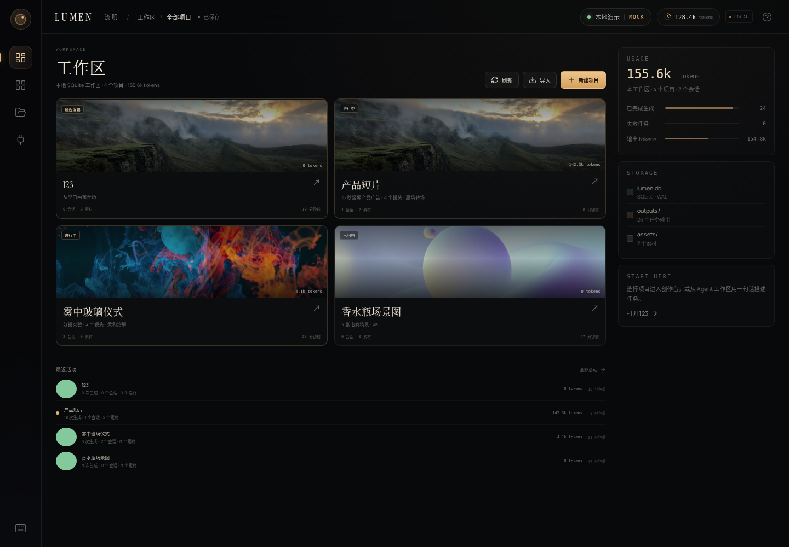 | 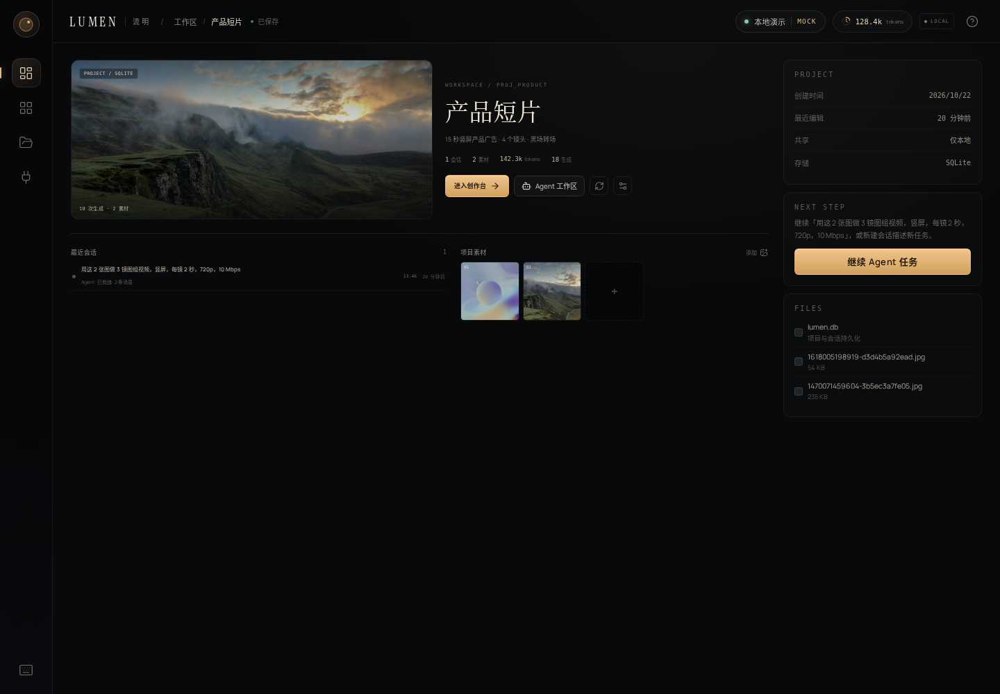 |

| Agent Runtime · 工具与计划 | Agent Runtime · 真实成片 |
| --- | --- |
| 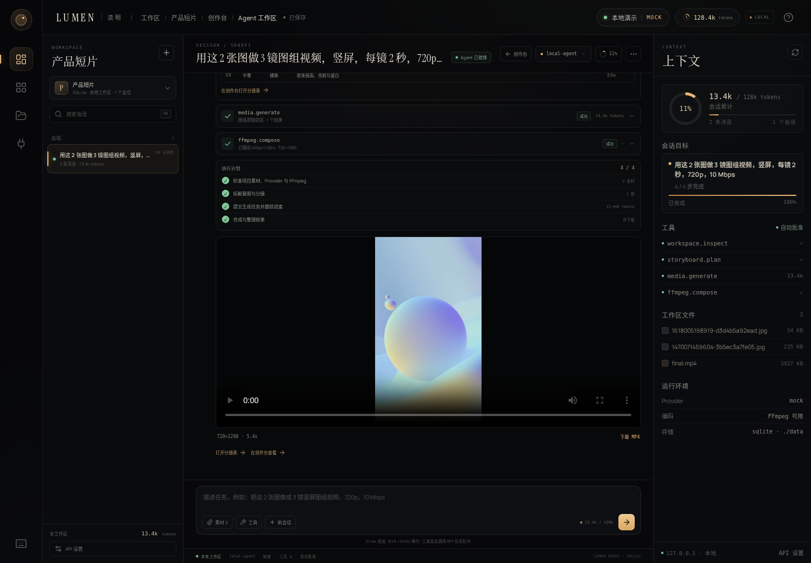 | 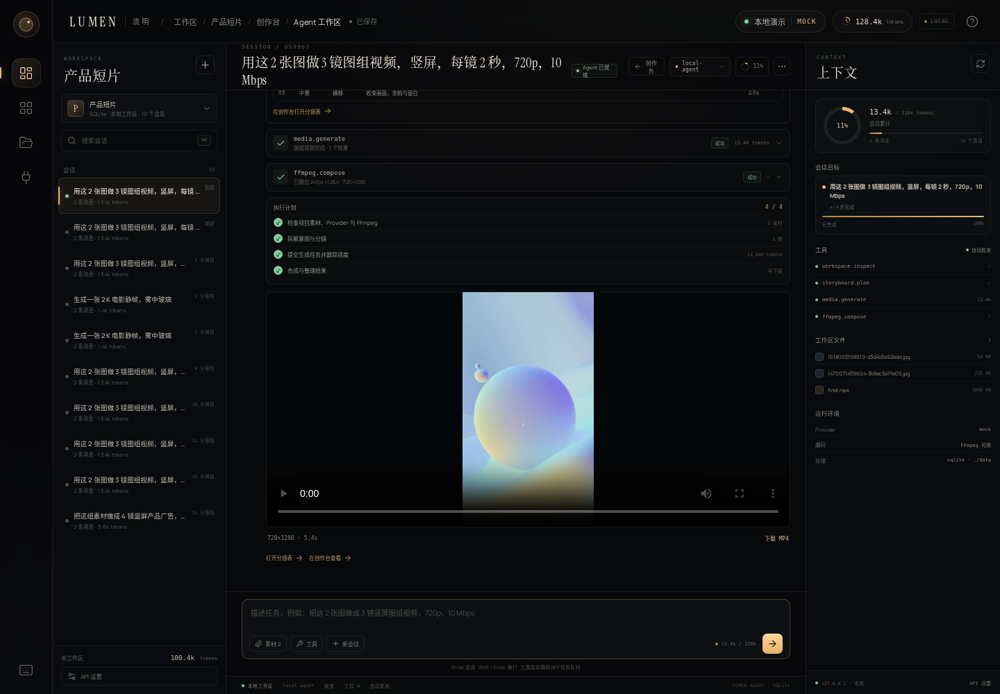 |

| BFF 连接 / 加密配置 | 图组视频 · FFmpeg 成片 |
| --- | --- |
| 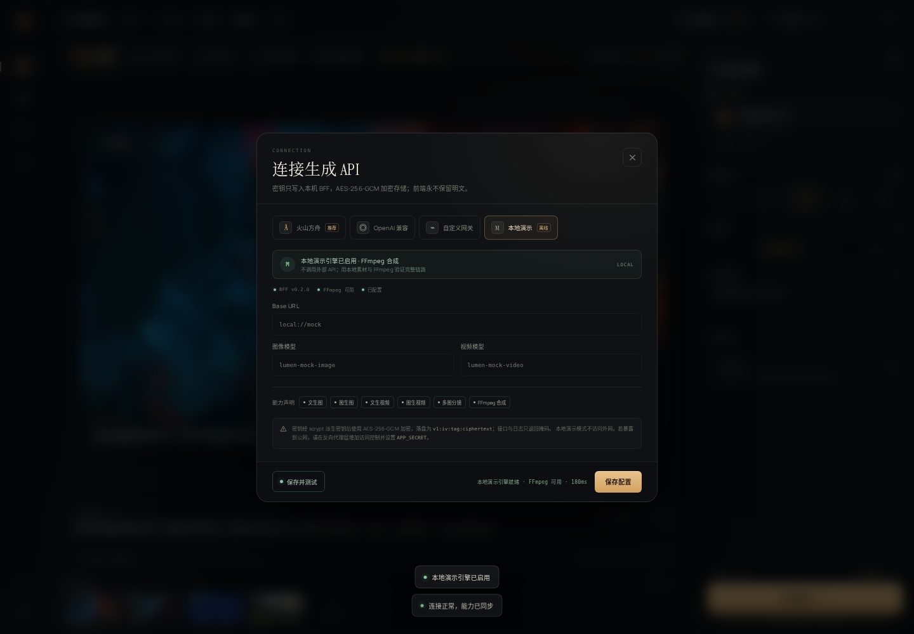 | 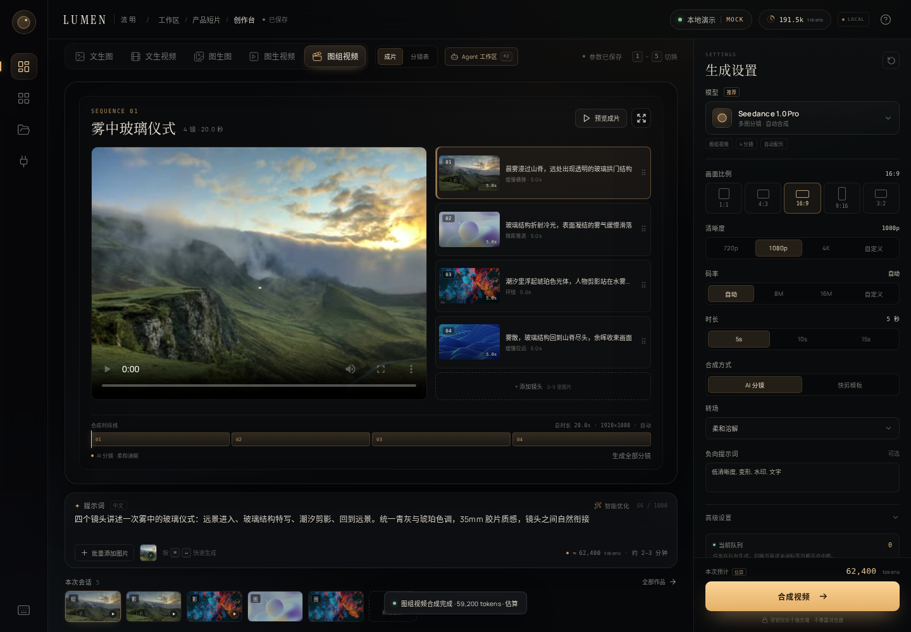 |

| 工作区 | 项目页 |
| --- | --- |
| 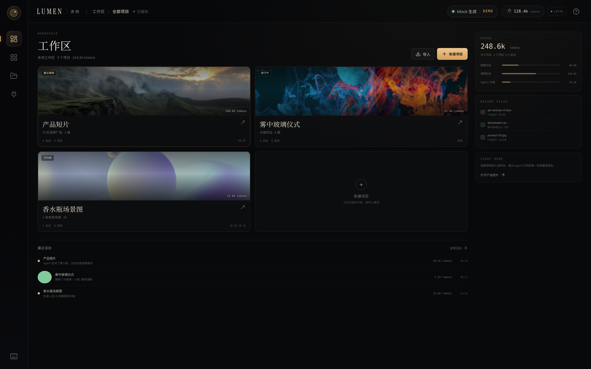 | 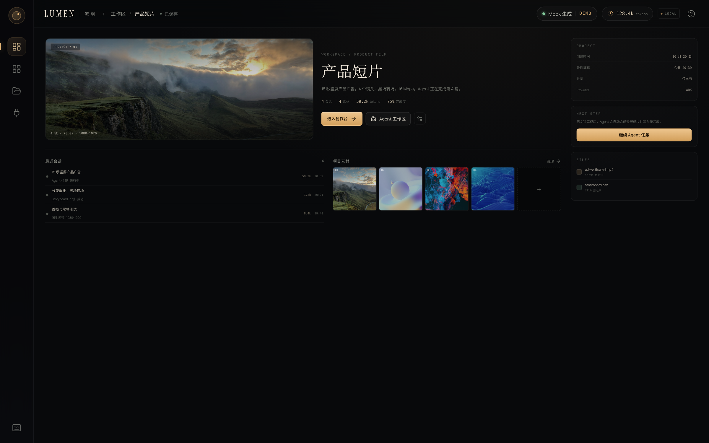 |

| 创作台 | 分镜表 |
| --- | --- |
| 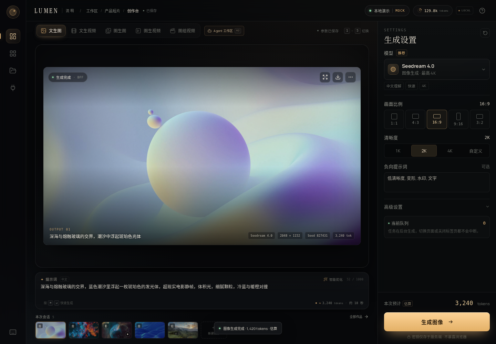 | 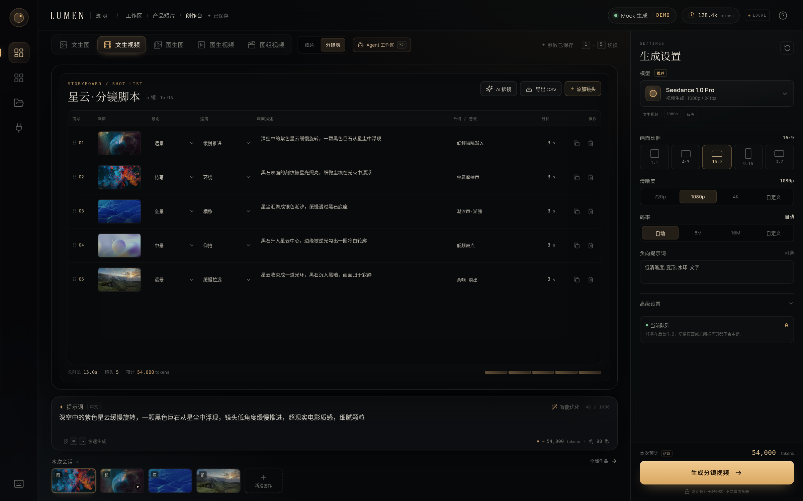 |

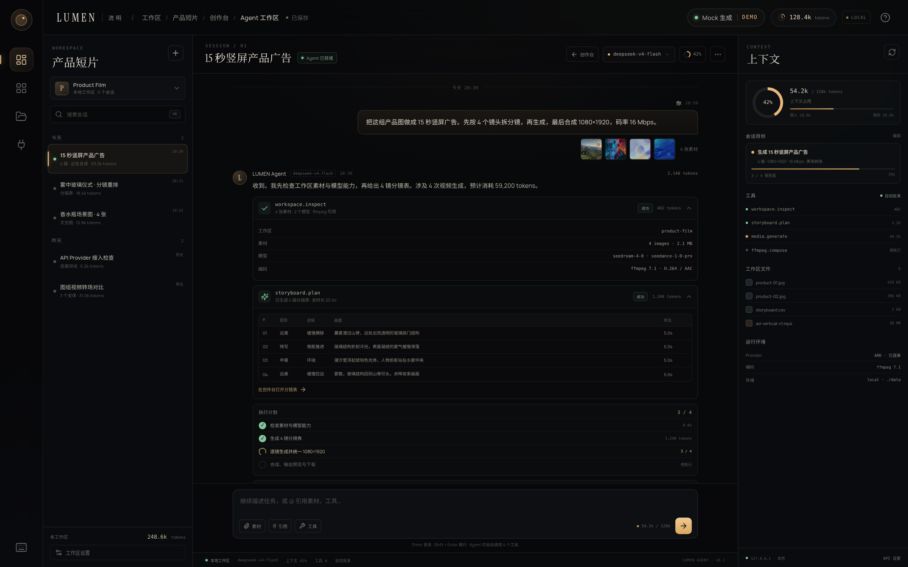

## 设计稿与规范

| 交付物 | 文件 |
| --- | --- |
| 高保真可交互设计稿 | [design/index.html](./design/index.html) |
| 设计规范 | [docs/01-design-spec.md](./docs/01-design-spec.md) |
| 施工图（技术方案） | [docs/02-construction-blueprint.md](./docs/02-construction-blueprint.md) |
| 模型获取 / 作品库 / 素材库设计稿 | [docs/04-model-works-assets-design.md](./docs/04-model-works-assets-design.md) |
| 模型获取 / 作品库 / 素材库施工图 | [docs/05-model-works-assets-blueprint.md](./docs/05-model-works-assets-blueprint.md) |
| i18n 与全局主题设计稿 | [docs/06-i18n-theme-design.md](./docs/06-i18n-theme-design.md) |
| i18n 与全局主题施工图 | [docs/07-i18n-theme-blueprint.md](./docs/07-i18n-theme-blueprint.md) |
| 主题可读性与创作台素材隔离修复方案 | [docs/08-theme-studio-asset-fix.md](./docs/08-theme-studio-asset-fix.md) |
| API 契约（OpenAPI 3.1） | [docs/03-api-contract.yaml](./docs/03-api-contract.yaml) |
| 设计稿截图 | [design/screenshots/](./design/screenshots/) |

直接打开 `design/index.html` 可查看静态设计原型（图片与字体本地，无网络依赖）。`design/` 是设计参考，不是生产前端；生产前端在 `src/`。

## 当前边界与下一步

- 真实 Ark / OpenAI 调用需要你的 Key 与模型 ID；已用本地假 Provider 验证请求/轮询/下载路径，但未消耗真实额度做画质回归。
- 队列、项目、会话现已持久化到 **SQLite（`node:sqlite`）**；下一步可换 Postgres/对象存储，而不改前端。
- 前端默认 HTTP 轮询任务；SSE 端点已实现，可在作品库/长任务场景切换。
- 视频统一输出 H.264 MP4（无音轨）；生成音频的 Provider 结果当前在合成时丢弃音轨，后续可补 AAC 混流。
- Agent 是**本地确定性编排器**，不调用 LLM；接入真实模型（DSH 会话协议或 Provider LLM）是下一步。
- 模型获取、作品库、素材库已按 [04](./docs/04-model-works-assets-design.md) / [05](./docs/05-model-works-assets-blueprint.md) 落地：模型目录与路由、作品快照与历史回填、素材标签/引用/作品转素材均可用。
- i18n 与全局主题已按 [06](./docs/06-i18n-theme-design.md) / [07](./docs/07-i18n-theme-blueprint.md) 在 Vue 层落地：`i18next` + 自建 `useT()` 响应式封装、`locales/<lang>/{base,页面}` 结构、偏好弹层（顶栏）、防闪烁内联脚本、浅色主题令牌重映射、媒体区保持深色；项目重命名、会话重命名/删除均可在 UI 中完成。
- 前端已迁移到 Vue 3 + TypeScript + Vue Router + Pinia；旧 React 组件与依赖已移除，BFF 与 `shared/contracts.ts` 协议未变。
- 作品/素材删除为软删除；文件按 `MEDIA_RETENTION_DAYS` 保留策略清理（清理任务 P1）。
- 未实现账号/多用户/配额；本地单用户，访问控制依赖本机与反向代理。
- 生产化需要：Postgres/SQLite、对象存储、短时签名 URL、审计日志、Docker 镜像与 CI。

## 测试与验证

- `npm run typecheck`：前端 + 服务端通过。
- `npm run test:server`：AES-GCM 往返/防篡改、token 估算、FFmpeg 两图合成与探测通过。
- `npm run test:server`（21 项）还覆盖：SQLite 项目/会话/消息持久化、Agent 意图解析（模式/竖屏/码率/每镜时长/动画）、Agent 取消（幂等、不递归、任务变为 canceled）、模型分类/目录/路由（含用户编辑保护与删除守卫）、作品物化（多输出/幂等/attempt/游标/收藏/软删）、素材（哈希/标签上限/引用/软删）。
- Playwright 冒烟（Vue）：工作区 → 项目页 → 创作台 → Agent 工作区（三栏布局 / 工具卡 / 计划 / 输出）→ 新建会话 → 重命名 → Enter 发送触发真实生成 → SSE 回写 → 删除会话 → 作品库 / 素材库 / 模型页 → API 弹层，全程无控制台错误。
- 媒体接口验证：Range 请求返回 `206 Partial Content`。
