# 设计稿 · LUMEN 流明

> AI 影像工作台 · 五模式创作单页  
> 版本：v0.1（设计提案，待确认）  
> 日期：2026-10-22  
> 配套：[可交互高保真设计稿](../design/index.html) · [施工图](./02-construction-blueprint.md) · [模型获取 / 作品库 / 素材库设计稿](./04-model-works-assets-design.md) · [对应施工图](./05-model-works-assets-blueprint.md)

---

## 0. 交付说明

| 交付物 | 路径 | 说明 |
| --- | --- | --- |
| 高保真交互原型 | [design/index.html](../design/index.html) | 纯静态 HTML/CSS/JS，可本地打开；五种模式可切换，参数、上传、生成进度、API 配置均有演示交互 |
| 设计规范 | 本文档 | 信息架构、布局、视觉、组件、状态、验收标准 |
| 施工图 | [02-construction-blueprint.md](./02-construction-blueprint.md) | React 技术方案、目录、API 契约、任务编排、里程碑 |
| API 契约 | [03-api-contract.yaml](./03-api-contract.yaml) | OpenAPI 3.1，可直接用于 mock / 联调 |

原型中的影像是 Unsplash 占位素材，仅用于验证构图、色彩与层级，不代表最终生成质量。正式实现时替换为真实生成结果。

**查看方式**

```bash
cd design
python3 -m http.server 4173
# 打开 http://127.0.0.1:4173
```

### 设计稿预览

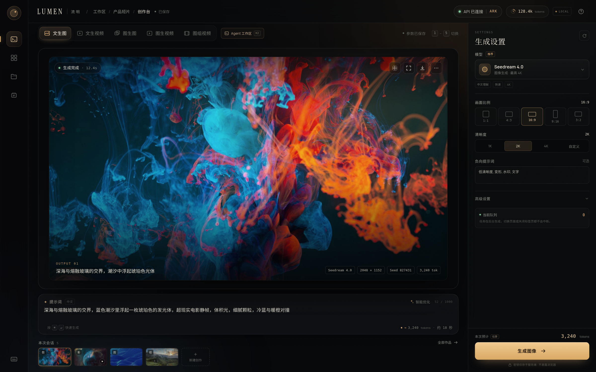

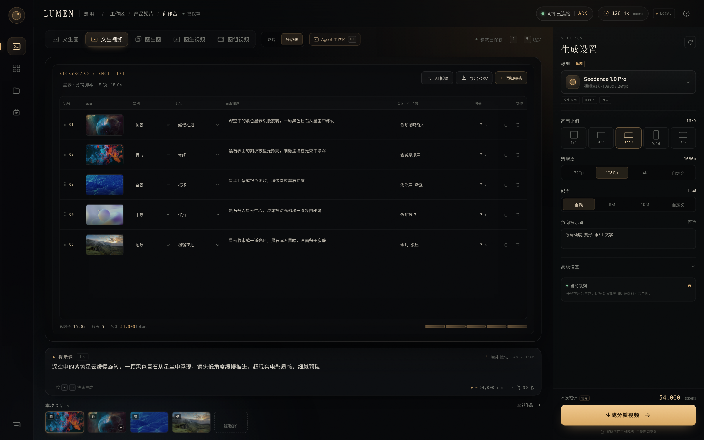

| 图组视频 · 分镜表 | 图组视频 · 成片预览 |
| --- | --- |
| 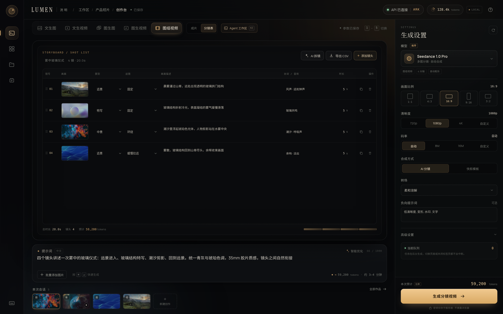 | 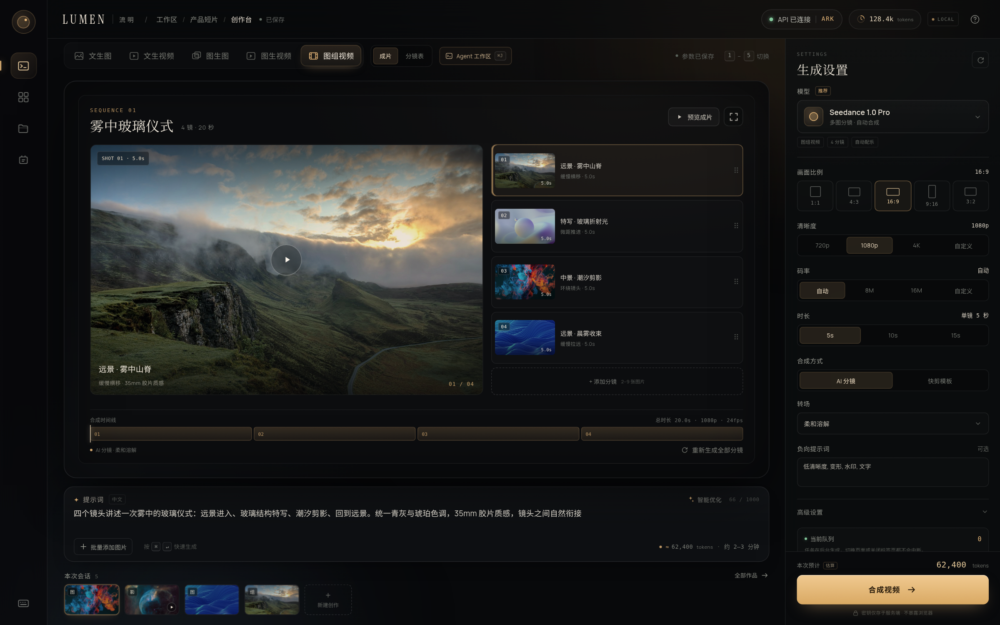 |

| 图生图 · 对比 | 图生视频 · 首尾帧 |
| --- | --- |
| 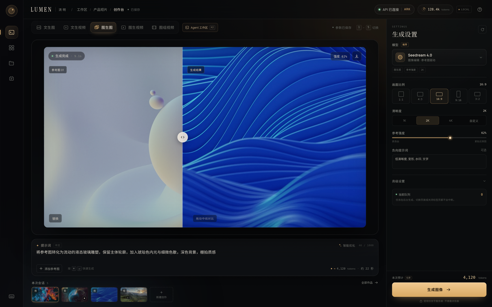 |  |

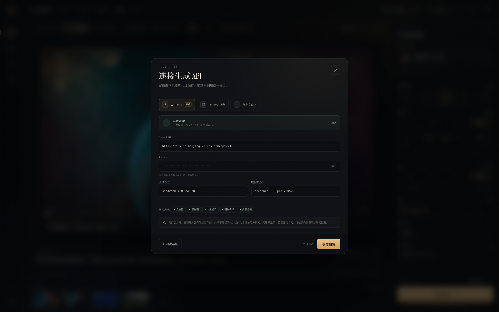

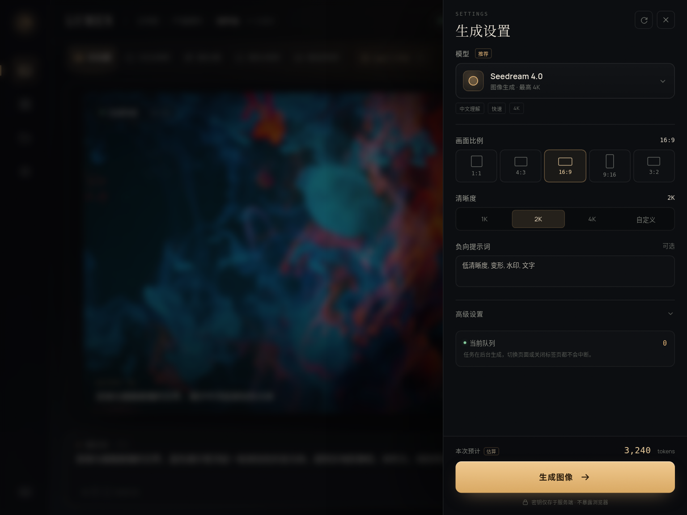

| 自定义清晰度 | 图生视频 · 动画模式 |
| --- | --- |
| 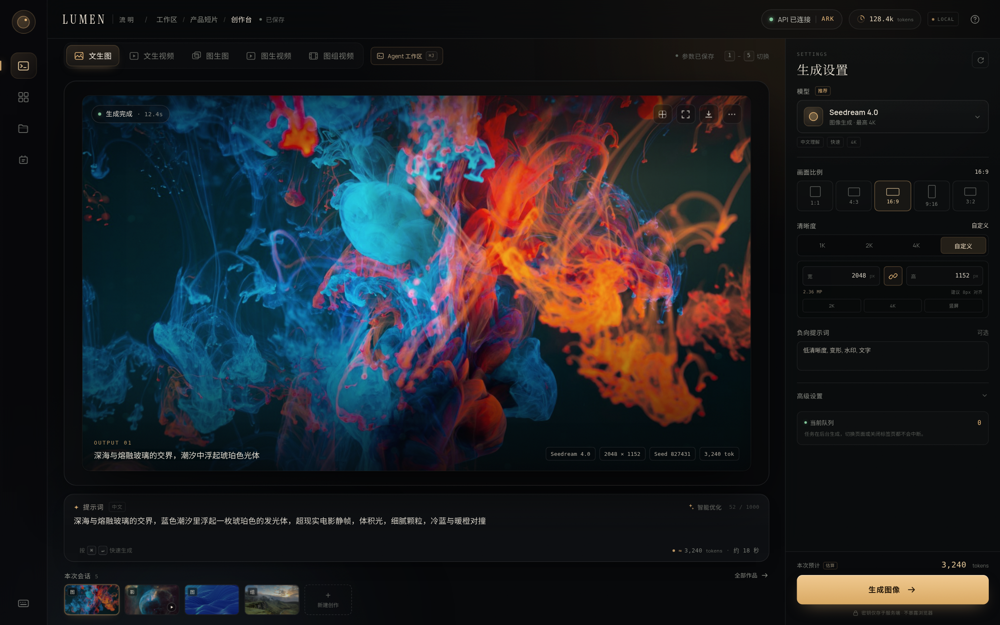 | 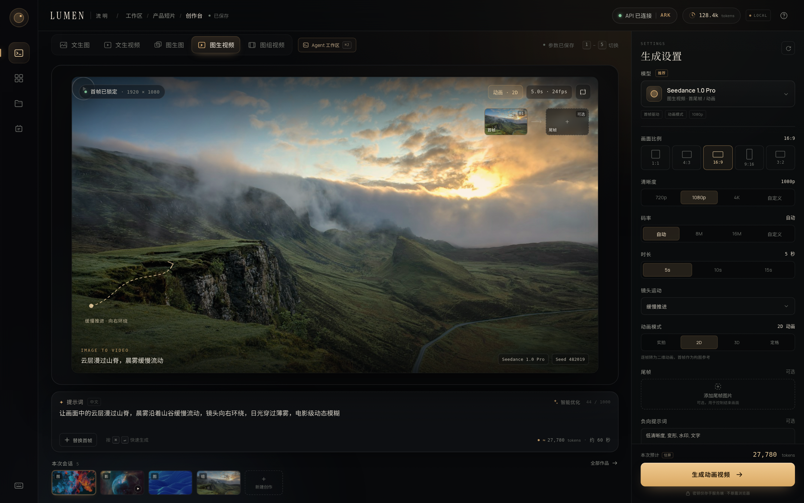 |

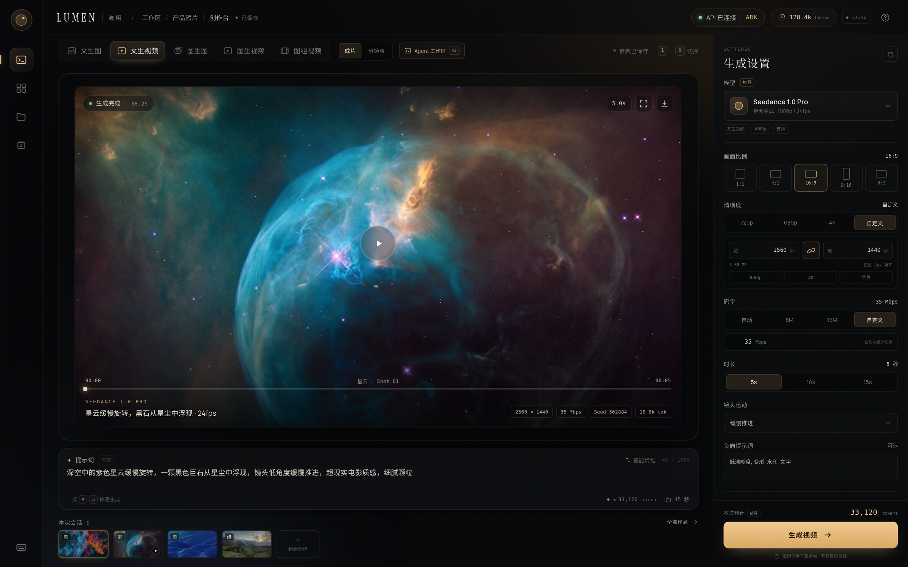

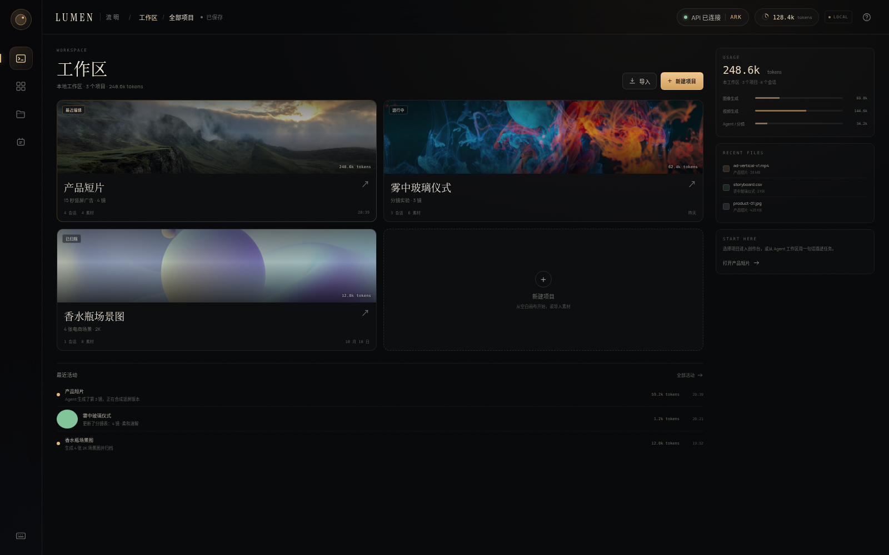

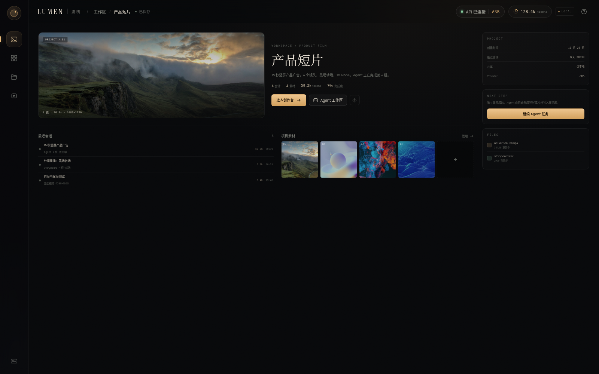

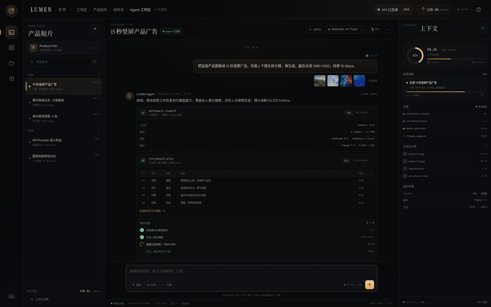

---

## 1. 产品定义

### 1.1 一句话

LUMEN 是一个“输入素材与意图，输出可交付影像”的 AI 创作工作台：在一个界面内完成文生图、文生视频、图生图、图生视频、图组视频，不跳转、不排队找入口。

### 1.2 目标用户

| 用户 | 典型任务 | 核心诉求 |
| --- | --- | --- |
| 内容创作者 / 自媒体 | 封面、短视频空镜、分镜 | 快、风格统一、结果可直接下载 |
| 电商 / 品牌设计 | 商品场景图、氛围短片 | 参考图一致性强、可复用参数 |
| 短片 / 广告前期 | 概念图、动态分镜、提案视频 | 多图成片、镜头连贯、可迭代 |
| 开发者 / 小团队 | 自建 API 工作流 | 模型可替换、密钥安全、接口稳定 |

### 1.3 设计原则

1. **画面优先**：画布占据视觉中心，参数退居右侧，不用弹窗打断创作。
2. **一屏完成**：模式切换、提示词、参考图、参数、结果都在同一工作台。
3. **Token 透明**：每次生成前明确模型、比例、时长、预计 tokens 与等待时间；生成后展示 Provider 实际 usage，缺失时标注“估算”。
4. **异步可离开**：任务后台运行，切页不中断；状态可恢复。
5. **失败可恢复**：错误必须说明原因、是否token 消耗、能否重试，并保留输入。
6. **暗房气质**：深色、暖琥珀光、电影颗粒，强调“作品感”而非工具感。

### 1.4 非目标（v1）

- 不做复杂时间线剪辑器、字幕/配音编辑、特效合成。
- 不做社区广场、作品公开分享、多人协作。
- 不做余额、充值、订阅或任何支付体系；只展示 token 用量。
- 不做账号注册/登录；v1 是本地单用户工作区。
- 不做模型训练/LoRA 管理。
- 不做移动端完整专业版；移动端保证浏览与简单生成。

---

## 2. 信息架构

```text
LUMEN
└── 工作区 /workspace                      ← 顶层入口：项目列表
    └── 项目 /workspace/:projectId         ← 项目概览、素材、会话
        └── 创作台 /workspace/:projectId/studio
            ├── 文生图        t2i
            ├── 文生视频      t2v
            ├── 图生图        i2i
            ├── 图生视频      i2v
            ├── 图组视频      multi
            └── Agent 工作区  ← 类 DSH 会话视图，属于创作台
```

辅助入口（全局）：作品库、素材库、API 与模型。

v1 实际落地：工作区项目列表、项目页、创作台、Agent 工作区、作品库。API 配置用右侧抽屉/弹窗承载，素材库先在作品库中聚合。**没有登录页、账户菜单或用户体系。**

> 作品库、素材库、API 与模型的独立页面、模型目录与模式路由的扩展设计见 [模型获取 / 作品库 / 素材库设计稿](./04-model-works-assets-design.md)，实现方案见 [对应施工图](./05-model-works-assets-blueprint.md)。

**入口路径固定为：工作区 → 项目 → 创作台。** Agent 工作区不是顶层导航，而是创作台内部视图，可从创作台顶部“Agent 工作区”或项目页的会话快捷方式进入，返回时回到创作台。

### 2.1 五种模式定义

| 模式 | 代号 | 输入 | 输出 | 默认模型 | 关键参数 |
| --- | --- | --- | --- | --- | --- |
| 文生图 | `t2i` | 提示词 | 1–4 张图 | 图像模型 | 比例、清晰度（1K/2K/4K/自定义宽高）、Seed、负向词 |
| 文生视频 | `t2v` | 提示词 / 分镜表 | 1 段视频 | 视频模型 | 单段或分镜、时长、比例、清晰度（720p/1080p/4K/自定义）、码率、运镜、Seed |
| 图生图 | `i2i` | 1–4 张参考图 + 提示词 | 1–4 张图 | 图像编辑模型 | 参考强度、比例、清晰度（含自定义宽高） |
| 图生视频 | `i2v` | 首帧（必选）+ 尾帧（可选）+ 提示词 | 1 段视频 | 视频模型 | 时长、运镜、动画模式、清晰度/码率 |
| 图组视频 | `multi` | 2–9 张图 + 分镜表 | 1 段合成视频 | 视频模型 | 单镜时长、清晰度/码率、转场、合成方式 |

### 2.2 文生视频的“分镜模式”

文生视频提供两个入口：

1. **单段生成**：一句提示词 → 一段连续视频。适合空镜、氛围片。
2. **分镜模式**：按电影分镜表拆成多个镜头，再逐镜生成并合成。适合叙事、广告、动态分镜。

分镜表字段：`镜号 / 画面 / 景别 / 运镜 / 画面描述 / 台词·音效 / 时长 / 操作`。支持新增、删除、复制、行内编辑、AI 拆镜、导出 CSV；总时长和 token 预估实时联动。图组视频复用同一张分镜表，只是每行绑定一张已上传图片。

### 2.3 “图组视频”的产品定义

“图组视频”即需求中的“图组合视频”。它不是一个模糊的“多图生成”，而是两条明确路径：

1. **AI 分镜（默认）**：每张图作为一个镜头的首帧，分别生成 3–5 秒动态镜头，再统一分辨率/帧率并合成。适合叙事短片、动态分镜。
2. **快剪模板（P1）**：不调用视频模型，用 Ken Burns 推拉摇移 + 转场 + 音乐直接合成。token 消耗低、速度快，适合电商轮播、图集视频。

界面用“合成方式”显式切换，避免用户误解 token 消耗。v1 先交付 AI 分镜，快剪模板作为降级路径。

### 2.4 自定义输出规格与动画模式

**图像自定义清晰度**
- 预设：1K / 2K / 4K；新增“自定义”，展开宽×高输入。
- 宽高范围 512–8192，建议 8px 对齐；支持比例锁定、2K/4K/竖屏快捷预设。
- 修改宽度时，锁定比例会联动高度；比例切换时以短边为基准重新适配，避免尺寸爆炸。
- 输出元信息实时显示实际像素，token 预估按实际 MP 缩放。

**视频自定义清晰度与码率**
- 预设：720p / 1080p / 4K；新增“自定义”，宽 640–3840、高 360–2160，建议 8px 对齐。
- 码率：自动 / 8 Mbps / 16 Mbps / 自定义（2–80 Mbps）。
- 码率只影响编码质量与文件大小，不改变生成内容，也不改变 token 预估；界面需明确提示。
- 所有视频模式（文生视频、图生视频、图组视频）共享这套规格；FFmpeg 编码按此输出。

**图生视频动画模式**
- 选项：实拍 / 2D 动画 / 3D 动画 / 定格动画。
- 动画模式改变生成提示词与模型参数，首帧仍作为构图/角色参考。
- 选择非实拍时，CTA 变为“生成动画视频”，画布顶部出现“动画 · 2D/3D/定格”标签。
- 动画模式会带来额外重绘开销，token 预估乘以 1.08–1.20 系数；具体以 Provider 为准。

---

## 3. 核心流程

### 3.1 首次使用

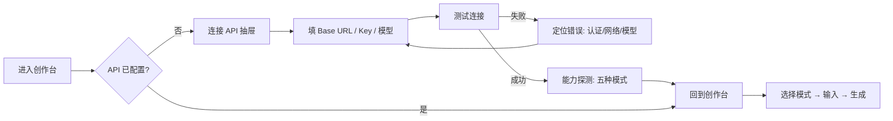

### 3.2 单次生成

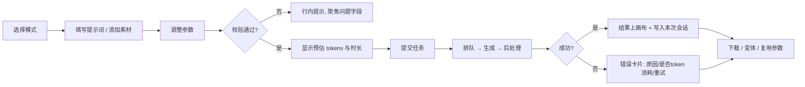

### 3.3 文生视频 · 分镜模式

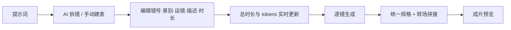

### 3.4 图组视频

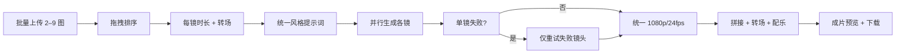

---

## 4. 布局

### 4.1 桌面端 1440×900 基线

```text
┌──────┬──────────────────────────────────────────────────────┬───────────────┐
│      │ LUMEN 流明 / 未命名作品        ● API 已连接   ✦ 2,480 │               │
│ 76px ├──────────────────────────────────────────────────────┤   344px       │
│      │ 文生图 文生视频 图生图 图生视频 图组视频  [成片|分镜表] │  SETTINGS     │
│ Rail │ ┌──────────────────────────────────────────────────┐ │  生成设置     │
│      │ │                                                  │ │               │
│ 创作 │ │                  画布 / 结果                     │ │  模型         │
│ 作品 │ │              （16:9，最大高度）                   │ │  比例         │
│ 素材 │ │                                                  │ │  清晰度       │
│ API  │ └──────────────────────────────────────────────────┘ │  时长/运镜    │
│      │ ┌──────────────────────────────────────────────────┐ │  负向词       │
│      │ │ ✦ 提示词                        智能优化  0/1000 │ │  高级         │
│      │ │ 描述你想生成的画面…                               │ │               │
│      │ │ + 添加参考图       ⌘↵    ≈3,240 tokens · 18s      │ │               │
│      │ └──────────────────────────────────────────────────┘ │  3,240 tokens │
│      │ 本次会话  [缩略图][缩略图][缩略图][缩略图]  + 新建    │ │ [ 生成图像 →] │
└──────┴──────────────────────────────────────────────────────┴───────────────┘
```

### 4.2 尺寸规范

| 区域 | 尺寸 | 说明 |
| --- | --- | --- |
| 左侧导航 | 76px | 图标 + tooltip；可折叠为 0（平板） |
| 顶栏 | 62px | 品牌、项目名、API 状态、会话 tokens、本地标识；无账户入口 |
| 模式栏 | 54px | 五模式切换 + 成片/分镜表视图切换 + 快捷键提示 |
| 右侧参数栏 | 344px（≤1360 为 322px） | 独立滚动，底部 CTA 吸底 |
| 工作区项目列表 | 主区 1fr + 286px 用量栏（≤1279 隐藏侧栏） | 项目卡 2 列；新建项目 |
| 项目页 | 主区 1fr + 286px 信息栏 | 项目封面、进入创作台、会话、素材 |
| Agent 工作区会话栏 | 264px（≤1440 为 250px） | 搜索、分组会话、工作区 token 汇总 |
| 工作区上下文栏 | 300px（≤1440 为 280px，≤1279 隐藏） | 上下文、目标、工具、文件、环境 |
| 工作区主栏 | 自适应 | 会话头 + 消息流 + 输入框 + 状态栏 |
| 画布内边距 | 22px | 结果卡片圆角 13px |
| 主内容左右留白 | 26 / 25px | 保持呼吸感 |
| 提示词框 | 自适应高度 128–150px | 2 行输入，超出滚动 |
| 会话缩略图 | 88×49px | 16:9，最多 5 个 |
| 组件圆角 | 6 / 9 / 12 / 16 / 20px | 小控件到大容器 |
| 基础间距 | 4 / 8 / 12 / 16 / 24 / 32px | 8pt 网格 |

### 4.3 视觉重心

- 画布占可用高度约 **55%–62%**，是第一优先级。
- 琥珀色只用于主 CTA、激活态与关键数字，全局占比 < 8%。
- 右侧参数栏使用更深的底色和细分割线，形成“暗房操作台”层次。
- 结果图必须带完整元信息：模型、尺寸、Seed、耗时；避免“黑盒感”。

---

## 5. 视觉系统

### 5.1 关键词

**暗房 / 电影片场 / 琥珀光 / 胶片颗粒 / 精密仪器**

不是“赛博霓虹”，也不是“白底 SaaS”。用低饱和暖光与深黑制造作品集质感；用细线、等宽数字和微型标签制造专业仪器感。

### 5.2 色彩

| Token | 值 | 用途 |
| --- | --- | --- |
| `--bg` | `#07080A` | 页面底色 |
| `--bg-deep` | `#050608` | 画布/模态遮罩底 |
| `--panel` | `#0B0D10` | 面板 |
| `--panel-2` | `#101317` | 输入框、浮层 |
| `--panel-3` | `#15181D` | hover、选中底 |
| `--line` | `rgba(255,255,255,.075)` | 常规分割线 |
| `--line-strong` | `rgba(255,255,255,.12)` | 浮层边框 |
| `--text` | `#F0ECE4` | 主文本（暖白） |
| `--text-soft` | `#C7C3BA` | 次文本 |
| `--muted` | `#85867F` | 辅助信息 |
| `--muted-2` | `#5E615E` | 占位、弱提示 |
| `--accent` | `#E7B778` | 品牌琥珀 / 主操作 |
| `--accent-bright` | `#F5D7A6` | hover / 高光 |
| `--accent-deep` | `#B8803F` | 渐变暗端 |
| `--accent-ink` | `#1D1409` | 琥珀底上的文字 |
| `--green` | `#83C99B` | 成功、连接正常 |
| `--red` | `#E78678` | 失败、危险 |
| `--blue` | `#9AB6CF` | 信息、冷色点缀 |

> 禁止纯白 `#FFF` 大面积使用；主文本用暖白，避免暗色界面刺眼。

### 5.3 字体

| 层级 | 字体 | 字号 / 行高 | 用途 |
| --- | --- | --- | --- |
| 品牌 | Instrument Serif | 20px / 1 | LUMEN 字标 |
| 页面标题 | Instrument Serif + Noto Serif CJK | 20–25px / 1.2 | 生成设置、API 标题 |
| 中文大标题 | Noto Serif CJK SC / Songti | 22px / 1.3 | 分镜标题 |
| 正文 | Manrope + Noto Sans CJK SC | 12.5px / 1.65 | 提示词、描述 |
| 控件 | Manrope + Noto Sans CJK SC | 9.5–12px / 1.4 | 按钮、字段 |
| 数字 / 标签 | DejaVu Sans Mono | 7.5–10px，字距 .04–.22em | tokens、Seed、耗时、eyebrow |

字体全部本地自托管（原型已内置 woff2），不依赖 Google Fonts，避免首屏闪烁与网络失败。

### 5.4 材质与光

- **颗粒**：全局 SVG fractalNoise，透明度 4.5%，`mix-blend-mode: overlay`；结果图内另加 7% 颗粒。
- **琥珀氛围光**：右上角 520px 模糊光斑 + 画布右上 radial gradient。
- **玻璃**：画布工具条与状态胶囊使用 `backdrop-filter: blur(12–18px)`，底色低于 50% 不透明。
- **阴影**：画布 `0 32px 80px -22px rgba(0,0,0,.85)`；模态 `0 48px 120px -24px`。
- **边框**：1px 半透明白线；激活态改用 1px 琥珀。
- **禁止**：大面积渐变按钮、彩色发光边框、玻璃拟态堆叠超过两层。

### 5.5 图标与插画

- 线性图标 1.2–1.5px stroke，尺寸 16/20px，圆角端点。
- 五种模式各有独立图标，保持 20×20 视觉体积一致。
- 空状态插画用“取景框 + 光点”构成，不使用 3D 吉祥物。

### 5.6 动效

| 场景 | 时长 | 曲线 |
| --- | --- | --- |
| hover / 颜色 | 160–200ms | ease |
| 面板切换 | 340ms | ease-out，位移 ≤ 6px |
| 生成遮罩 | 300ms | fade + blur |
| 模态 | 300ms | `cubic-bezier(.2,.8,.2,1)` |
| 生成光球 | 2.6s 循环 | linear |
| Toast | 250ms | ease |

约束：不使用弹跳；不使用超过 8px 的位移动画；遵守 `prefers-reduced-motion`。

### 5.7 Token 展示（参考 DSH）

- **顶栏会话计数**：等宽数字 + 单位，例如 `128.4k tokens`；hover 显示完整值 `128,420 tokens`。这是本地会话累计，不是余额。
- **生成前**：显示 `≈ 18,600 tokens`，并配“估算”标签；随分辨率、时长、分镜行数与镜头时长实时更新。
- **生成后**：优先展示 Provider 返回的 `input / output / total tokens`；若 Provider 不返回 usage，则继续显示 `≈` 并标注“估算”。
- **不出现**：积分、余额、充值、套餐、价格。也不做“token 钱包”。
- **格式**：≥1000 用 `k` 紧凑显示（`54.0k`），完整值在 tooltip；任务卡显示完整千分位，避免误差感。
- **口径**：图片/视频按 Provider 实际计量；预估仅用于决策，不承诺与实际完全一致。自定义宽高按实际 MP 缩放预估；码率不影响 token，仅影响编码。

---

## 6. 组件与状态

### 6.1 组件清单

| 组件 | 职责 | 关键状态 |
| --- | --- | --- |
| `AppShell` | 导航 + 顶栏 + 内容区 | 默认 / 工作区 / 创作台 |
| `WorkspaceHome` | 工作区项目列表、使用量、最近活动 | 空 / 项目卡 / 新建项目 |
| `ProjectPage` | 项目概览、会话、素材、进入创作台 | 默认 / 进行中 / 已归档 |
| `AgentWorkspace` | 创作台内的类 DSH 三栏会话视图 | 会话 / 消息 / 工具 / 上下文 |
| `SessionList` | 会话分组、搜索、新建、切换 | 默认 / active / 搜索无结果 |
| `AgentThread` | 用户消息、Agent 回复、工具调用、计划 | 流式 / 完成 / 失败 |
| `ToolCallCard` | 工具名、状态、tokens、可展开结果 | 运行中 / 成功 / 失败 |
| `PlanCard` | 执行步骤与进度 | 0–4 步 / 当前步骤 |
| `ContextPanel` | 上下文 tokens、目标、工具、文件、环境 | 紧凑 / 展开 |
| `AgentComposer` | 任务输入、素材/@/工具、发送 | 空 / 输入中 / 发送中 |
| `ApiStatusPill` | 展示连接与 Provider | 未配置 / 连接中 / 正常 / 异常 |
| `ModeTabs` | 五模式切换 | 默认 / hover / active / 禁用 |
| `ViewSwitch` | 成片 / 分镜表切换 | 仅文生视频、图组视频可见 |
| `StoryboardTable` | 电影分镜表，增删改、AI 拆镜、CSV | 默认 / 编辑 / 新增 / 删除 / 超限 / 空 |
| `TokenUsagePill` | 会话 token 与任务预估 | 估算 / 实际 / 加载 |
| `Artboard` | 结果舞台 | 空 / 生成中 / 图 / 视频 / 对比 / 分镜 |
| `ResultToolbar` | 对比、全屏、下载、更多 | 默认 / 下载中 / 不可用 |
| `PromptComposer` | 提示词、优化、附件、tokens 预估 | 空 / 聚焦 / 超长 / 附件上传中 |
| `AttachmentChip` | 已选素材缩略图 | 上传中 / 完成 / 失败 / 可删除 |
| `Inspector` | 参数面板 | 按模式显隐字段 |
| `AspectRatioPicker` | 比例 | 5 选 1 |
| `SegmentedControl` | 分辨率、时长、合成方式 | 默认 / active / disabled |
| `CustomResolutionPanel` | 自定义宽高、比例锁、快捷预设 | 收起 / 展开 / 超限 / 锁定 |
| `BitratePicker` | 自动/8/16/自定义 Mbps | 默认 / 自定义输入 / 超限 |
| `AnimationModePicker` | 实拍 / 2D / 3D / 定格 | 仅图生视频可见 |
| `StageMeta` | 输出尺寸、码率、动画标签 | 随参数实时更新 |
| `RangeField` | 强度、权重 | 拖动 / 键盘 |
| `ModelPicker` | 模型与能力 | 可用 / 不可用 / 未配置 |
| `GenerateBar` | 预计 tokens + 主 CTA | 可生成 / 缺输入 / 上传中 / 生成中 / 失败 |
| `GeneratingOverlay` | 阶段、百分比、可离开提示 | queued / rendering / postprocess |
| `StoryboardTable` | 电影分镜表、增删改、排序、合成 | 空 / 1–9 镜 / 拖拽中 / 超限 |
| `SessionStrip` | 本次会话结果 | 空 / 多条 / 选中 |
| `ApiSettingsDialog` | Provider 配置与测试 | 未配置 / 已连接 / 测试中 / 失败 |
| `ErrorCard` | 生成失败说明 | 可重试 / 不可重试 / 已产生 tokens |
| `Toast` | 轻提示 | 默认 / 成功 / 失败 |

### 6.2 生成按钮状态机

| 状态 | 按钮文案 | 行为 | 辅助信息 |
| --- | --- | --- | --- |
| 未配置 API | 连接 API | 打开配置 | 灰色说明 |
| 缺提示词 | 生成图像（禁用） | 不可点 | “先写一句提示词” |
| 缺参考图 | 生成图像（禁用） | 不可点 | “请添加一张参考图” |
| 上传中 | 上传素材 42% | 不可点 | 进度条 |
| 可生成 | 生成图像 → | 提交 | `≈ 3,240 tokens · 约 18 秒` |
| 提交中 | spinner | 不可点 | 防止重复提交 |
| 生成中 | 生成中 46% | 可取消 | 可离开提示 |
| 成功 | 生成图像 → | 再次生成 | 结果工具栏 / 实际 tokens |
| 失败 | 重试 | 重试同参数 | 错误卡片 |

### 6.3 参数显隐矩阵

| 参数 | 文生图 | 文生视频 | 图生图 | 图生视频 | 图组视频 |
| --- | :-: | :-: | :-: | :-: | :-: |
| 提示词 | ✓ | ✓ | ✓ | ✓ | ✓ |
| 负向提示词 | ✓ | ✓ | ✓ | ✓ | ✓ |
| 画面比例 | ✓ | ✓ | ✓ | ✓ | ✓ |
| 清晰度 | ✓ | ✓ | ✓ | ✓ | ✓ |
| 自定义宽高 | ✓ | ✓ | ✓ | ✓ | ✓ |
| 码率 | – | ✓ | – | ✓ | ✓ |
| 动画模式 | – | – | – | ✓ | – |
| 时长 | – | ✓ | – | ✓ | ✓（单镜） |
| 镜头运动 | – | ✓ | – | ✓ | ✓（按镜） |
| 参考强度 | – | – | ✓ | – | – |
| 首帧 | – | – | – | ✓ | 每镜 |
| 尾帧 | – | – | – | ✓ | – |
| 转场 | – | – | – | – | ✓ |
| 合成方式 | – | – | – | – | ✓ |
| Seed | ✓ | ✓ | ✓ | ✓ | ✓ |

### 6.4 API 配置弹窗

- 触发：顶栏 `API 已连接`、左侧 API 图标、未配置时的 CTA。
- 内容：
  - Provider 三选一：火山方舟（推荐）、OpenAI 兼容、自定义网关。
  - Base URL、API Key（掩码）、图像模型、视频模型。
  - 连接状态条：成功 / 失败原因 / 延迟。
  - 能力声明：文生图、图生图、文生视频、图生视频、多图分镜。
  - 安全说明：“密钥经服务端加密存储，前端不保留明文。”
- 操作：测试连接、保存配置。
- 失败态：字段级错误（认证失败 / 网络超时 / 模型不存在），保留已填内容。

---

## 7. 五种模式的画面

### 7.1 文生图（默认首屏）

- 画布：单张 16:9 结果，上缘状态胶囊“生成完成 · 12.4s”，右上工具（对比、全屏、下载、更多）。
- 底缘：`OUTPUT 01` + 一句画面摘要 + 模型/尺寸/Seed 元信息。
- 提示词默认给一段完整中文场景，降低空白恐惧。
- 参数：比例、清晰度（含自定义宽高）、负向词、Seed；自定义时显示实际 MP 与对齐提示。

### 7.2 文生视频

- 默认“成片”视图：视频海报、中央播放键、底部时间线 + 时间码 + 镜头标题。
- 新增“分镜表”视图：电影分镜表，5 个镜头行，列含镜号、画面、景别、运镜、画面描述、台词/音效、时长、操作。
- 分镜表支持：行内编辑、添加镜头、删除、复制、AI 拆镜、导出 CSV、缩略图替换；总时长与 tokens 实时计算。
- 切换到分镜表时，CTA 变为“生成分镜视频”，隐藏单段时长/运镜字段（改由表格逐镜控制）。
- 参数新增：时长、镜头运动、清晰度（720p/1080p/4K/自定义）与码率；分镜模式下时长/运镜由表格接管。
- 生成中展示“校验分镜 → 拆分节奏 → 并行各镜 → 统一转场 → 合成”阶段。

### 7.3 图生图

- 画布采用左右对比：左侧“参考图 01”，右侧“生成结果”，中线可拖拽。
- 强度以百分比显示在工具条；拖动即时更新数值。
- 参考图可一键替换，支持 1–4 张（多参考时以缩略图排列）。
- 如果用户尚未上传，画布直接变为大面积上传区，而不是空白。
- 清晰度支持自定义宽高，复用同一套比例锁和预设。

### 7.4 图生视频

- 首帧大图 + 可选的尾帧缩略图，明确 `首帧 → 尾帧` 关系。
- 画布上叠加虚线运动路径与“缓慢推进 · 向右环绕”说明，右侧播放键可预览运动。
- 参数新增：时长、运镜、尾帧上传、动画模式（实拍/2D/3D/定格）、自定义分辨率与码率。
- 选择动画模式后，画布工具条出现“动画 · 2D/3D/定格”状态标签，CTA 改为“生成动画视频”。
- 首帧与画面比例不匹配时，显示“将居中裁切”的提示。

### 7.5 图组视频

- 默认“分镜表”视图：与文生视频共用电影分镜表，每行绑定一张已上传图片；支持增删改、复制、AI 拆镜、导出 CSV。
- “成片”视图：左侧 16:9 成片预览，右侧竖排分镜列表，点击切换预览，底部合成时间线。
- 分镜表每行显示画面缩略图、景别、运镜、画面描述、台词/音效、时长；总时长/镜头数/tokens 实时联动。
- 分镜表模式 CTA 为“生成分镜视频”；成片预览模式 CTA 为“合成视频”。
- 支持 2–9 镜；超过 6 镜时横向滚动，不压缩卡片。
- 合成方式：AI 分镜 / 快剪模板；转场：柔和溶解（默认）、推拉、黑场。
- 单镜失败只重试该镜，不重新生成全部。
- 成片与分镜表共享视频清晰度/码率设置；自定义规格会影响合成输出。

---

## 8. 交互细节

### 8.1 快捷键

| 键 | 行为 |
| --- | --- |
| `1`–`5` | 切换五种模式（输入框聚焦时禁用） |
| `⌘/Ctrl + Enter` | 提交生成 |
| `Esc` | 关闭弹窗 / 取消拖拽 |
| `Space` | 视频播放/暂停（画布聚焦） |
| `⌘/Ctrl + D` | 下载当前结果 |

### 8.2 上传

- 点击或拖拽上传；支持 JPG / PNG / WebP。
- 单文件 ≤ 20MB，像素 ≥ 512，最多 9 张。
- 客户端先压缩到长边 ≤ 4096，保留 EXIF 方向，去除 GPS。
- 上传中显示缩略图 + 进度环；失败可单独重试。
- 图组视频按上传顺序入镜，可拖拽排序。

### 8.3 分镜表编辑

- 进入方式：文生视频 / 图组视频顶部的 `成片 | 分镜表` 切换。
- 行内编辑：景别、运镜为下拉；描述、台词/音效为输入；时长为 1–8s 数字。
- 增删改：添加镜头、复制镜头、删除镜头；至少保留 1 镜。删除后镜号自动重排。
- 缩略图：点击“替换”上传新图；图组视频每行必须有图才能生成。
- AI 拆镜：根据当前提示词重新拆分，覆盖当前表格前二次确认（正式实现）/ 原型直接演示。
- 导出 CSV：UTF-8 BOM，含镜号、景别、运镜、描述、音效、时长。
- 校验：总时长 ≤ 60s；图组视频 2–9 镜；文生视频分镜 1–9 镜。

### 8.4 自定义规格与动画模式

- 清晰度切到“自定义”时，展开宽高输入、比例锁和快捷预设；收起时隐藏，避免占用默认面板空间。
- 宽高输入实时 clamp：图像 512–8192、视频 640–3840 × 360–2160；非法值回退到最近合法值。
- 比例锁开启时，宽/高联动；关闭时可输出非比例尺寸（服务端将居中裁切/补边，需在生成前提示）。
- 码率选择“自定义”时出现 Mbps 输入；提示“仅影响编码质量，不影响 token 预估”。
- 动画模式仅图生视频显示；切换后更新 CTA、画布标签与 token 系数。
- 所有自定义输出规格写入结果元信息和下载文件命名，避免用户拿到与预期不符的尺寸。

### 8.5 生成中

- 遮罩不遮挡导航；允许切换作品库/设置，但当前画布保留进度。
- 显示阶段文案 + 百分比 + “可离开页面”说明。
- 支持取消；取消后已产生的 token 消耗以 Provider 账单为准。
- 完成时轻 Toast，不弹模态。

### 8.6 失败

错误卡片字段：发生了什么、为什么、是否token 消耗、下一步按钮。

| 错误 | 文案 | 操作 |
| --- | --- | --- |
| 401 | API Key 无效或已过期 | 重新配置 |
| 429 | 请求过于频繁，请稍后再试 | 查看排队 / 自动重试 |
| 内容审核 | 提示词或图片未通过审核 | 修改后重试 |
| 超时 | 生成超时，任务已停止 | 重试 / 降低时长 |
| 存储失败 | 结果已生成但保存失败 | 重新保存 |
| 网络 | 与生成服务断开 | 重连 / 查看任务 |

### 8.7 结果操作

- 下载原图/原视频。
- 生成变体（同 Seed 微调 / 随机 Seed）。
- 复用参数（回到对应模式并回填）。
- 删除（二次确认，仅删本地记录）。
- 视频：播放/暂停、静音、全屏。

---

### 8.8 工作区层级

- **工作区**：左侧导航“工作区”进入项目列表；点击项目卡进入项目页；移动端顶栏“工作区”回到项目列表。
- **项目**：主 CTA“进入创作台”；最近会话可快捷进入 Agent 工作区；面包屑可回工作区。
- **创作台**：顶部“Agent 工作区”进入类 DSH 会话；面包屑显示 `工作区 / 产品短片 / 创作台 / Agent 工作区`。
- **Agent 工作区**：会话切换、新建、搜索、发送消息、工具卡展开、计划进度、上下文 tokens。
- **移动端**：顶栏按钮按层级回退：Agent → 创作台 → 项目 → 工作区；消息流内滚、输入框吸底。
- 页面切换不重置创作台参数；工具卡内“在创作台打开分镜表”会切到图组视频分镜表。

## 9. 响应式与适配

| 断点 | 行为 |
| --- | --- |
| ≥ 1440px | 完整三栏，画布最大化 |
| 1280–1439px | 参数栏 322px，模式标签缩窄 |
| 1120–1279px | 参数栏改为右侧抽屉；提示词框右下出现“参数 / 生成”按钮 |
| 800–1119px | 左侧导航折叠为顶部图标，画布 16:9 自适应 |
| < 800px | 单栏；模式横向滚动；历史隐藏；参数使用全屏 Sheet；工作区/项目页单列；Agent 工作区隐藏会话/上下文栏，消息流内滚，顶栏按层级回退 |
| 900–1279px | Agent 工作区隐藏上下文栏；会话栏 248px；工作区/项目页隐藏右侧信息栏 |
| 1279–1439px | Agent 工作区上下文栏 280px；会话栏 250px |
| 高度 < 910px | 隐藏本次会话缩略图，压缩模式栏与提示词高度 |

原型已实现平板/移动端参数抽屉与快捷生成按钮；正式 React 实现沿用同一断点与交互。

---

## 10. 可访问性与国际化

- 文本对比度：主文本对背景 ≥ 12:1；次要文本 ≥ 4.5:1；禁用态除外。
- 所有图标按钮有 `aria-label`；模式切换使用 `role="tablist"` / `aria-selected`。
- 生成进度使用 `aria-live="polite"`，错误使用 `role="alert"`。
- 完整键盘可达；焦点环 1px 琥珀，不依赖颜色单独传达状态。
- 视频提供字幕/静音说明；生成图片 alt 使用提示词摘要。
- 动效遵循 `prefers-reduced-motion`。
- v1 仅中文；文案结构预留英文长度 1.4 倍。

---

## 11. 微文案

| 场景 | 文案 |
| --- | --- |
| 空提示词 | 描述你想生成的画面… |
| 未配置 API | 连接 API 后开始生成 |
| 生成按钮 | 生成图像 / 生成视频 / 合成视频 |
| 预计消耗 | 本次预计消耗 3,240 tokens（估算） |
| 长任务 | 任务在后台生成，切换页面或关闭标签页都不会中断 |
| 成功 | 已生成 · 已加入本次会话 |
| 上传成功 | 已添加 3 张图片 · 已自动压缩 |
| 内容审核 | 提示词或参考图未通过审核，请调整后重试 |
| 取消 | 任务已取消，已产生的费用以服务商账单为准 |
| 安全说明 | 密钥仅存于服务端 · 不暴露浏览器 |

---

## 12. 设计验收清单

- [ ] 五种模式在同一页面可切换，且当前模式、参数、提示词不串台。
- [ ] 任何模式下，画布都占据主要视觉面积，参数栏不抢焦点。
- [ ] 生成前可见模型、比例、时长、预计 tokens、预计等待时间；无积分/余额概念。
- [ ] 顶栏会话 tokens 与生成后实际（或估算）tokens 正确更新。
- [ ] 文生视频和图组视频均可切换到分镜表，完成增、删、改、复制、时长联动。
- [ ] 图像模式支持 1K/2K/4K/自定义宽高；比例锁、快捷预设、越界 clamp 正常。
- [ ] 所有视频模式支持 720p/1080p/4K/自定义宽高与自动/8/16/自定义码率；结果元信息与输出一致。
- [ ] 图生视频动画模式（实拍/2D/3D/定格）可切换，CTA、画布标签与 tokens 预估同步变化。
- [ ] 分镜表总时长、镜头数、tokens 与右侧 CTA 状态一致。
- [ ] 未配置 API、缺提示词、缺参考图、上传中均有明确禁用原因。
- [ ] 生成中可离开；返回后能恢复任务状态。
- [ ] 失败卡片说明原因、是否产生 token 消耗与重试路径。
- [ ] 图组视频支持 2–9 镜、分镜表增删改、单镜重试、失败不重跑全部。
- [ ] 无登录、无账户入口；密钥仍只在服务端。
- [ ] 入口路径为 工作区 → 项目 → 创作台，面包屑与移动端回退一致。
- [ ] 工作区项目列表、项目页、创作台、Agent 工作区四层均可达。
- [ ] Agent 工作区属于创作台：从创作台进入、返回创作台，不出现顶层独立入口。
- [ ] 项目页“进入创作台”与最近会话快捷方式正常。
- [ ] Agent 工作区消息流、工具卡、执行计划、上下文 tokens 正常。
- [ ] “在创作台打开分镜表”能跳到图组视频分镜表。
- [ ] API 配置密钥不回显明文，连接测试有成功/失败态。
- [ ] 1440、1280、1024 三档布局无横向滚动、无遮挡。
- [ ] 键盘可完成“切模式 → 输入 → 生成 → 下载”主路径。
- [ ] 视觉 token 与本文档一致；新增颜色需先补 token。

---

## 13. 待确认

1. **API 供应商**：火山方舟（Seedream 4.0 + Seedance 1.0 Pro）是否可用？是否有现成 Key 与模型 ID？
2. **图组视频默认路径**：先做 AI 分镜（质量高、慢、贵），还是先做快剪模板（快、便宜）？
3. **部署形态**：本机单用户（已确认无登录）。是否需要局域网访问？
4. **Token 口径**：预估用本地 tokenizer 还是固定系数？Provider 不返回 usage 时是否接受“≈ 估算”？
5. **输出规格**：视频是否必须 1080p / 24fps / MP4？单条最长 15 秒是否够用？
6. **品牌**：`LUMEN 流明` 为提案名，可替换；确认后统一替换字标与文案。
