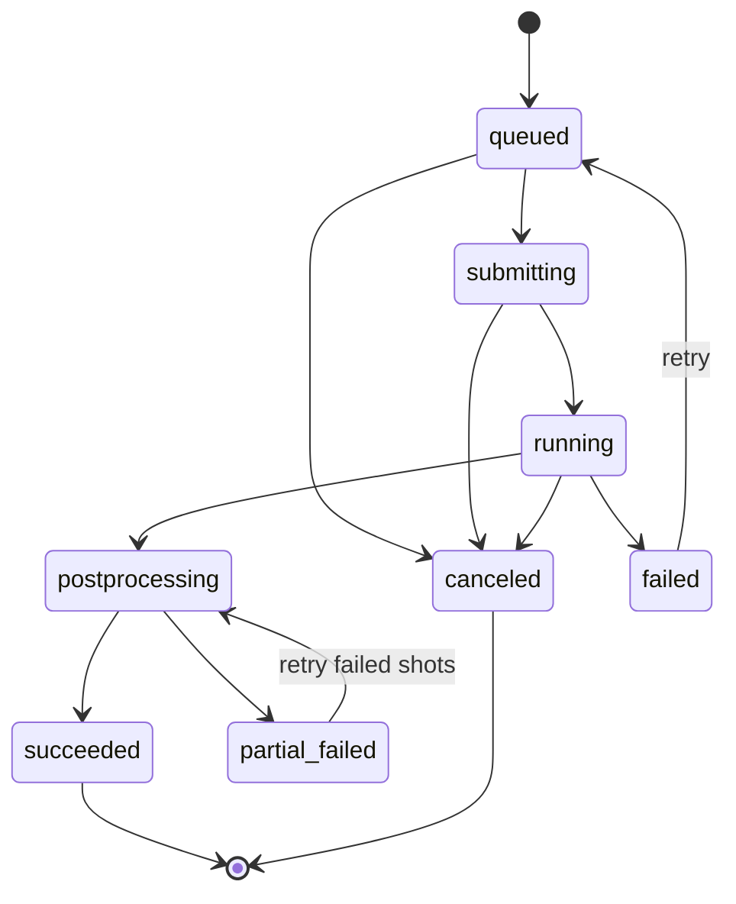
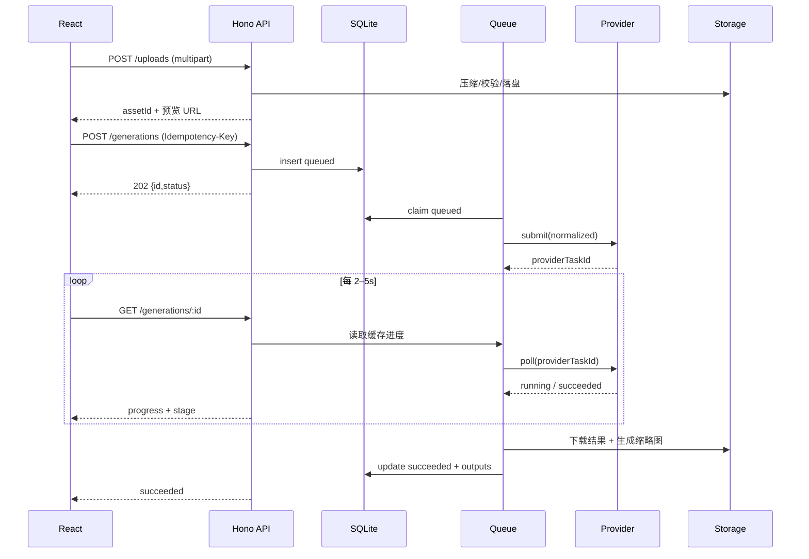
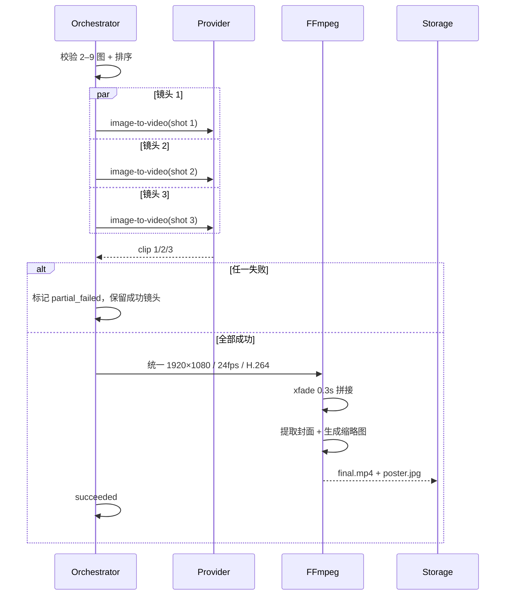

# 施工图 · LUMEN 流明

> React 全栈实现蓝图 · 五模式 AI 影像工作台  
> 版本：v0.2（M2 已落地，持续修订）  
> 配套：[设计稿](./01-design-spec.md) · [API 契约](./03-api-contract.yaml) · [高保真原型](../design/index.html)  
> 扩展模块：[模型获取 / 作品库 / 素材库设计稿](./04-model-works-assets-design.md) · [对应施工图](./05-model-works-assets-blueprint.md)

---

## 0. 技术结论（先看这里）

| 决策 | 选择 | 理由 |
| --- | --- | --- |
| 前端 | React 19 + TypeScript + Vite 7 | 单页高交互，构建快，生态稳定 |
| 样式 | Tailwind CSS v4 + CSS Variables + 少量组件 CSS | Token 可控，复杂画布样式仍可手写 |
| 路由 | React Router v7 | `/workspace` → `/workspace/:projectId` → `/workspace/:projectId/studio`（Agent 工作区为 studio 内视图） |
| 服务端状态 | TanStack Query v5 | 任务轮询、缓存、重试、乐观更新 |
| 客户端状态 | Zustand v5 + persist | 草稿持久化、跨模式保存 |
| 表单与校验 | React Hook Form + Zod | 与后端共享 schema |
| 无障碍原语 | Radix UI（Dialog / Tabs / Slider / Tooltip） | 键盘与焦点管理可靠 |
| 图标 | lucide-react | 线性图标统一 |
| BFF | Hono v4 on Node 22 | 轻量、TS 友好、易写 SSE/流式 |
| 数据库 | SQLite + Drizzle ORM | 本地零运维；可切换 Postgres |
| 队列 | 进程内 `p-queue` + DB 持久化 | MVP 单机足够；后续换 BullMQ |
| 图片处理 | Sharp | 压缩、缩略图、EXIF 清理 |
| 视频处理 | FFmpeg | 统一规格、拼接、转场、封面 |
| 文件存储 | 本地 `data/`（生产 S3/R2） | 开发零依赖，接口抽象 |
| 部署 | 单机 Node 服务 + 静态前端，仅监听 127.0.0.1；Docker 可选 | 同源、无 CORS、无账号；密钥不出服务端 |
| 测试 | Vitest + Testing Library + Playwright | 单测、组件、端到端、视觉回归 |

**核心原则：浏览器永远不直接持有 Provider API Key。** 前端只调用同源 `/api/v1`，由 BFF 代理、排队、存储与 **Provider token usage 归一化**。

### 0.1 当前实现状态（M2）

| 模块 | 蓝图方案 | 当前落地 | 说明 |
| --- | --- | --- | --- |
| 前端 | Tailwind + Router + TanStack | React 19 + 手写 CSS 变量 + Context | 视觉与设计稿一致；路由暂用页面状态，接口已隔离 |
| BFF | Hono on Node 22 | Hono 4 + Node 24 | `/api/v1` 同源，Vite 代理 |
| Provider | Mock / Ark / OpenAI 兼容 | 已实现三类 Adapter | Ark 图像+视频任务；OpenAI Images/Edits/Videos |
| 密钥 | AES-256-GCM | **已实现**，`APP_SECRET` 或 `data/master.key`，0600 | 接口只返回掩码 |
| 上传 | Sharp + 校验 | FFmpeg + magic bytes + 缩略图 | 单图 20MB；EXIF 清理后异步替换 |
| 持久化 | SQLite + Drizzle | **已实现 SQLite（`node:sqlite` + 手写 SQL/WAL）**，覆盖 Provider / 项目 / 素材 / 任务 / Agent 会话与消息 | 无 ORM 与原生依赖；旧 JSON 启动时一次性导入 |
| 队列 | p-queue + DB | 自研 Worker + 并发 2 + DB 持久化 | 支持取消、重试、启动恢复重入队 |
| 轮询 | 前端轮询 / SSE | 两者均实现，UI 默认轮询 | SSE：`/generations/:id/events`、`/agent/sessions/:id/events` |
| 合成 | FFmpeg | **已实现**：静帧 Ken Burns / xfade / 多段拼接 / faststart | H.264 MP4，无音轨 |
| 项目 / Agent | DSH 会话协议（待定） | **已实现本地确定性 Agent Runtime** | 意图解析 → 计划 → 工具调用 → 真实任务 → SSE |
| 模型 / 作品 / 素材 | 见 [04](./04-model-works-assets-design.md) / [05](./05-model-works-assets-blueprint.md) | **设计与施工图完成，代码未接入** | 当前模型仍需手填、作品未独立物化、素材无独立页面 |
| 测试 | Vitest + Playwright | Node test（12 项）+ Playwright 冒烟 | `npm run test:server` |

> 与蓝图不同之处是刻意的 MVP 取舍：先保证本机可跑通、密钥安全、任务可恢复，再替换数据库与队列实现。

---

## 1. 范围

### 1.1 v1 必须交付

- 五种模式：文生图、文生视频、图生图、图生视频、图组视频。
- API 配置：Provider、Base URL、Key、图像/视频模型、连通性测试、能力探测。
- 生成任务：提交、排队、轮询、进度、取消、失败重试。
- 素材上传：拖拽/选择、压缩、校验、缩略图。
- 结果：图片/视频预览、下载、复用参数、删除。
- 本次会话历史 + 作品库基础筛选。
- Mock Provider：无 Key 也能完整演示。
- 单用户本地模式。

### 1.2 明确不做（v1）

- 多租户、注册登录、支付订阅、余额体系。
- 时间线精剪、字幕、TTS 配音、复杂特效。
- 模型训练/LoRA、工作流编排、批量任务 CSV。
- 公开分享页、评论、社区。
- 移动端专业剪辑体验。

---

## 2. 总体架构

```mermaid
flowchart TB
  subgraph Browser["Browser · React SPA"]
    UI[Studio UI]
    Store[Zustand 草稿]
    Query[TanStack Query]
    Upload[上传器 / 压缩]
  end

  subgraph Server["Node BFF · Hono"]
    API[REST /api/v1]
    Auth[会话 / 限流 / 幂等]
    Gen[Generation Service]
    Queue[p-queue 并发池]
    Media[Sharp + FFmpeg]
    Store2[(SQLite + 文件)]
    SSE[轮询 / SSE]
  end

  subgraph Providers["Provider Adapters"]
    Mock[Mock]
    Ark[火山方舟]
    OAI[OpenAI 兼容]
  end

  UI --> Query --> API
  Upload --> API
  API --> Auth --> Gen
  Gen --> Store2
  Gen --> Queue
  Queue --> Ark
  Queue --> OAI
  Queue --> Mock
  Queue --> Media
  Query -. 2.5s poll .-> API
  API --> SSE
  Media --> Store2
```

### 2.1 请求路径

1. 前端上传素材 → `POST /api/v1/uploads` → 返回 `assetId`。
2. 前端提交生成 → `POST /api/v1/generations`，带 `clientRequestId` 幂等键。
3. BFF 校验模式能力与参数 → 写入 `generation_tasks` → 入队。
4. Worker 调用 Provider Adapter → 轮询 Provider 任务 → 下载结果 → 转存。
5. 图组视频先并行生成各镜，再由 FFmpeg 统一规格并拼接。
6. 前端轮询 `GET /generations/:id`，或订阅 SSE。
7. 成功后返回本地资产 URL（开发）或签名 URL（生产）。

### 2.2 为什么需要 BFF

| 问题 | 纯前端直连 | BFF |
| --- | --- | --- |
| API Key | 暴露在浏览器/localStorage | 仅服务端加密存储 |
| CORS | 多数视频 API 不允许浏览器跨域 | 同源，无 CORS |
| 长任务 | 关页即丢 | 任务持久化，可恢复 |
| 视频拼接 | 浏览器性能差、格式不可控 | FFmpeg 稳定输出 |
| 配额/限流 | 无法保护 | 服务端可控 |
| Provider 差异 | 前端到处写 if | Adapter 归一化 |

> 若用户坚持“纯前端单文件”，降级方案见 §17.3：只支持同步图片 API，Key 存用户浏览器，明确标注不安全，不提供视频拼接。

---

## 3. 工程结构

```text
image-video/
├── package.json                 # pnpm workspace root
├── pnpm-workspace.yaml
├── tsconfig.base.json
├── .env.example
├── README.md
├── apps/
│   ├── web/
│   │   ├── index.html
│   │   ├── vite.config.ts       # /api → 127.0.0.1:8787
│   │   ├── src/
│   │   │   ├── main.tsx
│   │   │   ├── App.tsx
│   │   │   ├── router.tsx
│   │   │   ├── styles/
│   │   │   │   ├── tokens.css
│   │   │   │   ├── global.css
│   │   │   │   └── artboard.css
│   │   │   ├── components/
│   │   │   │   ├── shell/{AppShell,RailNav,TopBar}.tsx
│   │   │   │   ├── studio/{ModeTabs,Stage,PromptComposer,Inspector}.tsx
│   │   │   │   ├── result/{ImageResult,VideoResult,CompareView,Storyboard}.tsx
│   │   │   │   ├── params/{ModelPicker,AspectRatioPicker,Segmented,RangeField}.tsx
│   │   │   │   ├── generation/{GenerateBar,ProgressOverlay,ErrorCard}.tsx
│   │   │   │   ├── api/{ApiStatusPill,ApiSettingsDialog}.tsx
│   │   │   │   ├── workspace/{WorkspaceHome,ProjectPage,AgentWorkspace,SessionList,AgentThread,ToolCallCard,PlanCard,ContextPanel,AgentComposer}.tsx
│   │   │   │   └── ui/{Button,Dialog,Tooltip,Toast,Spinner}.tsx
│   │   │   ├── features/
│   │   │   │   ├── studio/{useStudioStore,useGeneration,validation}.ts
│   │   │   │   ├── upload/{useUpload,compressImage}.ts
│   │   │   │   ├── workspace/{useProjects,useWorkspace,useSessionStream}.ts
│   │   │   │   └── library/{useLibrary}.ts
│   │   │   ├── lib/{api,queryClient,format,errors}.ts
│   │   │   └── pages/{WorkspaceHomePage,ProjectPage,StudioPage,AgentWorkspacePage,LibraryPage,NotFound}.tsx
│   │   └── public/
│   └── server/
│       ├── src/
│       │   ├── index.ts
│       │   ├── app.ts
│       │   ├── env.ts
│       │   ├── routes/{health,providers,uploads,generations,assets,projects,sessions}.ts
│       │   ├── services/
│       │   │   ├── agent-service.ts
│       │   │   ├── generation-service.ts
│       │   │   ├── orchestration.ts
│       │   │   ├── multi-video.ts
│       │   │   ├── storage.ts
│       │   │   ├── crypto.ts
│       │   │   └── media.ts
│       │   ├── providers/
│       │   │   ├── types.ts
│       │   │   ├── registry.ts
│       │   │   ├── mock.ts
│       │   │   ├── ark.ts
│       │   │   └── openai-compatible.ts
│       │   ├── db/{schema.ts,client.ts,migrate.ts}
│       │   ├── queue/{worker.ts,pool.ts}
│       │   └── middleware/{auth,rate-limit,errors}.ts
│       └── data/                 # gitignored
├── packages/
│   └── shared/
│       ├── src/{schemas.ts,types.ts,tokens.ts,modes.ts}
│       └── package.json
├── docs/
│   ├── 01-design-spec.md
│   ├── 02-construction-blueprint.md
│   └── 03-api-contract.yaml
└── design/                       # 设计稿原型
```

### 3.1 启动命令

```bash
pnpm install
cp .env.example .env
pnpm db:migrate
pnpm dev            # web:5173 + server:8787
# http://127.0.0.1:5173
```

生产：

```bash
pnpm build
pnpm start          # server 同时托管 apps/web/dist 与 /api
```

---

## 4. 领域模型

`packages/shared/src/types.ts`：

```ts
export const MODES = [
  "text-to-image",
  "text-to-video",
  "image-to-image",
  "image-to-video",
  "multi-image-to-video",
] as const;

export type GenerationMode = (typeof MODES)[number];

export const TASK_STATUS = [
  "queued",
  "submitting",
  "running",
  "postprocessing",
  "succeeded",
  "failed",
  "canceled",
  "partial_failed",
] as const;

export type TaskStatus = (typeof TASK_STATUS)[number];

export type AssetRole = "reference" | "first_frame" | "last_frame" | "shot";

export type GenerationType = "single" | "storyboard";

export interface StoryboardRow {
  id: string;
  order: number;                 // 0-based
  assetId?: string;              // 图组视频必填；文生视频可为空
  shotSize: "远景" | "全景" | "中景" | "近景" | "特写" | "微距";
  motion: string;                // 缓慢推进 / 环绕 / 固定…
  description: string;           // 画面描述
  audio?: string;                // 台词 / 音效
  durationSec: number;           // 1–8s
}

export interface TokenUsage {
  inputTokens: number;
  outputTokens: number;
  totalTokens: number;
  estimated: boolean;            // Provider 未返回 usage 时为 true
  source: "provider" | "tokenizer" | "heuristic";
}

export interface MediaAsset {
  id: string;
  kind: "image" | "video" | "audio";
  mime: string;
  width?: number;
  height?: number;
  durationSec?: number;
  size: number;
  url: string;
  thumbnailUrl?: string;
  createdAt: string;
}

export interface GenerationInput {
  assetId: string;
  role: AssetRole;
  order: number;
}

export interface GenerationParams {
  aspectRatio: "1:1" | "4:3" | "16:9" | "9:16" | "3:2";
  resolution: "1K" | "2K" | "4K" | "720p" | "1080p" | "custom";
  width?: number;              // custom 时必填，图像 512–8192，视频 640–3840
  height?: number;             // custom 时必填，图像 512–8192，视频 360–2160
  bitrateKbps?: number;        // 视频 2000–80000；仅编码质量，不影响生成
  animationMode?: "live" | "2d" | "3d" | "stop";  // 仅 image-to-video
  durationSec?: 5 | 10 | 15;
  fps?: 24 | 30;
  seed?: number;
  negativePrompt?: string;
  strength?: number;        // 0–1，仅 image-to-image
  motion?: MotionPreset;    // 仅视频
  transition?: "dissolve" | "push" | "fade_black" | "none";
  shotDurationSec?: number; // 图组视频单镜
  shotPrompts?: string[];
  composeMode?: "ai_storyboard" | "quick_template";
}

export interface GenerationRequest {
  clientRequestId: string;  // UUID，幂等
  mode: GenerationMode;
  generationType: GenerationType;   // t2v 可选 single/storyboard；multi 固定 storyboard
  providerId: string;
  modelId: string;
  prompt: string;
  params: GenerationParams;
  inputs: GenerationInput[];
  storyboard?: StoryboardRow[];     // 分镜模式必填
}

export interface GenerationTask {
  id: string;
  mode: GenerationMode;
  generationType: GenerationType;
  status: TaskStatus;
  progress: number;          // 0–100
  stage: string;
  prompt: string;
  params: GenerationParams;
  outputs: MediaAsset[];
  shots?: ShotState[];
  storyboard?: StoryboardRow[];
  estimatedTokens: number;
  usage?: TokenUsage;
  error?: GenerationError;
  createdAt: string;
  startedAt?: string;
  finishedAt?: string;
  providerTaskId?: string;
}

export interface GenerationError {
  code: string;
  message: string;
  retryable: boolean;
  tokensUsed?: number;       // 已产生的 Provider 消耗；无则不展示
  traceId: string;
}

/* ---------- 工作区 / 项目 / Agent 工作区 ---------- */

export interface WorkspaceProject {
  id: string;
  name: string;
  description: string;
  coverUrl?: string;
  status: "active" | "archived";
  tokenUsage: TokenUsage;
  sessionCount: number;
  assetCount: number;
  createdAt: string;
  updatedAt: string;
}

export interface WorkspaceSession {
  id: string;
  projectId: string;
  title: string;
  status: "idle" | "running" | "paused" | "error";
  agentModel: string;        // 例如 deepseek-v4-flash
  tokenUsage: TokenUsage;
  contextWindow: number;     // 128000
  createdAt: string;
  updatedAt: string;
}

export interface ToolCallState {
  id: string;
  name: "workspace.inspect" | "storyboard.plan" | "media.generate" | "ffmpeg.compose";
  status: "running" | "succeeded" | "failed";
  summary: string;
  tokens: number;
  args?: Record<string, unknown>;
  result?: Record<string, unknown>;
  startedAt: string;
  endedAt?: string;
}

export interface PlanStep {
  id: string;
  label: string;
  status: "pending" | "running" | "done" | "failed";
  meta?: string;
}

export interface SessionMessage {
  id: string;
  sessionId: string;
  role: "user" | "assistant" | "tool";
  content: string;
  attachments?: MediaAsset[];
  toolCalls?: ToolCallState[];
  plan?: PlanStep[];
  tokenUsage?: TokenUsage;
  createdAt: string;
}

export type AgentEvent =
  | { type: "message.delta"; messageId: string; delta: string }
  | { type: "tool.call"; tool: ToolCallState }
  | { type: "tool.result"; tool: ToolCallState }
  | { type: "plan.update"; steps: PlanStep[] }
  | { type: "usage.update"; usage: TokenUsage }
  | { type: "session.status"; status: WorkspaceSession["status"] }
  | { type: "error"; message: string; retryable: boolean };
```

### 4.1 数据库表

```sql
-- providers：只存密文与元数据
providers(
  id TEXT PRIMARY KEY,
  kind TEXT NOT NULL,             -- ark | openai_compatible | mock
  base_url TEXT NOT NULL,
  api_key_cipher TEXT NOT NULL,   -- AES-256-GCM
  image_model TEXT,
  video_model TEXT,
  capabilities_json TEXT NOT NULL,
  is_default INTEGER NOT NULL DEFAULT 0,
  created_at TEXT NOT NULL,
  updated_at TEXT NOT NULL
);

-- assets：上传与生成结果
assets(
  id TEXT PRIMARY KEY,
  kind TEXT NOT NULL,
  storage_key TEXT NOT NULL,
  mime TEXT NOT NULL,
  size INTEGER NOT NULL,
  width INTEGER, height INTEGER, duration_sec REAL,
  sha256 TEXT NOT NULL,
  source TEXT NOT NULL,           -- upload | generation
  created_at TEXT NOT NULL
);

-- generations：任务主表
generations(
  id TEXT PRIMARY KEY,
  client_request_id TEXT UNIQUE NOT NULL,
  mode TEXT NOT NULL,
  provider_id TEXT NOT NULL,
  model_id TEXT NOT NULL,
  prompt TEXT NOT NULL,
  params_json TEXT NOT NULL,
  inputs_json TEXT NOT NULL,
  status TEXT NOT NULL,
  progress INTEGER NOT NULL DEFAULT 0,
  stage TEXT,
  provider_task_id TEXT,
  outputs_json TEXT NOT NULL DEFAULT '[]',
  shots_json TEXT,
  storyboard_json TEXT,
  generation_type TEXT NOT NULL DEFAULT 'single',
  estimated_tokens INTEGER NOT NULL,
  usage_json TEXT,
  error_json TEXT,
  created_at TEXT NOT NULL,
  started_at TEXT,
  finished_at TEXT,
  canceled_at TEXT
);

CREATE INDEX idx_generations_created ON generations(created_at DESC);
CREATE INDEX idx_generations_status ON generations(status);

-- 工作区项目
workspace_projects(
  id TEXT PRIMARY KEY,
  name TEXT NOT NULL,
  description TEXT,
  cover_key TEXT,
  status TEXT NOT NULL DEFAULT 'active',
  token_usage_json TEXT NOT NULL DEFAULT '{}',
  created_at TEXT NOT NULL,
  updated_at TEXT NOT NULL
);

-- 工作区：类 DSH 会话与消息（会话属于项目）
workspace_sessions(
  id TEXT PRIMARY KEY,
  project_id TEXT NOT NULL REFERENCES workspace_projects(id) ON DELETE CASCADE,
  title TEXT NOT NULL,
  status TEXT NOT NULL,
  agent_model TEXT NOT NULL,
  context_window INTEGER NOT NULL DEFAULT 128000,
  token_usage_json TEXT NOT NULL DEFAULT '{}',
  created_at TEXT NOT NULL,
  updated_at TEXT NOT NULL
);

workspace_messages(
  id TEXT PRIMARY KEY,
  session_id TEXT NOT NULL REFERENCES workspace_sessions(id) ON DELETE CASCADE,
  role TEXT NOT NULL,              -- user | assistant | tool
  content TEXT NOT NULL DEFAULT '',
  attachments_json TEXT,
  tool_calls_json TEXT,
  plan_json TEXT,
  token_usage_json TEXT,
  created_at TEXT NOT NULL
);

CREATE INDEX idx_workspace_sessions_project ON workspace_sessions(project_id, updated_at);
CREATE INDEX idx_workspace_messages_session ON workspace_messages(session_id, created_at);
```

### 4.2 任务状态机



规则：

- `queued/submitting/running/postprocessing` 为未终态；进程重启时扫描并恢复。
- 成功后 `progress = 100`。
- `partial_failed` 只用于图组视频，保留已成功镜头。
- 任何错误都写 `error_json`，且 `retryable` 明确。
- 取消是协作式的：置 `canceled_at`，Worker 在下一次轮询时停止；已提交给 Provider 的费用不保证退还。

---

## 5. API 契约

Base：`/api/v1`，详见 [OpenAPI](./03-api-contract.yaml)。

### 5.1 端点总表

| Method | Path | 用途 |
| --- | --- | --- |
| GET | `/health` | 存活与版本 |
| GET | `/providers` | Provider 列表（Key 掩码） |
| PUT | `/providers/:id` | 保存配置（加密） |
| POST | `/providers/:id/test` | 连通性 + 能力探测 |
| GET | `/models?mode=` | 当前可用模型/能力 |
| POST | `/uploads` | multipart 上传素材 |
| DELETE | `/assets/:id` | 删除素材（软删/延迟清理） |
| POST | `/generations` | 创建任务（幂等） |
| GET | `/generations/:id` | 查询任务 |
| POST | `/generations/:id/cancel` | 取消 |
| POST | `/generations/:id/retry` | 重试失败任务/镜头 |
| GET | `/generations` | 作品库分页 |
| GET | `/generations/:id/events` | SSE 进度（可选，v1.1） |
| GET | `/assets/:id/content` | 读取本地资产（生产为 302 签名 URL） |

### 5.2 创建任务

```http
POST /api/v1/generations
Content-Type: application/json
Idempotency-Key: 3d0f...   # 与 body.clientRequestId 一致
```

```json
{
  "clientRequestId": "3d0f6e2a-7c1a-4f56-9b7e-e9b1e5b0f3a2",
  "mode": "multi-image-to-video",
  "generationType": "storyboard",
  "providerId": "ark",
  "modelId": "seedance-1-0-pro-250528",
  "prompt": "雾中的玻璃仪式，青灰与琥珀色调，35mm 胶片质感",
  "params": {
    "aspectRatio": "16:9",
    "resolution": "1080p",
    "durationSec": 5,
    "fps": 24,
    "bitrateKbps": 16000,
    "seed": 827431,
    "negativePrompt": "低清晰度, 变形, 水印, 文字",
    "transition": "dissolve",
    "shotDurationSec": 5,
    "composeMode": "ai_storyboard"
  },
  "inputs": [
    { "assetId": "ast_01", "role": "shot", "order": 0 },
    { "assetId": "ast_02", "role": "shot", "order": 1 },
    { "assetId": "ast_03", "role": "shot", "order": 2 },
    { "assetId": "ast_04", "role": "shot", "order": 3 }
  ],
  "storyboard": [
    { "id": "sh_1", "order": 0, "assetId": "ast_01", "shotSize": "远景", "motion": "缓慢横移", "description": "晨雾漫过山脊，远处出现玻璃拱门", "audio": "风声·远处钟声", "durationSec": 5 },
    { "id": "sh_2", "order": 1, "assetId": "ast_02", "shotSize": "特写", "motion": "微距推进", "description": "玻璃结构折射冷光，雾气滑落", "audio": "玻璃共鸣", "durationSec": 5 },
    { "id": "sh_3", "order": 2, "assetId": "ast_03", "shotSize": "中景", "motion": "环绕", "description": "潮汐里浮起琥珀色光体，人物剪影", "audio": "潮汐·呼吸声", "durationSec": 5 },
    { "id": "sh_4", "order": 3, "assetId": "ast_04", "shotSize": "远景", "motion": "缓慢拉远", "description": "雾散，余晖收束画面", "audio": "余响·淡出", "durationSec": 5 }
  ]
}
```

返回 `202 Accepted`：

```json
{
  "id": "gen_01J9...",
  "mode": "multi-image-to-video",
  "generationType": "storyboard",
  "status": "queued",
  "progress": 0,
  "stage": "排队中",
  "estimatedTokens": 59200,
  "estimatedSeconds": 150,
  "outputs": [],
  "createdAt": "2026-10-22T12:30:00.000Z"
}
```

查询：

```json
{
  "id": "gen_01J9...",
  "mode": "multi-image-to-video",
  "status": "running",
  "progress": 42,
  "stage": "正在生成第 2 / 4 镜",
  "shots": [
    { "order": 0, "status": "succeeded", "progress": 100, "assetId": "ast_11" },
    { "order": 1, "status": "running", "progress": 55 },
    { "order": 2, "status": "queued", "progress": 0 },
    { "order": 3, "status": "queued", "progress": 0 }
  ],
  "outputs": [],
  "estimatedTokens": 59200,
  "usage": null
}
```

### 5.3 错误结构

```json
{
  "error": {
    "code": "PROVIDER_AUTH_FAILED",
    "message": "API Key 无效或已过期",
    "retryable": false,
    "tokensUsed": 0,
    "traceId": "tr_8f2c...",
    "details": { "providerId": "ark", "status": 401 }
  }
}
```

| HTTP | code | 前端表现 |
| --- | --- | --- |
| 400 | `VALIDATION_FAILED` | 字段级错误 + 聚焦 |
| 404 | `NOT_FOUND` | 空态 |
| 409 | `IDEMPOTENCY_CONFLICT` | 复用已有任务，不重复生成 |
| 413 | `UPLOAD_TOO_LARGE` | 上传区提示 |
| 415 | `UNSUPPORTED_MEDIA_TYPE` | 上传区提示 |
| 422 | `UNSUPPORTED_MODE` | 模型能力不足 |
| 429 | `RATE_LIMITED` | 倒计时 + 自动重试 |
| 502 | `PROVIDER_ERROR` | 错误卡片 + 重试 |
| 504 | `TASK_TIMEOUT` | 错误卡片 + 降低时长 |
| 500 | `INTERNAL` | traceId + 客服入口 |

### 5.4 校验规则

| 字段 | 规则 |
| --- | --- |
| `prompt` | 1–1000 字符；图组视频可空，但会用模板提示词 |
| `inputs` | 根据模式要求数量；asset 必须存在且属于当前会话 |
| 图片 | JPG/PNG/WebP；≤ 20MB；边长 512–8192；解码成功 |
| `strength` | 0–1，默认 0.62 |
| `resolution=custom` | 必须同时提供 `width`/`height`；宽高为偶数；图像 512–8192，视频 640–3840 × 360–2160；服务端按模型约束对齐 |
| `width`/`height` | 比例锁仅在前端；服务端以实际宽高为准，超出模型能力时拒绝并返回可用范围 |
| `bitrateKbps` | 2000–80000；缺省由服务端按分辨率自动选择；仅视频 |
| `animationMode` | 仅 `image-to-video`；枚举 `live/2d/3d/stop` |
| `durationSec` | 5/10/15；上限受模型能力限制 |
| `generationType` | 文生视频可为 `single` / `storyboard`；图组视频固定 `storyboard` |
| `storyboard` | 分镜模式必填；1–9 行（图组视频 2–9 行）；单镜 1–8s；总时长 4–60s |
| `storyboard[].description` | 1–240 字符 |
| `storyboard[].assetId` | 图组视频必填；必须属于当前工作区 |
| `storyboard[].durationSec` | 1–8 秒，支持 0.5s 步进 |
| `seed` | 0–2^31-1，可选 |
| `providerId/modelId` | 必须存在且声明支持该 mode |
| `clientRequestId` | UUID v4；唯一索引；重复请求返回原任务 |

---

## 6. Provider Adapter

### 6.1 接口

```ts
export interface ProviderCapabilities {
  textToImage: boolean;
  imageToImage: boolean;
  textToVideo: boolean;
  imageToVideo: boolean;
  multiImageToVideo: boolean;   // 原生多图；false 时走分镜拼接
  firstLastFrame: boolean;
  audio: boolean;
  customResolution: boolean;
  bitrateControl: boolean;
  animationModes: Array<"live" | "2d" | "3d" | "stop">;
  maxImageCount: number;
  maxDurationSec: number;
}

export interface ProviderTask {
  providerTaskId: string;
  status: "queued" | "running" | "succeeded" | "failed";
  progress?: number;
  outputs?: Array<{ url: string; mime: string; width?: number; height?: number; durationSec?: number }>;
  usage?: TokenUsage;            // Provider 返回则透传，缺失时由服务端估算
  error?: { code: string; message: string; retryable: boolean };
}

export interface ProviderAdapter {
  id: string;
  capabilities: ProviderCapabilities;
  testConnection(): Promise<{ ok: boolean; latencyMs: number; message?: string }>;
  submit(req: NormalizedRequest): Promise<ProviderTask>;
  poll(providerTaskId: string): Promise<ProviderTask>;
  cancel(providerTaskId: string): Promise<void>;
}
```

`NormalizedRequest` 由 `orchestration.ts` 生成，确保 Adapter 只处理“能力范围内”的请求：

```ts
interface NormalizedRequest {
  mode: GenerationMode;
  model: string;
  prompt: string;
  negativePrompt?: string;
  images: Array<{ url: string; role: AssetRole; order: number }>;
  ratio: string;
  resolution: string;
  width?: number;
  height?: number;
  bitrateKbps?: number;
  animationMode?: string;
  durationSec?: number;
  fps?: number;
  seed?: number;
  strength?: number;
  motion?: string;
  storyboardRow?: StoryboardRow;  // 分镜任务单行上下文
}
```

### 6.2 实现清单

| Adapter | 用途 | 说明 |
| --- | --- | --- |
| `MockAdapter` | 开发/演示/测试 | 延迟 2–6 秒，返回本地示例图/视频；支持模拟 429、超时、审核失败 |
| `ArkAdapter` | 火山方舟 | 图像与视频分别提交；任务 ID 轮询；模型 ID 从配置读取，不写死 |
| `OpenAICompatibleAdapter` | OpenAI 图像 / 兼容网关 | 先支持同步图像生成与编辑；视频能力按网关声明，默认为 false |
| `CustomGatewayAdapter` | P1 | 仅允许已配置的 Base URL；避免任意 URL SSRF |

### 6.3 能力矩阵与 UI

- `GET /models?mode=...` 返回当前可用模型及 `capabilities`。
- 若当前 Provider 不支持某模式：模式 Tab 仍可见，但进入后显示“此 Provider 暂不支持图生视频”，CTA 变为“切换模型/Provider”。
- 不在前端硬编码模型 ID；模型列表由服务端配置或 Provider 探测得到。
- 模型能力变化时，参数区自动收敛（如视频模型不支持 15s，则隐藏 15s）。

### 6.4 重试与超时

| 错误 | 重试策略 |
| --- | --- |
| 429 | 指数退避 + 抖动，最多 3 次，总等待 ≤ 60s |
| 5xx / 网络 | 最多 2 次，间隔 2s、8s |
| 401/403 | 不重试，标记配置失效 |
| 内容审核 | 不重试，提示修改 |
| 轮询超时 | 图片 3 分钟；视频 15 分钟；多镜 30 分钟 |

所有重试必须复用 `clientRequestId` 与 Provider 任务 ID，避免重复生成与重复 token 消耗。

### 6.5 Token 计量归一化

- Provider 返回 `usage` 时，Adapter 映射为 `TokenUsage`：`inputTokens`、`outputTokens`、`totalTokens`、`estimated=false`、`source="provider"`。
- 不返回 usage 时：
  - 优先用对应模型 tokenizer 估算；
  - 否则用字符启发式（中文 ≈ 1 字 1 token，英文 ≈ 4 字符 1 token）；
  - 标记 `estimated=true`、`source="tokenizer" | "heuristic"`。
- 分镜任务：`totalTokens = Σ 各镜 tokens + 合成开销`；合成开销按固定系数计入 `estimatedTokens`，若 Provider 无合成 usage，则成片 usage 标为估算。
- **禁止**把 token 转换成积分/金额展示；前端只显示 token。
- 预估与实际的差异允许存在，但必须用 `≈` / “估算” 标签明确表达。

---

## 7. 时序

### 7.1 单任务



### 7.2 图组视频



---

## 8. 前端状态设计

### 8.1 Zustand 草稿

```ts
interface StudioState {
  mode: GenerationMode;
  drafts: Record<GenerationMode, {
    prompt: string;
    negativePrompt: string;
    modelId: string;
    params: GenerationParams;
    inputs: LocalAsset[];
  }>;
  setMode(mode: GenerationMode): void;
  updateDraft(patch: Partial<Draft>): void;
  addInput(asset: LocalAsset): void;
  removeInput(id: string): void;
  reorderInputs(from: number, to: number): void;
  reset(): void;
}
```

- `persist` 到 `localStorage: lumen.studio.v1`，只存草稿、不存 `objectURL`。
- 上传成功后把 `LocalAsset` 的 `previewUrl` 替换为服务端 URL；`assetId` 持久化。
- 页面刷新后恢复参数与已上传素材；未完成上传不恢复。
- 每个模式独立保留提示词，切模式不丢。

### 8.2 TanStack Query

| Key | 用途 | 刷新 |
| --- | --- | --- |
| `['providers']` | Provider 状态 | 配置变更后失效 |
| `['models', mode]` | 模型列表 | 5 分钟 stale |
| `['generation', id]` | 任务详情 | 未终态时 2.5s；退避至 5s |
| `['generations', filters]` | 作品库 | 生成成功后失效 |
| `['assets']` | 素材库 | 上传/删除后失效 |

轮询实现：

```ts
useQuery({
  queryKey: ["generation", id],
  queryFn: () => api.getGeneration(id),
  refetchInterval: (query) => {
    const status = query.state.data?.status;
    if (!status || isTerminal(status)) return false;
    return status === "queued" ? 2000 : 3000;
  },
  refetchIntervalInBackground: true,
});
```

失败重试：仅网络错误重试 2 次；业务错误不自动重试，展示 ErrorCard。

### 8.3 生成校验（共享 Zod）

```ts
const storyboardRowSchema = z.object({
  id: z.string(),
  order: z.number().int().min(0).max(8),
  assetId: z.string().optional(),
  shotSize: z.enum(["远景", "全景", "中景", "近景", "特写", "微距"]),
  motion: z.string().min(1).max(20),
  description: z.string().min(1).max(240),
  audio: z.string().max(80).optional(),
  durationSec: z.number().min(1).max(8),
});

const base = z.object({
  prompt: z.string().trim().min(1).max(1000),
  params: paramsSchema,
});

export const requestSchema = z.discriminatedUnion("mode", [
  base.extend({ mode: z.literal("text-to-image"), inputs: z.array(inputSchema).max(0) }),
  base.extend({ mode: z.literal("image-to-image"), inputs: z.array(inputSchema).min(1).max(4) }),
  base.extend({
    mode: z.literal("text-to-video"),
    generationType: z.enum(["single", "storyboard"]),
    storyboard: z.array(storyboardRowSchema).min(1).max(9).optional(),
    inputs: z.array(inputSchema).max(2),
  }).refine((v) => v.generationType === "single" || (v.storyboard?.length ?? 0) > 0, {
    message: "分镜模式必须提供分镜表",
  }),
  base.extend({ mode: z.literal("image-to-video"), inputs: z.array(inputSchema).min(1).max(2) }),
  base.extend({
    mode: z.literal("multi-image-to-video"),
    generationType: z.literal("storyboard"),
    storyboard: z.array(storyboardRowSchema).min(2).max(9),
    inputs: z.array(inputSchema).min(2).max(9),
  }),
]);
```

前端用同一 schema 生成字段错误；后端再次校验，绝不信任前端。

---

## 9. 组件实现要点

### 9.1 组件树

```text
<App>
  <AppShell>
    <RailNav />
    <TopBar>
      <ApiStatusPill /> <TokenUsagePill /> <LocalBadge />
    </TopBar>
    <WorkspaceHomePage /> | <ProjectPage />
    <StudioPage>
      <AgentWorkspacePage />   {/* 创作台内部视图 */}
      <AgentEntry />
      <ModeTabs />
      <ViewSwitch />            {/* 仅 t2v / multi：成片 | 分镜表 */}
      <Stage mode={mode} view={view}>
        <ImageResult /> | <VideoResult /> | <CompareView />
        | <FirstFrameView /> | <StoryboardPreview />
        | <StoryboardTable />   {/* 增删改 / AI 拆镜 / CSV */}
        <ProgressOverlay />
      </Stage>
      <PromptComposer />
      <SessionStrip />
      <Inspector>
        <ModelPicker /> <AspectRatioPicker /> <ResolutionPicker />
        <CustomResolutionPanel /> <BitratePicker /> <DurationPicker />
        <MotionPicker /> <AnimationModePicker /> <StrengthRange />
        <StoryboardSettings /> <NegativePrompt /> <AdvancedPanel />
        <TokenEstimate /> <GenerateBar />
      </Inspector>
    </StudioPage>
  </AppShell>
  <ApiSettingsDialog />
  <ToastViewport />
</App>
```

### 9.2 关键 props

```tsx
type GenerateBarProps = {
  state: "blocked" | "ready" | "uploading" | "submitting" | "generating" | "failed";
  blockedReason?: string;
  estimatedTokens: number;
  etaLabel: string;
  onGenerate: () => void;
  onCancel?: () => void;
};

type StageProps = {
  mode: GenerationMode;
  task?: GenerationTask;
  draftInputs: LocalAsset[];
  onReplaceInput: (role: AssetRole) => void;
  onReorderShots: (from: number, to: number) => void;
  onRetryShot: (order: number) => void;
};
```

### 9.3 设计 Token 落地

- `tokens.css` 直接使用设计稿变量（`--bg`, `--accent` 等），Tailwind v4 `@theme` 映射为 `bg-panel`, `text-muted`, `border-line` 等。
- 复杂画布（渐变、颗粒、对比滑杆、分镜卡）保留独立 CSS，避免 utility 爆炸。
- 所有颜色/圆角/阴影必须来自 token；新增 token 先更新设计稿表格。
- 字体本地自托管，禁止运行时请求 Google Fonts。

### 9.4 可访问性实现

- Dialog / Tabs / Slider 使用 Radix；焦点陷阱与 Esc 由原语处理。
- 生成状态用 `<div role="status" aria-live="polite">`。
- 错误用 `role="alert"`。
- 上传区支持键盘：Enter 打开文件选择，Delete 移除。
- 分镜拖拽同时提供“上移/下移”按钮，避免只能鼠标操作。
- 颜色不作为唯一状态标识；成功/失败同时用图标 + 文案。

---

## 10. 分模式实现

### 10.1 文生图

- 提交 `mode=text-to-image`，`inputs=[]`。
- 结果 1–4 张（v1 固定 1 张，预留 `n` 参数）。
- 成功后画布渲染 `` + 元信息；支持下载原图、复用到图生图。
- 分辨率映射：1K/2K/4K → 服务端按模型能力换算像素；选择“自定义”时传 `resolution=custom + width/height`，服务端按模型约束校验/对齐（建议 8px，具体以模型要求为准）。
- 自定义面板由 `CustomResolutionPanel` 承载：比例锁、快捷预设、MP 实时显示；前端 clamp 后再提交。

### 10.2 文生视频

- 两种提交形态：
  - `generationType=single`：提交 `durationSec`、`motion`、`fps`，一次生成整段。
  - `generationType=storyboard`：提交 `storyboard[]` 分镜表；`orchestration.ts` 按 `buildShotPlan()` 拆成 1–9 个 i2v…不，是 t2v 子任务（无首帧），逐镜或并行生成后由 FFmpeg 合成。
- 分镜表组件 `StoryboardTable`：行内编辑景别/运镜/描述/音效/时长，支持增、删、复制、AI 拆镜（服务端 LLM/启发式拆分接口）、导出 CSV。
- 分镜模式下隐藏单段时长/运镜字段；总时长与 `estimatedTokens` 由分镜行实时汇总。
- 清晰度支持 720p/1080p/4K/自定义宽高；码率支持自动/8/16/自定义（2–80 Mbps）。FFmpeg 编码按目标宽高与码率执行，例如 `-b:v {bitrateKbps}k -maxrate ... -bufsize ...`。
- 结果下载到本地后由 FFmpeg 统一转 H.264/AAC MP4；封面取第 1 秒。
- 前端 `<video playsInline controls={false}>` + 自定义播放控件；`preload="metadata"`。
- 生成中展示阶段：解析 →（分镜：校验表格/拆分节奏/并行各镜/统一转场）→ 帧序列 → 编码。
- 无音轨时显式显示“无声”，避免用户以为播放失败。

### 10.3 图生图

- 上传 1–4 张，第一张为主参考。
- `strength` 0–1；默认 0.62。
- 多参考图时 Provider 若不支持，只取第一张并在 UI 说明。
- 结果与参考图默认左右对比；支持拖动分割线。
- 复用：把结果作为新参考图，进入下一轮。

### 10.4 图生视频

- 输入：1 张首帧，可选 1 张尾帧。
- 校验比例：首帧比例与目标比例不一致时，前端提示“将居中裁切”；服务端用 Sharp 统一尺寸。
- 若模型不支持尾帧：隐藏上传槽，显示能力提示。
- 首帧必须在生成前完成上传，禁止用本地 objectURL 直接提交。
- 生成完成后自动播放一次（静音），失败则保持海报。
- 动画模式 `animationMode=live|2d|3d|stop`：非 live 时在提示词前追加对应风格约束（如“二维手绘动画、逐帧重绘”），并按 1.08–1.20 系数调整 token 预估；首帧仍作为构图参考。
- CTA 文案随动画模式切换为“生成动画视频”，画布显示动画标签。

### 10.5 图组视频

- 固定 `generationType=storyboard`；输入 2–9 张，与文生视频共用 `StoryboardTable`，每行 `assetId` 绑定一张图片（必填）。
- 排序即镜头顺序；分镜表编辑后 `inputs` 的 order 与表格行同步。
- 每镜提示词 = 整体提示词 + 行 `description`（默认拼接，可展开单镜编辑）。
- 生成策略：
  - `composeMode=ai_storyboard`：并行提交 2–3 个 i2v 子任务（受 Provider 并发限制）。
  - 单镜失败：整体 `partial_failed`，仅失败镜可重试。
  - 全部成功：FFmpeg 规范化 + 拼接 + 转场 + 封面。
- 转场实现：
  - `dissolve`：`xfade=transition=fade:duration=0.3`
  - `push`：`xfade=transition=slideleft`
  - `fade_black`：`fade` 出 + 入
  - `none`：直接 concat
- 成片与分镜表共享清晰度/码率：各镜统一到目标宽高（不足补边/超采样），最终按设定码率编码。
- 音频：v1 保留原声/静音；P1 支持 BGM 与淡入淡出。
- 快剪模板（P1）：不调用 Provider，FFmpeg `zoompan` 生成 5s/镜，token 消耗为 0（仅本地算力）。

### 10.6 工作区层级与 Agent 工作区

**入口固定为：工作区 → 项目 → 创作台。** Agent 工作区是创作台内部视图，不是顶层页面。

```text
/workspace                         工作区：项目列表
  /workspace/:projectId            项目：概览 / 会话 / 素材
    /workspace/:projectId/studio   创作台：五模式编辑器
      /workspace/:projectId/studio/agent  Agent 工作区（类 DSH）
```

- 工作区只负责项目选择、用量与活动，不直接生成。
- 项目页是工作区与创作台之间的层级，主 CTA 为“进入创作台”。
- 创作台顶部“Agent 工作区”进入类 DSH 会话；返回创作台。
- 顶栏面包屑按层级展示；移动端顶部按钮按 Agent → 创作台 → 项目 → 工作区逐级回退。

Agent 工作区是“会话式指挥层”：

```text
用户任务
  → Agent Runtime（会话 / 计划 / 工具调用）
  → workspace.inspect   读取素材、模型能力、工作区文件
  → storyboard.plan     生成/编辑分镜表
  → media.generate      调用现有 /api/v1/generations
  → ffmpeg.compose      合成、封面、写入作品库
  → 结果回写会话与上下文
```

**实现方式（按优先级）**

1. **复用 DSH 会话协议（推荐）**：BFF 接入 DSH Agent Runtime，工作区使用 DSH 的会话/消息/工具事件，生成工具作为自定义 Tool 注册。前端只消费归一化后的 AgentEvent。
2. **本地轻量 Agent**：v1 先用规则/LLM 编排，`workspace.inspect`、`storyboard.plan` 为本地函数，`media.generate` 调用生成服务；SSE 推送事件。
3. **纯静态演示**：当前设计稿；不接 Agent，只验证信息架构与交互。

**接口**

| Method | Path | 用途 |
| --- | --- | --- |
| GET | `/api/v1/projects` | 工作区项目列表 |
| POST | `/api/v1/projects` | 新建项目 |
| GET | `/api/v1/projects/:projectId` | 项目详情 |
| GET | `/api/v1/projects/:projectId/sessions` | 项目内会话列表 |
| POST | `/api/v1/projects/:projectId/sessions` | 新建会话 |
| GET | `/api/v1/projects/:projectId/sessions/:id` | 会话详情 + 消息 |
| POST | `/api/v1/projects/:projectId/sessions/:id/messages` | 发送消息，SSE 事件流 |
| POST | `/api/v1/projects/:projectId/sessions/:id/cancel` | 取消当前运行 |
| GET | `/api/v1/projects/:projectId/sessions/:id/events` | 重连事件流 |

SSE 事件使用 `AgentEvent` 联合类型；工具卡与计划由事件增量更新，避免整页刷新。

**工具映射**

| Tool | 行为 | 现有能力 |
| --- | --- | --- |
| `workspace.inspect` | 读取素材、模型能力、文件、环境 | assets / providers / models |
| `storyboard.plan` | 生成或修改分镜表 | storyboard schema / LLM |
| `media.generate` | 逐镜/单段生成 | `/generations` |
| `ffmpeg.compose` | 统一规格、转场、封面 | media pipeline |

**关键约束**

- 工作区与创作台共享同一份资产、任务与参数，不复制数据。
- 消息中的工具调用必须可审计：工具名、参数摘要、状态、tokens、耗时。
- 取消只停止 Agent 调度；已提交给 Provider 的任务按生成服务规则处理。
- 无登录；会话按本地工作区隔离，默认仅监听 127.0.0.1。
- 移动端只保留主栏 + 输入框；会话/上下文通过抽屉或顶部切换进入（P1）。

---

## 11. 上传与媒体管线

### 11.1 客户端

1. `accept="image/jpeg,image/png,image/webp"`，`multiple`。
2. `createImageBitmap(file, { imageOrientation: "from-image" })` 读取方向。
3. 长边 > 4096 时用 canvas 等比压缩到 4096；JPEG 质量 0.9；PNG 保留透明。
4. 生成缩略图 480px 用于列表。
5. 用 XHR 上传以获取 progress；失败保留本地缩略图并提供重试。
6. 成功后释放 objectURL。

### 11.2 服务端

- 限制 `Content-Length` 与流式读取上限（防 DoS）。
- 用 `file-type` 读 magic bytes，拒绝伪装扩展名。
- Sharp `metadata()` 校验尺寸；重新编码，剥离 EXIF/GPS。
- 计算 sha256，同一用户 24h 内重复图片可去重（可选）。
- 存储路径：`data/assets/{yyyy}/{mm}/{id}.{ext}`；缩略图 `..._thumb.webp`。
- 上传资产默认 7 天未被引用则清理（定时任务）；生成结果保留至用户删除。
- 视频结果：`ffprobe` 校验时长/编码；`faststart` 便于网页播放。

### 11.3 文件大小与配额

| 项 | 限制 |
| --- | --- |
| 单图 | 20MB |
| 单次请求总上传 | 120MB |
| 图片边长 | 512–8192 |
| 视频输出 | 1080p，H.264，24/30fps，≤ 60s |
| 本地存储告警 | 10GB |

---

## 12. 安全与合规

### 12.1 密钥

- `APP_SECRET`（32 bytes）经 scrypt 派生 AES-256-GCM key。
- 密文格式：`v1:<iv>:<tag>:<ciphertext>`；数据库不存明文。
- API 返回仅 `keyMasked: "ark-••••••8f2a"`。
- 日志统一 redact：`authorization`, `api_key`, `x-api-key`, `cookie`。
- `.env` 不入库；生产使用 Secret Manager。

### 12.2 网络安全

- 同源部署，CORS 默认关闭；开发仅允许 `http://127.0.0.1:5173`。
- 自定义 Base URL 做 allowlist + DNS 解析后拒绝私网/回环地址（防 SSRF）。
- 所有出站请求 15s 连接超时、60s 读取超时；限制重定向次数。
- 上传接口限流 30/min/IP；生成接口 10/min/IP；并发任务 2。
- 生产启用 CSP：`default-src 'self'; img-src 'self' data: blob:; media-src 'self' blob:; connect-src 'self'`。

### 12.3 内容与隐私

- 透传 Provider 内容审核错误，映射为 `CONTENT_BLOCKED`。
- 提示词属于用户隐私：默认不写日志正文；仅记录长度与 hash。
- 生成结果默认私有，不做公开 URL；生产使用短时签名 URL。
- 删除作品时同时删除 DB 记录、文件与缩略图（延迟 24h 硬删）。
- 页面展示“AI 生成”标识，下载文件写入 metadata（可选）。

### 12.4 Token 计量与展示

- 无积分、无余额、无支付。v1 只记录与展示 token 用量。
- `GET /usage` 返回本地工作区累计 `totalTokens / inputTokens / outputTokens / generations`；前端顶栏展示紧凑值（如 `128.4k tokens`）。
- 创建任务时返回 `estimatedTokens`；完成后返回 `usage`。无 Provider usage 时必须 `estimated=true`，前端显示 `≈`。
- `estimatedTokens` 由服务端 token 估算器计算：图片按分辨率档位/自定义 MP、视频按时长/分辨率、分镜按“每秒 tokens × 总时长 + 每镜开销”；自定义宽高按 MP 缩放，动画模式乘 1.08–1.20；码率不参与 token 计算。
- 前端不得自行把 token 换算成金额或余额。
- 失败任务若 Provider 已产生消耗，`error.tokensUsed` 展示实际消耗；未产生则不显示。

---

## 13. 环境变量

```dotenv
# server
NODE_ENV=development
PORT=8787
APP_ORIGIN=http://127.0.0.1:5173
APP_SECRET=replace-with-32-byte-random-string
DATA_DIR=./data
DATABASE_URL=file:./data/lumen.db

# 默认 Provider：mock | ark | openai_compatible
DEFAULT_PROVIDER=mock

# Ark（可选）
ARK_BASE_URL=https://ark.cn-beijing.volces.com/api/v3
ARK_API_KEY=
ARK_IMAGE_MODEL=
ARK_VIDEO_MODEL=

# 媒体
FFMPEG_PATH=ffmpeg
FFPROBE_PATH=ffprobe
MAX_UPLOAD_MB=20
GENERATION_CONCURRENCY=2
TASK_TIMEOUT_IMAGE_SEC=180
TASK_TIMEOUT_VIDEO_SEC=900
```

前端仅需：

```dotenv
VITE_API_BASE=/api/v1
```

---

## 14. 性能

| 项 | 目标 | 手段 |
| --- | --- | --- |
| 首屏 LCP | < 2.0s（本地） | 本地字体、关键 CSS、图片懒加载 |
| 交互 INP | < 200ms | 拆分组件、避免整页重渲染 |
| 结果图 | 首屏 < 500KB | 生成 2K 原图 + 480px 缩略图；`srcset` |
| 视频 | 快速起播 | MP4 faststart、poster、preload metadata |
| 列表 | 1000 条不卡 | 虚拟滚动（作品库） |
| 轮询 | 单任务 ≤ 0.4 req/s | 2.5s 间隔 + 页面隐藏降频 |
| 包体 | initial JS < 220KB gzip | 路由级懒加载、Radix 按需、无大动画库 |

服务端：

- 图片下载并发 ≤ 4；FFmpeg 任务并发 1（CPU 密集）。
- 结果下载流式写盘，不整段进内存。
- 轮询缓存：同一 Provider 任务 1.5s 内复用结果，避免多端重复请求。
- SQLite 开 WAL；写任务用事务。

---

## 15. 测试

### 15.1 单元

- `buildNormalizedRequest`：五模式映射正确、能力不匹配时报错。
- `estimateTokens`：分辨率/时长倍率；自定义宽高按 MP 缩放；动画模式系数；分镜表“每秒 × 总时长 + 每镜开销”；usage 缺失时 `estimated=true`。
- `resolution=custom`：宽高 clamp、偶/64 对齐、比例锁联动、越界拒绝。
- 码率：自动/8/16/自定义；FFmpeg 参数映射正确；码率变化不影响 token 预估。
- 动画模式：非 live 时 CTA/标签/系数正确，仅 i2v 生效。
- 分镜 schema：单镜 1–8s、总时长 ≤ 60s、图组视频 2–9 行且每行有 assetId、文生视频分镜 1–9 行。
- 状态机：非法迁移拒绝；重启恢复。
- 上传校验：MIME 伪装、超大、EXIF 清理。
- Provider mock：429 重试、401 不重试、超时。

### 15.2 组件

- 切模式后提示词独立、参数显隐正确。
- 缺输入时 CTA 禁用原因正确。
- 上传失败显示重试；移除素材后 CTA 回到禁用。
- 错误卡片显示“是否产生 token 消耗”。
- 分镜表：增/删/改/复制后镜号连续、总时长与 tokens 即时更新。
- 分镜模式下时长/运镜字段隐藏，CTA 文案变为“生成分镜视频”。
- 自定义清晰度面板：比例锁、预设、实时 MP、越界 clamp 正常。
- 视频码率选择与自定义输入正常；画布元信息同步。
- 图生视频动画模式切换后，CTA 与画布标签同步。
- 工作区：项目卡进入项目页、项目 CTA 进入创作台；Agent 工作区会话切换、新建、搜索、发送消息、工具卡展开、计划进度、上下文 tokens 正常。
- 工作区“在创作台打开分镜表”跳转正确，且不丢创作台参数。
- 移动端顶栏可 Agent → 创作台 → 项目 → 工作区逐级回退。
- 无任何积分/余额/登录入口。

### 15.3 E2E（Playwright）

1. 无 Key 启动 → 使用 Mock Provider → 生成文生图 → 结果出现 → 刷新后任务恢复。
2. 上传参考图 → 图生图 → 对比滑杆可拖动。
3. 文生视频单段 → 取消 → 状态为 canceled。
4. 文生视频分镜表：AI 拆镜 5 镜 → 修改 1 镜时长 → 生成 → 成片时长一致；tokens 汇总正确。
5. 文生图自定义 1600×900、视频自定义 2560×1440 + 24 Mbps → 结果元信息与下载文件一致。
6. 图生视频切 2D 动画 → CTA 变为“生成动画视频”，画布标签与 tokens 系数正确。
5. 图组视频 4 镜（分镜表）→ 第 3 镜失败 → 仅重试第 3 镜 → 合成成功。
5. API 配置错误 Key → 字段级错误；正确 Key → 状态变绿。
6. 分镜表导出 CSV 内容与表格一致（含 BOM）。
7. 1440 / 1280 / 1024 截图对比，无溢出。

### 15.4 视觉回归

- 对 `/workspace/:projectId/studio` 五种模式各截一张 1440×900；工作区/项目页/Agent 工作区/API 弹窗各一张。
- `toHaveScreenshot` 阈值 0.2%，字体本地化后稳定。

---

## 16. 里程碑

| 阶段 | 内容 | 交付 | 估时 |
| --- | --- | --- | --- |
| M0 | 设计确认 | 本设计稿 + 施工图 + 原型 | 已完成，待评审 |
| M1 | 工程骨架 + Mock + 设计系统 | 可运行工作台、五模式壳、视图切换、API 配置、token 计量、Mock 全链路 | 3 天 |
| M2 | 文生图 + 图生图 | 上传、生成、对比、下载、作品库 | 2–3 天 |
| M3 | 文生视频（单段 + 分镜表）+ 图生视频 | StoryboardTable 增删改/AI 拆镜/CSV、任务轮询、视频播放、取消、失败重试 | 4–5 天 |
| M4 | 图组视频 | 复用分镜表绑定图片、并行生成、FFmpeg 合成、单镜重试 | 3–4 天 |
| M5 | 工作区层级 | 项目列表、项目页、创作台入口、Agent 工作区、会话/工具/计划/上下文、SSE | 4–5 天 |
| M6 | 打磨与验收 | 响应式、无障碍、错误态、E2E、Docker | 2–3 天 |

单人全职约 **19–24 个工作日**；真实 Provider / Agent Runtime 联调时间取决于账号、模型与并发配额。

### 16.1 建议实施顺序

1. 先做 Mock 全链路，确保 UI/状态机/轮询/存储全部跑通。
2. 再接图像 Provider（同步、简单），打通真实上传与结果下载。
3. 再接视频 Provider（异步、轮询、超时）。
4. 最后做图组视频（多任务编排 + FFmpeg）。
5. 每个阶段都保留 Mock 开关，便于离线开发与测试。

---

## 17. 风险与备选

### 17.1 主要风险

| 风险 | 影响 | 缓解 |
| --- | --- | --- |
| Provider 接口差异大/文档变更 | 联调延期 | Adapter 隔离；模型 ID 配置化；Mock 先行 |
| 视频生成慢/贵 | 体验与并发 | 明确预估、限制时长、并发上限、取消 |
| 多图一致性差 | 成片不可用 | 统一首尾帧、统一色彩后处理、单镜重试 |
| CORS / Key 泄露 | 安全 | 必须 BFF；不提供浏览器直连生产方案 |
| FFmpeg 环境缺失 | 合成失败 | 启动自检；Docker 内置；失败降级为逐镜下载 |
| 存储增长 | 磁盘满 | 配额、7 天未引用清理、对象存储 |
| 内容审核误伤 | 用户困惑 | 原文透传错误、提供修改建议、说明已产生的 token 消耗 |
| 轮询压力 | 服务端负载 | 退避、缓存、SSE（v1.1） |

### 17.2 降级路径

- 视频 Provider 不可用：保留文生图/图生图，视频模式显示“未配置视频模型”；图组视频降级为快剪模板。
- FFmpeg 不可用：各镜单独下载，提供 ZIP；不阻塞主流程。
- 存储不可用：结果先保留 Provider 临时 URL 1 小时，提示尽快下载。
- 队列崩溃：启动时扫描未终态任务，`running` 置 `queued` 并重试（最多 1 次）。

### 17.3 纯前端备选

若最终必须“无后端、单 HTML”：

- 仅支持同步图像 API（OpenAI Images 等）。
- Key 存 `sessionStorage`，用户自担风险；页面显著提示。
- 视频生成需 Provider 支持浏览器 CORS 且返回可直接播放 URL；不做拼接。
- 图组视频降级为纯前端图片轮播预览，不导出 MP4（或使用 `MediaRecorder` 仅 canvas 录制，质量有限）。

此方案不作为推荐交付。

---

## 18. 验收标准

### 18.1 功能

- [ ] 五种模式均可提交并得到结果（Mock 与真实 Provider 各跑通一次）。
- [ ] 文生视频分镜模式与图组视频共用分镜表，增删改/复制/AI 拆镜/CSV 均可用。
- [ ] 图像支持 1K/2K/4K/自定义宽高；比例锁与越界 clamp 正常。
- [ ] 所有视频模式支持 720p/1080p/4K/自定义宽高与自动/8/16/自定义码率，输出文件参数一致。
- [ ] 图生视频动画模式可用，CTA/标签/tokens 同步变更。
- [ ] 任务卡片展示 `estimatedTokens` 与 `usage`；无 usage 时显示“≈ 估算”；无积分/余额概念。
- [ ] 无登录/账户入口；服务仅监听本机。
- [ ] 入口路径为 工作区 → 项目 → 创作台；Agent 工作区仅作为创作台内部视图存在。
- [ ] 工作区项目列表、项目页、创作台、Agent 工作区四层路由与面包屑正确。
- [ ] Agent 工作区会话列表、消息流、工具卡、计划、上下文 tokens 正常。
- [ ] 工作区移动端可切换，消息流内滚、输入框吸底。
- [ ] API 配置保存后刷新仍在；Key 不回显；错误 Key 有明确提示。
- [ ] 上传校验、压缩、缩略图、删除均正常。
- [ ] 任务刷新/重启后可恢复；取消生效。
- [ ] 图组视频 2/4/9 镜均可合成；单镜失败可单独重试。
- [ ] 下载文件可被系统播放器/看图器正常打开。
- [ ] 生成失败不丢失输入；重试复用参数。

### 18.2 非功能

- [ ] 1440 / 1280 / 1024 无横向滚动与遮挡。
- [ ] 键盘可完成主路径；焦点可见；Dialog 可 Esc 关闭。
- [ ] `prefers-reduced-motion` 下无循环动画。
- [ ] 首屏 JS < 220KB gzip；图片有缩略图。
- [ ] 密钥不出现在任何前端响应/日志中。
- [ ] E2E 全绿；关键页面视觉回归通过。

---

## 19. 待确认决策

| # | 问题 | 默认建议 |
| --- | --- | --- |
| 1 | Provider 选型 | 火山方舟（Seedream + Seedance），模型 ID 以控制台为准 |
| 2 | “图组视频”默认路径 | 先 AI 分镜；快剪模板作为 P1 降级 |
| 3 | 部署 | 本机单用户、无登录（已确认）；仅监听 127.0.0.1 |
| 4 | Token 口径 | Provider usage 优先；缺失时 tokenizer 估算并标“≈”；不折算金额 |
| 5 | 视频规格 | 1080p / 24fps / H.264 MP4，单段 ≤ 15s，成片 ≤ 60s |
| 6 | 品牌名 | 暂用 LUMEN 流明，可全局替换 |

> M1（React 前端）与 M2（BFF / Adapter / 上传 / 队列 / FFmpeg / 加密）已落地。真实 Ark / OpenAI 画质回归仍需用户提供 Key 与模型 ID；数据库、项目/会话持久化、Agent Runtime 为下一步。
