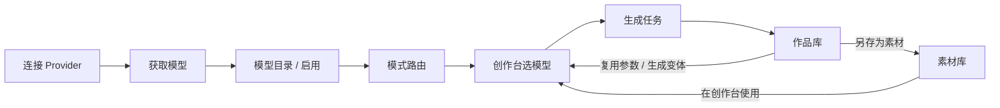
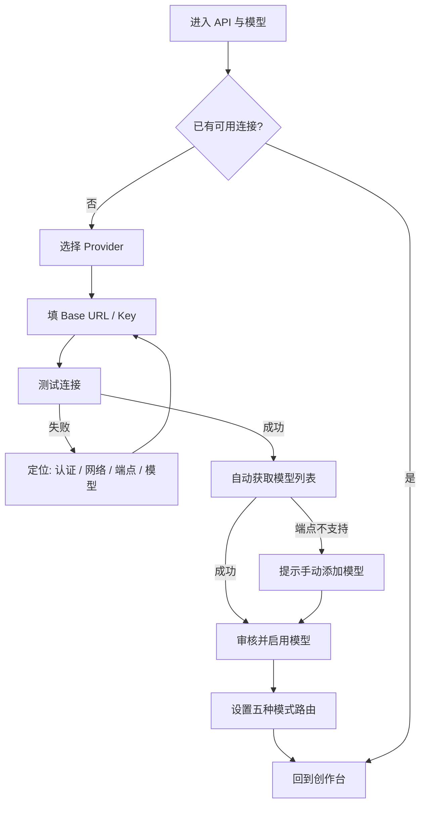
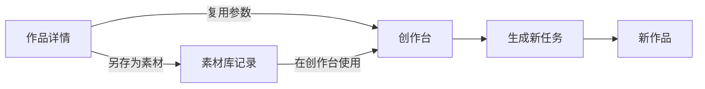
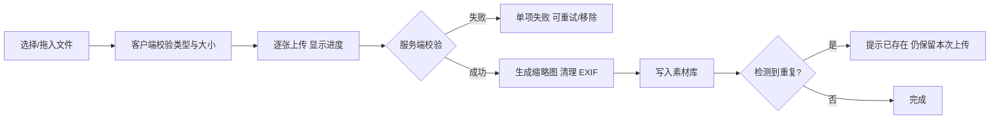

# 设计稿 · 模型获取 / 作品库 / 素材库

> LUMEN 流明 · 三个新增产品面的信息架构、交互与视觉设计  
> 版本：v0.1（设计提案，待确认）  
> 日期：2026-10-22  
> 配套：[产品设计规范](./01-design-spec.md) · [总体施工图](./02-construction-blueprint.md) · [API 契约](./03-api-contract.yaml) · [本模块施工图](./05-model-works-assets-blueprint.md)

---

## 0. 交付与范围

### 0.1 本文交付什么

| 交付物 | 位置 | 说明 |
| --- | --- | --- |
| 设计稿 | 本文 | 模型获取、作品库、素材库的定位、信息架构、页面布局、状态、交互、文案与验收标准 |
| 施工图 | [05-model-works-assets-blueprint.md](./05-model-works-assets-blueprint.md) | 数据库迁移、Provider 模型发现、API、前端组件、测试与里程碑 |

本轮只交付设计与施工图，不改生产代码；施工图中的接口提案在实现时同步写入 `03-api-contract.yaml`。

### 0.2 三个模块解决什么问题

| 模块 | 当前断点 | 设计目标 |
| --- | --- | --- |
| 模型获取 | API 弹窗只能手填「图像模型 / 视频模型」；`/models` 只是把两个字段包装成两条记录；创作台模型卡是静态文案，点击提示“下一阶段接入” | 连接 Provider 后可一键获取模型、识别能力、启用模型、按模式路由；创作台能选到真实可用模型 |
| 作品库 | 生成结果只存在于任务的 `outputs` JSON 和本次会话缩略图里；刷新或换设备后缺少统一的“作品”入口 | 所有成功生成沉淀为可检索、可筛选、可收藏、可复用参数的作品；保留完整来源与成本 |
| 素材库 | 上传素材只在项目页出现一个缩略图网格，没有独立页面、标签、搜索、详情、引用关系 | 上传素材与“作品转素材”统一管理；能搜索、打标签、查看被谁使用，并一键回到创作台 |

### 0.3 与现有产品结构的关系

```text
LUMEN
├── 工作区 /workspace                 项目列表（已有）
│   └── 项目 /workspace/:projectId    项目概览（已有）
│       └── 创作台                    五种模式 + Agent（已有）
├── 作品库 /works                     ← 新增：成功生成结果的统一归宿
├── 素材库 /assets                    ← 新增：输入素材的统一管理
└── API 与模型 /models                ← 升级：连接 + 模型目录 + 模式路由
```

三个入口都是**全局页面**，不隶属于某个项目；项目是筛选维度，不是权限边界。作品库、素材库默认展示全部项目，也可以按项目过滤。

### 0.4 共同产品约束

1. **单用户、无登录、无账户菜单**；不做分享、评论、团队协作。
2. **只计量 tokens**；不出现积分、余额、充值、套餐、价格。
3. **模型发现不自动消耗 tokens**；任何会产生费用的“验证生成”都必须二次确认，默认不执行。
4. **密钥只存在服务端**；模型列表、错误信息、日志都不回传 API Key 明文。
5. **作品与素材是两类对象**：作品是“生成结果快照”，素材是“可复用输入”。作品可以另存为素材，素材不会自动变成作品。
6. **删除先软删**：列表立即消失，底层文件保留一段时间；有引用关系时给出明确提示，不做静默级联。
7. **项目可移动、可筛选**；作品与素材的项目归属可修改，不复制文件。
8. **视觉沿用现有暗房体系**：深黑底、暖琥珀强调、等宽数字、细线分割；不引入新的品牌色。

### 0.5 术语

| 术语 | 定义 |
| --- | --- |
| Provider / 连接 | 一个可调用的生成服务配置（火山方舟、OpenAI 兼容、自定义网关、本地演示） |
| 模型 / Model | Provider 暴露的具体模型 ID，例如 `doubao-seedream-4-0-250828` |
| 模型目录 | LUMEN 本地保存的模型清单，包含远程发现结果、手工添加、能力和启用状态 |
| 模型路由 | “某种生成模式默认使用哪个模型”的映射，例如文生图 → Seedream 4.0 |
| 作品 / Work | 一次成功生成产生的最终输出快照，带提示词、参数、模型、tokens 与来源 |
| 素材 / Asset | 可被再次使用的输入媒体：上传图片，或由作品另存而来的图片/视频 |
| 任务 / Task | 一次生成请求的执行记录；任务成功后才产生作品 |
| 快照 | 作品保存当时的结果元信息，不随项目改名、模型下架而变化 |

---

## 1. 信息架构与导航

### 1.1 左侧导航

保持 76px 图标栏，四个一级入口：

| 顺序 | 图标 | 名称 | 页面 | 说明 |
| :-: | --- | --- | --- | --- |
| 1 | 网格/仪表盘 | 工作区 | `workspace` | 项目列表，已有 |
| 2 | 四宫格 | 作品库 | `works` | 新增；成功生成的结果 |
| 3 | 文件夹 | 素材库 | `assets` | 新增；上传与转存的输入媒体 |
| 4 | 插头 | API 与模型 | `models` | 升级；连接、模型目录、路由 |

当前 `src/App.tsx` 中作品库、素材库按钮只弹“将在下一阶段接入”，API 与模型打开弹窗。改造后三个按钮都进入完整页面，API 弹窗保留为“快速连接”入口，不再承载模型管理。

### 1.2 顶栏与面包屑

| 页面 | 面包屑 |
| --- | --- |
| 作品库 | `作品库 / 全部作品` |
| 素材库 | `素材库 / 全部素材` |
| API 与模型 | `API 与模型 / 模型库`（随当前 Tab 变化） |
| 从项目进入素材 | `工作区 / 项目名 / 素材库`，项目筛选自动生效 |

顶栏右侧继续保留 API 状态胶囊与 tokens 计数：

- API 胶囊点击进入「API 与模型 → 连接」。
- tokens 计数仍是**本地累计**，不是余额；作品库/素材库页面的统计使用相同口径。
- 新增页面不改变顶栏高度（62px）与左右留白。

### 1.3 跨模块路径



- 模型获取是**供给侧**：让创作台有真实可用的模型。
- 作品库是**结果侧**：所有成功输出必须自动进入，不依赖用户手动保存。
- 素材库是**输入侧**：上传即入库；从作品另存是补充来源。
- 三个模块通过项目、模型、任务、来源四个维度互相引用，但都不复制生成参数之外的数据。

### 1.4 入口与回退

| 来源 | 行为 | 返回 |
| --- | --- | --- |
| 左侧导航 | 进入全局页面，保留当前项目筛选或重置为全部 | 浏览器/应用内回退到上一页 |
| 创作台模型卡 | 打开模型库并定位当前模型 | 关闭后回到创作台，保留参数 |
| 创作台素材槽 | 打开素材选择抽屉 | 选中后回到创作台并填入槽位 |
| 项目页“项目素材” | 进入素材库并锁定该项目 | 面包屑回项目 |
| 作品卡“复用参数” | 进入创作台并回填参数 | 面包屑回作品库 |
| Agent 工具卡“查看作品” | 打开作品详情抽屉 | 关闭回到 Agent |

移动端（≤800px）不显示左侧导航，改为顶栏图标入口；页面内使用单列布局，详情抽屉变为全屏 Sheet。

---

## 2. 共用布局与视觉

### 2.1 桌面端页面骨架（1440×900 基线）

```text
┌──────┬──────────────────────────────────────────────────────────┬──────────────┐
│      │ LUMEN 流明 / 作品库 / 全部作品          ● 已连接   ✦ 128.4k │              │
│ 76px ├──────────────────────────────────────────────────────────┤   380px      │
│ Rail │ 作品库                                          42 件作品 │              │
│      │ 成功生成的结果，按时间倒序                    [刷新] [排序] │   作品详情    │
│      │ ┌──────────────────────────────────────────────────────┐ │              │
│      │ │ 搜索作品、提示词…   项目▾  类型▾  模式▾  模型▾  收藏  │ │   预览        │
│      │ └──────────────────────────────────────────────────────┘ │   元信息      │
│      │ ┌────────────┐ ┌────────────┐ ┌────────────┐             │   提示词      │
│      │ │  缩略图     │ │  缩略图     │ │  缩略图     │             │   参数        │
│      │ │  标题       │ │  标题       │ │  标题       │             │   来源        │
│      │ │  模型·时间  │ │  模型·时间  │ │  模型·时间  │             │   操作        │
│      │ └────────────┘ └────────────┘ └────────────┘             │              │
│      │  全部作品已加载 · 本地 SQLite                              │              │
└──────┴──────────────────────────────────────────────────────────┴──────────────┘
```

### 2.2 尺寸规范

| 区域 | 尺寸 | 说明 |
| --- | --- | --- |
| 页面顶部标题区 | 高 84px | eyebrow + 标题 + 一句说明 + 右侧统计/操作 |
| 筛选工具条 | 高 52px，吸顶 | 搜索、筛选 chips、视图切换 |
| 内容左右留白 | 26 / 25px | 与工作区一致 |
| 卡片网格 | `minmax(220px, 1fr)`，间距 14px | 1440px 下 4 列；1280px 下 3 列 |
| 作品/素材缩略图 | 16:9，圆角 12px | 视频带时长胶囊与播放标记 |
| 详情抽屉 | 380px；视频详情 420px | 独立滚动，底部操作吸底 |
| 标签/胶囊 | 高 24–28px，圆角 999px | 等宽数字用于 tokens、尺寸、时长 |
| 列表行高 | 56px | 列表视图；缩略图 68×38 |
| 批量操作条 | 高 56px，底部浮起 | 选中后出现，不遮挡内容 |

### 2.3 共用组件

| 组件 | 职责 | 关键状态 |
| --- | --- | --- |
| `LibraryPage` | 页面骨架：标题、工具条、内容、抽屉 | 默认 / 加载 / 空 / 错误 / 抽屉打开 |
| `LibraryToolbar` | 搜索、筛选、排序、视图切换 | 默认 / 有筛选 / 搜索中 / 无结果 |
| `FilterChip` | 单个筛选条件 | 默认 / 激活 / 可清除 |
| `MediaCard` | 作品/素材缩略图卡 | 默认 / hover / 选中 / 加载失败 / 视频 |
| `MediaPreview` | 图片或视频预览 | 图片 / 视频 / 加载中 / 失败 |
| `DetailDrawer` | 右侧详情抽屉 | 打开 / 关闭 / 宽屏 / Sheet |
| `SelectionBar` | 批量选择与操作 | 0 选中 / 多选 / 操作中 |
| `TagEditor` | 素材标签编辑 | 空 / 输入 / 超限 / 重复 |
| `UploadDropzone` | 拖拽/点击上传 | 空闲 / 拖入 / 上传中 / 失败 |
| `EmptyState` | 空状态与引导 | 首次为空 / 筛选无结果 / 离线 |
| `ConfirmDialog` | 删除、移动、另存确认 | 默认 / 危险 / 进行中 |
| `SourceBadge` | Studio / Agent / 上传 / 作品转存 | 四种来源 |

### 2.4 共用状态

| 状态 | 表现 |
| --- | --- |
| 加载 | 骨架卡片，不显示 0 计数；保留标题与工具条 |
| 空（首次） | 取景框图形 + 一句解释 + 主 CTA（去创作台 / 上传素材 / 连接 Provider） |
| 空（筛选） | “没有符合条件的作品/素材” + 清除筛选 |
| 错误 | 行内错误条 + 重试；不整页白屏 |
| 离线 | 顶部黄色提示条“本机 BFF 未启动，显示已缓存内容”，禁用写操作 |
| 处理中 | 按钮 spinner + 禁用重复提交；批量操作显示进度 N/M |
| 部分失败 | 批量结果摘要“成功 3 · 失败 1”，失败项保留选中 |

### 2.5 视觉规则

- 作品/素材的缩略图是主角；卡片 chrome 只有 1px 半透明线，不使用大面积彩色底。
- 琥珀色只用于主 CTA、收藏激活、选中描边与关键数字；单屏占比 < 8%。
- 视频卡用 `▶` 与时长胶囊区分，不自动播放；详情抽屉才允许播放。
- 所有元信息使用等宽数字：`2K · 16:9 · 3,240 tokens`、`00:12`、`4.2 MB`。
- 空状态插画沿用“取景框 + 光点”，不使用 3D 吉祥物。
- 动效 160–200ms；抽屉 300ms `cubic-bezier(.2,.8,.2,1)`；遵守 `prefers-reduced-motion`。

---

## 3. 模型获取

### 3.1 产品定义

模型获取不是“让用户手填两个模型 ID”，而是一条完整的供给链：

```text
连接 Provider → 拉取模型清单 → 识别模型类型与能力 → 启用模型 → 按模式设置默认路由 → 创作台可用
```

**成功标准**：新用户在 3 分钟内完成“连接 → 获取 → 启用 → 在创作台选中模型”；失败时能明确知道是认证、网络、端点不支持还是模型不存在。

### 3.2 当前断点

| 位置 | 现状 | 问题 |
| --- | --- | --- |
| [ApiModal](../src/components/ApiModal.tsx) | Base URL、Key、图像模型、视频模型四个文本输入 | 用户要知道模型 ID；无法发现账号下可用模型 |
| `GET /api/v1/models` | 把 `provider.imageModel` / `videoModel` 包装成两条记录 | 不是真实目录；没有启用状态、能力和来源 |
| [Inspector](../src/studio/Inspector.tsx) | 模型卡读取 `MODES[mode].model` 静态文案 | 与 Provider 配置脱节；点击无反应 |
| 生成请求 | `providerId + modelId` 由前端拼装 | 没有校验模型是否支持当前模式 |

### 3.3 页面结构

`API 与模型` 是完整页面，顶部三个 Tab：

| Tab | 内容 | 默认场景 |
| --- | --- | --- |
| 连接 | Provider 卡片列表 + 配置表单 + 测试连接 | 首次使用、API 胶囊、故障排查 |
| 模型库 | 已发现/已添加模型，启用、搜索、详情 | 日常管理、模型下架排查 |
| 路由 | 五种模式默认模型与能力校验 | 接入新模型后、生成前提示 |

#### 连接 Tab

```text
┌──────────────────────────────────────────────────────────────────────────┐
│ API 与模型                                          BFF v0.3.0 · FFmpeg ✓ │
│ [连接]  [模型库 12]  [路由 5]                                             │
├──────────────────┬───────────────────────────────────────────────────────┤
│ Provider         │ 火山方舟                                    ● 已连接    │
│ ● 火山方舟       │ Base URL  https://ark.cn-beijing.volces.com/api/v3     │
│ ○ OpenAI 兼容    │ API Key   ark-••••••••8f2a        [显示] [更新密钥]    │
│ ○ 自定义网关     │ 上次测试  2026-10-22 14:02 · 218ms · 探测到 12 个模型 │
│ ○ 本地演示       │ 能力      文生图 图生图 文生视频 图生视频 多图分镜      │
│                  │ [测试连接]                    [保存连接]              │
│ + 添加连接       │                                                       │
├──────────────────┴───────────────────────────────────────────────────────┤
│ 安全说明：密钥经 scrypt 派生 + AES-256-GCM 加密，只存本机；接口仅返回掩码。 │
└──────────────────────────────────────────────────────────────────────────┘
```

**连接表单规则**

- Provider 四选一：火山方舟（推荐）、OpenAI 兼容、自定义网关、本地演示。
- Base URL 必填（本地演示固定 `local://mock`）；必须是 `http(s)`，保存时去除尾部 `/`。
- API Key 首次必填；已配置后留空表示保持原密钥；输入框默认掩码，可切换显示。
- “测试连接”先保存再握手；失败保留已填内容并定位到字段。
- 连接卡片显示 `最后测试时间 / 延迟 / 探测到的模型数`；超过 24 小时标“建议重新测试”。
- 支持多个连接并存，但同一时间只有一个“当前连接”；切换当前连接不影响已保存模型。

#### 模型库 Tab

```text
┌──────────────────────────────────────────────────────────────────────────┐
│ [连接]  [模型库 12]  [路由 5]                    [获取模型]  [手动添加]   │
├──────────────┬───────────────────────────────────────────────────────────┤
│ 来源          │ 搜索模型 ID / 名称            类型▾  状态▾  仅看已启用     │
│ ● 全部 12     │ ┌───────────────────────────────────────────────────────┐ │
│ ○ 火山方舟 9  │ │ ☑ doubao-seedream-4-0-250828   图像  T2I·I2I   ● 就绪 │ │
│ ○ OpenAI 3    │ │ ☑ doubao-seedance-1-0-pro-250528 视频 T2V·I2V  ● 就绪 │ │
│               │ │ ☐ doubao-seededit-3-0        图像  I2I       ◐ 未启用 │ │
│ 状态          │ │ ☐ ep-20261022-xxxx           未知  待确认     ○ 未验证 │ │
│ ● 全部        │ └───────────────────────────────────────────────────────┘ │
│ ○ 已启用      │ 12 个模型 · 8 个已启用 · 最近同步 2 分钟前               │
│ ○ 未启用      │                                                         │
│ ○ 异常        │                                                         │
└──────────────┴───────────────────────────────────────────────────────────┘
```

**列表字段**

| 字段 | 说明 |
| --- | --- |
| 启用勾选 | 控制是否出现在创作台模型选择器；不删除模型记录 |
| 模型 ID | 远程 ID，等宽字体；过长中间省略，hover 显示完整值 |
| 类型 | 图像 / 视频 / 未知；未知需人工确认 |
| 支持模式 | `T2I` `I2I` `T2V` `I2V` `MULTI` 缩写胶囊 |
| 状态 | 就绪 / 未验证 / 未启用 / 待确认 / 已下架 |
| 来源 | 自动发现 / 手工添加 / 预置 |
| 最近使用 | 日期或“未使用” |

**同步行为**

1. 点击“获取模型”：对当前连接调用远程模型列表；按钮进入“正在获取…”并禁用重复点击。
2. 返回后先展示差异摘要：`新增 3 · 更新 1 · 未再出现 2`；用户确认后写入本地目录。
3. 新增模型默认不启用；类型识别置信度高的模型预勾选“建议启用”，未知类型不勾选。
4. 已下架模型不自动删除，标为“已下架”，并从创作台选择器隐藏；路由若引用它，路由页顶部出现警告。
5. 手工添加：填模型 ID、类型（图像/视频）、支持模式、显示名称；用于网关不开放 `/models` 或使用推理接入点 `ep-...` 的情况。
6. 远程端点不支持（404/405）时：不报“连接失败”，提示“该网关未开放模型列表，可手动添加模型”，并保留已保存目录。

#### 路由 Tab

```text
┌──────────────────────────────────────────────────────────────────────────┐
│ [连接]  [模型库 12]  [路由 5]                              [自动匹配]     │
├──────────────────────────────────────────────────────────────────────────┤
│ 文生图      doubao-seedream-4-0-250828     火山方舟 · 4K · 图像          │
│ 图生图      doubao-seedream-4-0-250828     火山方舟 · 参考图驱动          │
│ 文生视频    doubao-seedance-1-0-pro-250528 火山方舟 · 1080p / 有声        │
│ 图生视频    doubao-seedance-1-0-pro-250528 火山方舟 · 首尾帧              │
│ 图组视频    doubao-seedance-1-0-pro-250528 火山方舟 · 2–9 镜合成          │
├──────────────────────────────────────────────────────────────────────────┤
│ ⚠ 图生视频当前模型不支持「尾帧」，生成时将隐藏尾帧或要求更换模型。        │
└──────────────────────────────────────────────────────────────────────────┘
```

- 每行点击展开模型选择器；只列出**支持该模式且已启用**的模型。
- 能力不满足时，允许保存但显示黄色警告；生成前再次校验并给出明确原因。
- “自动匹配”按“能力完整 → 最近使用 → 推荐模型”排序，选择每个模式的最佳候选；执行前预览差异。
- 路由是全局配置，不按项目区分；项目可以覆盖模型吗？v1 不做，避免同一项目内行为不一致。

#### 模型详情抽屉

| 区块 | 内容 |
| --- | --- |
| 头部 | 显示名称、远程 ID、Provider、状态徽章 |
| 能力 | 五种模式、首尾帧、音频、自定义分辨率、码率、动画模式、最大图片数、最大时长 |
| 规格 | 类型、支持模式、最大分辨率、最大时长、来源、启用开关 |
| 时间 | 首次发现、最近同步、最近使用 |
| 风险 | 未知类型、能力未验证、已下架、与路由不匹配 |
| 操作 | 启用/停用、编辑、设为某模式默认、复制模型 ID、删除 |

### 3.4 首次接入流程



### 3.5 模型识别与能力规则

远程 `/models` 通常只返回 ID，不返回能力。LUMEN 的识别分三层，**任何推断都必须在启用前可见、可改**：

| 层级 | 规则 | 示例 |
| --- | --- | --- |
| 1. Provider 类型 | 继承 Provider 的能力默认值 | 火山方舟支持首尾帧与多图分镜；OpenAI 兼容默认不支持多图分镜 |
| 2. 模型家族 | 按 ID 关键词识别图像/视频与模式 | `seedream` / `gpt-image` → 图像；`seedance` / `sora` → 视频 |
| 3. 用户确认 | 未知或推断冲突时要求选择 | `ep-...` 推理接入点、私有网关模型名 |

**保守原则**

- 无法判断类型 → `未知`，不自动启用。
- 无法判断是否支持图生图/首尾帧 → 默认关闭对应能力，并在详情标注“未验证”。
- 推断结果只写入“建议能力”；用户修改后，后续同步不覆盖用户选择。
- 模型是否真正可用，以首次生成为准；不在后台自动发起试探生成。

### 3.6 创作台模型选择器

替换 [Inspector](../src/studio/Inspector.tsx) 的静态模型卡：

```text
┌──────────────────────────────────────────────┐
│ 模型                              推荐        │
│ ┌──────────────────────────────────────────┐ │
│ │ ◉ Seedream 4.0                           │ │
│ │   火山方舟 · 图像 · 最高 4K      图像 2K  │ │
│ └──────────────────────────────────────────┘ │
│ ┌──────────────────────────────────────────┐ │
│ │ ○ Seedance 1.0 Pro                       │ │
│ │   火山方舟 · 视频 · 1080p        最近使用 │ │
│ └──────────────────────────────────────────┘ │
│ 管理模型 ↗                                   │
└──────────────────────────────────────────────┘
```

- 只显示当前模式可用、已启用、未下架的模型。
- 当前模型不支持某能力时，对应参数置灰并显示原因，而不是静默隐藏。
- 模型卡显示 Provider、类型、关键规格、最近使用/推荐标签。
- 模型切换后重置不兼容参数（例如从视频模型切到图像模型），并给出轻提示。
- 模型为空时，模型卡变为“连接并获取模型”，点击进入模型库。

### 3.7 状态与错误

| 场景 | 展示 | 操作 |
| --- | --- | --- |
| 无 Provider | 空状态“还没有连接生成服务” | 连接火山方舟 / 本地演示 |
| 未配置 Key | 黄色“等待配置” | 填写 Key |
| 测试中 | 按钮 spinner + “正在握手…” | 禁用重复点击 |
| 认证失败 401/403 | “API Key 无效或没有权限” | 更新密钥 |
| 网络超时 | “连接超时，检查 Base URL 或代理” | 重试 |
| `/models` 404/405 | “连接正常，但该网关未开放模型列表” | 手动添加 |
| 返回空列表 | “没有发现可用模型” | 手动添加 / 检查账号权限 |
| 模型已下架 | 列表灰显 + “已下架” | 更换路由 / 删除 |
| 生成时模型不可用 | 错误卡“当前模型不可用” | 更换模型 / 重新获取 |
| 模型不支持当前模式 | 禁用原因“该模型不支持图生视频” | 更换模型 |

### 3.8 文案

| 场景 | 文案 |
| --- | --- |
| 获取按钮 | 获取模型 |
| 获取中 | 正在获取模型… |
| 获取成功 | 已更新模型目录 · 新增 3，更新 1 |
| 获取为空 | 没有发现可用模型；可检查账号权限或手动添加 |
| 端点不支持 | 该网关未开放模型列表，可手动添加模型 |
| 未启用 | 已启用后才会出现在创作台 |
| 手动添加 | 手动添加模型 |
| 路由警告 | 当前模型能力不完整，生成时可能受限 |
| 创作台无模型 | 先连接并获取模型 |
| 安全说明 | 密钥仅存于服务端 · 模型列表不包含密钥 |

### 3.9 验收

- [ ] 连接 Provider 后，可通过一次点击获取模型列表；失败有明确分类。
- [ ] 新增模型默认不启用；启用后才出现在创作台。
- [ ] 未知模型必须人工确认类型与支持模式，不能被静默推断为可用。
- [ ] 五种模式各自有默认路由；路由引用的模型被停用/下架时有警告。
- [ ] 创作台模型卡显示真实模型，不再使用静态文案。
- [ ] 生成时校验模型与模式匹配；不匹配时错误可读、可恢复。
- [ ] 密钥不出现在模型列表接口、错误信息或日志中。
- [ ] 模型发现过程默认不产生生成费用。

---

## 4. 作品库

### 4.1 产品定义

**作品 = 一次成功生成产生的最终输出快照。**

- 文生图/图生图：每张输出是一份作品。
- 文生视频/图生视频：最终视频是一份作品。
- 文生视频分镜/图组视频：合成后的成片是一份作品；单个镜头的中间片段不是作品（除非未来提供“导出单镜”）。
- 任务失败、取消、部分失败：不产生作品；仍可在任务/会话记录中排查。
- 作品是不可变的结果快照；标题、收藏、项目归属、标签可编辑，但提示词、参数、模型、tokens 保留原值。

### 4.2 作品、素材、任务的区别

| 维度 | 作品 | 素材 | 任务 |
| --- | --- | --- | --- |
| 来源 | 成功生成 | 上传 / 作品另存 | 用户提交 |
| 是否可复用为输入 | 另存为素材后可以 | 可以 | 不可以 |
| 是否保留提示词/参数 | 是，完整快照 | 否（仅文件元信息） | 是，执行记录 |
| 是否进入作品库 | 是 | 否 | 否 |
| 是否进入素材库 | 另存后 | 是 | 否 |
| 删除影响 | 只影响作品展示；不删除任务记录 | 影响引用它的历史作品输入缩略图 | 不提供删除入口 |

### 4.3 页面布局

```text
┌──────────────────────────────────────────────────────────────────────────┐
│ 作品库                                              42 件 · 12.8 MB · 8.2M tokens │
│ 成功生成的结果，按时间倒序                              [刷新]  [列表/网格] │
├──────────────────────────────────────────────────────────────────────────┤
│ 🔍 搜索标题、提示词…   项目▾  类型▾  模式▾  模型▾  收藏  日期▾   [清除]  │
├──────────────────────────────────────────────────────────────────────────┤
│ ┌──────────────┐ ┌──────────────┐ ┌──────────────┐ ┌──────────────┐      │
│ │  [视频 00:12]│ │  [图片 2K]   │ │  [图片 2K]   │ │  [视频 00:05]│      │
│ │ 星云巨石     │ │ 琥珀潮汐     │ │ 玻璃仪式     │ │ 产品短片 01  │      │
│ │ Seedance     │ │ Seedream     │ │ Seedream     │ │ Seedance     │      │
│ │ 2 分钟前     │ │ 昨天         │ │ 昨天         │ │ 10 月 20 日  │      │
│ └──────────────┘ └──────────────┘ └──────────────┘ └──────────────┘      │
│  已加载全部 42 件                                                         │
└──────────────────────────────────────────────────────────────────────────┘
```

### 4.4 卡片

| 区域 | 内容 |
| --- | --- |
| 缩略图 | 16:9；图片用缩略图；视频用封面 + 时长 + 播放标记 |
| 左上角 | 类型徽章（图片/视频）、来源徽章（Studio/Agent） |
| 右上角 | 收藏星标；hover 显示选择框 |
| 标题 | 默认取提示词前 18–24 字；可重命名 |
| 元信息 | 模型名 · 分辨率 · tokens |
| 时间 | 相对时间；hover 完整时间 |
| 底部 hover 操作 | 预览、下载、复用、更多 |

**卡片状态**：默认 / hover / 选中 / 收藏 / 视频 / 加载失败 / 已软删（不在列表出现）。

### 4.5 筛选、排序、搜索

| 维度 | 选项 | 说明 |
| --- | --- | --- |
| 项目 | 全部 + 项目列表 | 与项目页联动 |
| 类型 | 全部 / 图片 / 视频 | 声音作品暂不进入 v1 |
| 模式 | 五种模式 | 文生图、文生视频、图生图、图生视频、图组视频 |
| 模型 | 已使用过的模型 | 来自作品快照，不依赖当前模型目录 |
| 收藏 | 仅收藏 |  |
| 日期 | 今天 / 7 天 / 30 天 / 自定义 |  |
| 搜索 | 标题 + 提示词 | 防抖 300ms；不搜索参数 JSON |
| 排序 | 最新 / 最早 / tokens 高→低 / 时长长→短 | 默认最新 |

筛选状态在页面内保持；离开再返回不重置（v1 使用应用内状态；深链见待确认）。

### 4.6 详情抽屉

```text
┌────────────────────────────────────────────┐
│ 作品详情                              [×]  │
│ ┌────────────────────────────────────────┐ │
│ │                                        │ │
│ │              视频 / 图片预览            │ │
│ │                                        │ │
│ └────────────────────────────────────────┘ │
│ [下载] [复用参数] [生成变体] [更多▾]       │
│ ────────────────────────────────────────── │
│ 星云巨石                                   │
│ 2026-10-22 14:32 · 已收藏                  │
│ 模型      Seedance 1.0 Pro · 火山方舟      │
│ 规格      1080p · 16:9 · 24fps · 00:12     │
│ 消耗      3,240 tokens（Provider 实际）     │
│ 项目      产品短片                         │
│ 来源      Studio · gen_01J9Z8Q2            │
│ ────────────────────────────────────────── │
│ 提示词                             [复制]  │
│ 深空中的紫色星云缓慢旋转…                  │
│ ────────────────────────────────────────── │
│ 参数                               [展开]  │
│ 比例 16:9 · 1080p · 5s · Seed 481920      │
│ ────────────────────────────────────────── │
│ 输入素材                                   │
│ [首帧缩略图] [尾帧缩略图]                  │
│ ────────────────────────────────────────── │
│ 操作                                       │
│ 重命名 · 移动到项目 · 另存为素材 · 删除    │
└────────────────────────────────────────────┘
```

**操作定义**

| 操作 | 行为 | 结果 |
| --- | --- | --- |
| 下载 | 原文件下载，文件名使用作品标题 | 浏览器下载 |
| 复用参数 | 进入对应模式创作台，回填提示词、参数、输入素材、模型（模型不可用则提示替换） | 不自动生成 |
| 生成变体 | 进入创作台，保留参数，Seed 随机或微调 | 用户确认后手动生成 |
| 另存为素材 | 复制/硬链接到素材库，建立独立素材记录 | 作品不受影响 |
| 移动到项目 | 修改作品项目归属 | 不复制文件 |
| 收藏 | 切换收藏 | 列表立即更新 |
| 重命名 | 修改标题，最多 80 字 | 不改提示词 |
| 删除 | 二次确认，软删除 | 任务记录仍在；文件按保留策略清理 |

### 4.7 批量操作

进入方式：hover 卡片出现选择框，或工具条“选择”。选中后底部出现：

```text
┌──────────────────────────────────────────────────────────────────────────┐
│ 已选 3 件      [收藏] [取消收藏] [另存为素材] [移动到项目▾] [删除] [取消] │
└──────────────────────────────────────────────────────────────────────────┘
```

- 批量删除必须二次确认，确认文案包含数量与“不可恢复”说明。
- 批量另存为素材对已存在的作品做幂等处理，不重复创建。
- 部分失败显示结果摘要，失败项保持选中。

### 4.8 作品 → 素材 / 复用流程



### 4.9 空、加载、错误

| 状态 | 表现 |
| --- | --- |
| 首次为空 | “还没有作品。去创作台生成第一张图或第一段视频。” + 去创作台 |
| 筛选为空 | “没有符合条件的作品” + 清除筛选 |
| 加载 | 4–8 个骨架卡；不显示“0 件” |
| 失败 | “无法读取作品库” + 重试 + 检查 BFF |
| 视频缩略图缺失 | 用渐变占位 + 类型图标，不显示破图 |
| 文件丢失 | 卡片标“文件不可用”，详情提供“删除记录” |

### 4.10 删除与保留

- 默认软删除：`deleted_at` 置位，列表与详情立即不可见。
- 任务记录、tokens 统计保留；作品库统计扣除该作品。
- 底层文件保留 `MEDIA_RETENTION_DAYS`（默认 7 天，沿用现有配置）后清理；有素材引用时跳过清理。
- v1 不提供“回收站”页面；误删可通过重新生成或联系本地数据恢复。P1 增加回收站。
- 删除作品不删除作为输入的素材。

### 4.11 文案

| 场景 | 文案 |
| --- | --- |
| 空状态 | 还没有作品。去创作台生成第一张图或第一段视频。 |
| 筛选空 | 没有符合条件的作品 |
| 加载失败 | 无法读取作品库，请确认本机 BFF 已启动 |
| 另存成功 | 已加入素材库 |
| 已存在 | 该作品已经在素材库中 |
| 删除确认 | 删除后作品将从作品库移除，任务记录与 tokens 统计仍保留。 |
| 批量删除 | 删除选中的 3 件作品？此操作不可撤销。 |
| 复用提示 | 已回填参数，确认后点击生成 |
| 模型不可用 | 原模型不可用，已切换到当前路由模型 |

### 4.12 验收

- [ ] 所有成功生成（Studio / Agent / 五种模式）自动进入作品库。
- [ ] 失败、取消、部分失败不产生作品。
- [ ] 多输出任务每张输出独立成作品；分镜成片只产生一份作品。
- [ ] 作品卡片、详情、筛选、搜索、排序正常。
- [ ] 复用参数能回填对应模式；模型不可用有提示。
- [ ] 另存为素材幂等，作品删除不影响素材。
- [ ] 批量收藏、另存、移动、删除可用；删除有确认。
- [ ] 作品库不出现余额、积分、价格。
- [ ] 列表 1000 件时滚动与筛选无明显卡顿。

---

## 5. 素材库

### 5.1 产品定义

**素材 = 可被再次使用的输入媒体。**

v1 来源：

1. 上传的图片（PNG / JPEG / WebP，单张 ≤ 20MB）。
2. 从作品另存的图片或视频（图片用于参考/首帧，视频可作为未来视频参考，v1 主要展示与下载）。
3. Agent 生成过程中明确保存的输入素材（与上传同源）。

v1 不把生成结果自动放进素材库；否则“作品”和“素材”会混淆。用户需要显式“另存为素材”。

### 5.2 目标用户任务

- 找到上周上传的那张产品图，用作新项目的首帧。
- 给素材打标签（产品、人物、场景、参考），按标签筛选。
- 知道某张图被哪些作品使用过，避免误删。
- 批量上传、批量移动项目、批量删除。
- 从作品库把成片转成素材，供后续图生视频使用。

### 5.3 页面布局

```text
┌──────────────────────────────────────────────────────────────────────────┐
│ 素材库                                              86 件 · 248 MB         │
│ 上传、整理、复用你的参考图与首帧                    [上传素材]  [列表/网格] │
├──────────────────────────────────────────────────────────────────────────┤
│ 🔍 搜索文件名、标签…   项目▾  类型▾  来源▾  标签▾  未使用  日期▾  [清除] │
├──────────────────────────────────────────────────────────────────────────┤
│ ┌──────────────┐ ┌──────────────┐ ┌──────────────┐ ┌──────────────┐      │
│ │ [图片 2048]  │ │ [图片 1024]  │ │ [图片 2048]  │ │ [视频 00:08] │      │
│ │ 产品主图     │ │ 人物参考     │ │ 场景 03      │ │ 成片切片     │      │
│ │ 2.4 MB       │ │ 1.1 MB       │ │ 3.8 MB       │ │ 12.6 MB      │      │
│ │ 产品短片     │ │ 未归档       │ │ 玻璃仪式     │ │ 来自作品      │      │
│ └──────────────┘ └──────────────┘ └──────────────┘ └──────────────┘      │
│  拖拽图片到这里上传 · 支持 PNG / JPEG / WebP                              │
└──────────────────────────────────────────────────────────────────────────┘
```

### 5.4 上传

**入口**

- 素材库页面右上“上传素材”。
- 页面任意位置拖拽。
- 项目页“添加素材”跳转素材库并锁定项目。
- 创作台参考图槽的“从素材库选择”只选择，不上传（上传仍走原上传器）。

**流程**



**规则**

- 支持 JPG / PNG / WebP；单张 ≤ 20MB；最小边 ≥ 64px（沿用现有服务端校验）。
- 多选上传按队列逐张；单项失败不影响其他项。
- 上传中显示缩略图 + 进度环；可取消未开始的项。
- 重复检测按内容 SHA-256：只提示“素材库已有相同文件”，不自动合并、不阻止上传。
- 上传时可选择项目与标签（默认使用当前筛选项目；不选则为“未归档”）。
- 成功后清空队列，保留本次新增的筛选状态。

### 5.5 筛选、标签、搜索

| 维度 | 选项 |
| --- | --- |
| 项目 | 全部 / 未归档 / 各项目 |
| 类型 | 全部 / 图片 / 视频 |
| 来源 | 全部 / 上传 / 来自作品 / Agent |
| 标签 | 多选；显示计数；支持“无标签” |
| 使用状态 | 全部 / 已使用 / 未使用 |
| 日期 | 今天 / 7 天 / 30 天 / 自定义 |
| 搜索 | 文件名、标签；不搜索二进制内容 |
| 排序 | 最新 / 最早 / 大小 / 名称 |

**标签规范**

- 单个标签 1–24 字，去首尾空格；同一素材最多 8 个标签；大小写不敏感。
- 标签是平铺的，不做层级文件夹；项目承担“归档”职责。
- 标签编辑支持回车添加、点击删除、从已有标签联想。
- 删除标签只解除关联，不删除素材。

### 5.6 卡片与列表

| 区域 | 内容 |
| --- | --- |
| 缩略图 | 正方形或 4:3 裁切；视频用封面 + 时长 |
| 文件名 | 默认原始文件名；可重命名 |
| 元信息 | 尺寸 · 大小；来源作品则显示“来自作品” |
| 项目 | 项目名或“未归档” |
| 标签 | 最多显示 2 个，其余 `+N` |
| hover | 预览、下载、在创作台使用、更多 |
| 选中 | 左上勾选，卡片琥珀描边 |

### 5.7 详情抽屉

```text
┌────────────────────────────────────────────┐
│ 素材详情                              [×]  │
│ ┌────────────────────────────────────────┐ │
│ │              图片 / 视频预览            │ │
│ └────────────────────────────────────────┘ │
│ [在创作台使用] [下载] [更多▾]              │
│ ────────────────────────────────────────── │
│ 产品主图.jpg                               │
│ 图片 · 2048×2048 · 2.4 MB · PNG            │
│ 上传于 2026-10-20 11:24                    │
│ ────────────────────────────────────────── │
│ 项目       产品短片                        │
│ 来源       上传                            │
│ 标签       [产品] [场景] [+ 添加]          │
│ 引用       被 3 个作品使用  [查看]          │
│ 校验       SHA-256 8f2a… · 无重复          │
│ ────────────────────────────────────────── │
│ 操作                                       │
│ 重命名 · 移动项目 · 下载 · 删除            │
└────────────────────────────────────────────┘
```

**“在创作台使用”**

1. 根据当前模式选择角色：图生图 → 参考图；图生视频 → 首帧（或尾帧，若从详情指定）；图组视频 → 分镜图；文生视频 → 首帧。
2. 进入创作台对应项目与模式，把素材填入槽位，保留用户已有提示词。
3. 若当前没有项目，使用素材所属项目；未归档则使用当前项目或提示选择。
4. 不自动提交生成。

### 5.8 引用关系

- 生成任务创建时记录素材被哪些任务使用：参考图、首帧、尾帧、分镜图。
- 素材详情显示“被 N 个作品使用”；点击展开引用列表（作品缩略图 + 模式 + 时间）。
- 删除素材时：
  - 若被**运行中**的任务引用：阻止删除，提示“有任务正在使用”。
  - 若仅被历史作品引用：二次确认“历史作品中的输入缩略图将不可用，作品本身不会删除”。
  - 未被引用：普通确认。
- 素材删除为软删除；文件与引用记录保留到清理任务执行。

### 5.9 批量操作

| 操作 | 说明 |
| --- | --- |
| 移动到项目 | 选择目标项目或“未归档” |
| 添加标签 | 批量追加，自动去重 |
| 移除标签 | 批量解除 |
| 下载 | 逐项下载；浏览器可能要求允许多文件下载 |
| 删除 | 二次确认；运行中引用项单独列出并跳过 |
| 收藏？ | v1 素材不做收藏；用标签 + 项目替代 |

### 5.10 空、加载、错误

| 状态 | 表现 |
| --- | --- |
| 首次为空 | 大面积上传区 + “上传第一张素材” + 去创作台 |
| 筛选为空 | “没有符合条件的素材” + 清除筛选 |
| 上传失败 | 单项错误行 + 重试/移除；不整页报错 |
| 重复 | 成功提示 + “素材库已有相同文件” |
| 文件丢失 | 卡片“文件不可用”，详情提供删除记录 |
| 离线 | 禁用上传与写操作，保留已加载列表 |

### 5.11 删除与保留

- 软删除，列表立即消失；`deleted_at` 置位。
- 文件保留 7 天（沿用 `MEDIA_RETENTION_DAYS`）后清理；被作品/任务引用时跳过或延后。
- v1 不提供回收站；P1 增加。
- 删除素材不删除作品文件，不影响作品库。

### 5.12 文案

| 场景 | 文案 |
| --- | --- |
| 空状态 | 上传第一张素材，或从作品库另存 |
| 上传中 | 正在上传 2 / 5… |
| 上传成功 | 已添加 3 张素材 |
| 重复 | 素材库已有相同文件，已保留本次上传 |
| 删除确认 | 删除后素材将从素材库移除；被历史作品引用时，输入缩略图将不可用。 |
| 运行中阻止 | 有任务正在使用该素材，完成后再删除 |
| 未归档 | 未归档 |
| 在创作台使用 | 已填入图生视频首帧 |
| 标签超限 | 最多添加 8 个标签 |

### 5.13 验收

- [ ] 素材库显示全部上传素材，支持项目/类型/来源/标签/使用状态筛选。
- [ ] 多选上传、进度、单项失败重试正常。
- [ ] 重复文件检测提示准确，不静默丢文件。
- [ ] 标签增删、联想、超限提示正常；按标签筛选正确。
- [ ] 详情显示尺寸、大小、来源、项目、引用数；可查看引用作品。
- [ ] “在创作台使用”按模式填入正确槽位，不自动生成。
- [ ] 运行中引用阻止删除；历史引用二次确认。
- [ ] 作品另存为素材幂等，素材与作品生命周期独立。
- [ ] 删除为软删除，文件按保留策略清理。

---

## 6. 跨模块联动

| 触发 | 行为 | 目标页面 |
| --- | --- | --- |
| 生成成功 | 自动创建作品记录（含 Studio/Agent 来源） | 作品库 |
| 作品“复用参数” | 回填模式、提示词、参数、模型、输入素材 | 创作台 |
| 作品“另存为素材” | 创建素材记录，来源=来自作品 | 素材库 |
| 素材“在创作台使用” | 按当前模式填槽位 | 创作台 |
| 项目页“项目作品” | 作品库锁定项目 | 作品库 |
| 项目页“项目素材” | 素材库锁定项目 | 素材库 |
| 创作台模型卡“管理模型” | 模型库定位当前模型 | API 与模型 |
| API 胶囊 | 连接 Tab | API 与模型 |
| Agent 工具卡输出 | 作品详情 / 打开创作台 | 作品库 / 创作台 |

**统计口径**

- 作品库统计：作品数、文件总大小、tokens 总和（使用作品快照中的 usage）。
- 素材库统计：素材数、文件总大小。
- 项目统计：项目作品数、素材数、tokens；与全局库一致，不做二次估算。
- 顶栏 tokens 仍是本会话累计，不随作品库筛选变化。

---

## 7. 响应式

| 断点 | 作品库 / 素材库 | API 与模型 |
| --- | --- | --- |
| ≥ 1440px | 4 列网格；详情抽屉 380/420px | 左 Provider 240px + 中列表 + 右详情 320px |
| 1280–1439px | 3 列；抽屉 360px | 左 220px；详情变抽屉 |
| 1120–1279px | 3 列；筛选条可横向滚动 | 模型详情用抽屉；路由表横向滚动 |
| 800–1119px | 2 列；左侧导航折叠为顶部图标 | Tab 保持；Provider 列表变下拉 |
| < 800px | 单列；详情全屏 Sheet；批量条吸底 | Tab 横向滚动；表单单列；模型行卡片化 |

- 所有页面禁止横向滚动；筛选 chips 超出时横向滚动并保留左右渐隐。
- 高度 < 910px 时压缩标题区，工具条保持吸顶。
- 移动端上传使用系统文件选择器；拖拽仅桌面。

---

## 8. 可访问性

- 页面标题使用 `h1`；抽屉使用 `role="dialog"` + `aria-modal` + 焦点圈定；关闭后焦点回到触发元素。
- 卡片是 `button` 或 `a` 时提供完整 `aria-label`（标题 + 类型 + 时间）；批量选择框有独立标签，不嵌套交互元素。
- 筛选 chips 使用 `aria-pressed`；排序使用 `aria-haspopup="listbox"`。
- 上传进度使用 `role="progressbar"` + `aria-valuenow`；错误使用 `role="alert"`。
- 视频提供播放/暂停、静音、全屏按钮与键盘操作；不自动播放声音。
- 颜色不是唯一状态：收藏有星标、已选有勾选、错误有图标与文案。
- 对比度：主文本 ≥ 12:1，次要文本 ≥ 4.5:1；禁用态除外。
- 动效遵循 `prefers-reduced-motion`；键盘可完成“筛选 → 打开详情 → 下载/复用”。

---

## 9. 设计验收清单

- [ ] 左侧四个入口均可达，当前入口有明确激活态；面包屑与移动端回退一致。
- [ ] 模型获取、作品库、素材库均为全局页面，项目筛选生效且不改变数据归属。
- [ ] 模型目录能区分自动发现/手工添加/预置，未知模型不被静默启用。
- [ ] 作品与素材概念在界面文案、空状态、删除确认中始终区分。
- [ ] 作品库自动收录成功输出，不收录失败/取消任务。
- [ ] 素材库支持上传、标签、搜索、引用查看、在创作台使用。
- [ ] 三个页面的加载、空、筛选空、离线、错误状态完整。
- [ ] 批量操作有选中计数、结果摘要与二次确认。
- [ ] 1440 / 1280 / 1024 / 390 四档无横向滚动、无遮挡。
- [ ] 所有主路径可用键盘完成；抽屉焦点管理正确。
- [ ] 视觉 token、字号、圆角、间距与 [01-design-spec.md](./01-design-spec.md) 一致；新增样式只使用既有 token。
- [ ] 页面不出现余额、积分、价格、账户入口。

---

## 10. 待确认

1. **模型列表端点差异**：自定义网关可能不支持 `/models`，也可能返回非 OpenAI 结构；v1 是否只支持 OpenAI `{ data: [{ id }] }` + 手工添加？
2. **模型启用策略**：新增模型默认不启用（本文方案）还是自动启用高置信度模型？前者更安全，后者更快。
3. **模型验证成本**：是否允许“验证模型”发起一次真实生成？本文建议默认不做，首次生成时验证。
4. **作品标签**：v1 是否只做收藏与项目，不做标签？本文按“v1 不做作品标签，P1 增加”设计。
5. **素材去重**：重复文件是保留两份（本文）、自动复用已有、还是阻止上传？
6. **作品保留期**：软删后 7 天清理是否足够？是否需要回收站？
7. **深链**：当前应用使用页面状态而非 URL 路由；是否为三个库增加 `#/works` 等可分享深链？
8. **多输出图片**：本文按“每张输出一份作品”设计；若改为“一次任务一份组合作品”，需要调整作品唯一键与批量操作语义。
9. **项目与素材归属**：一个素材是否允许同时属于多个项目？v1 按单项目 + 未归档设计。
10. **视频素材上传**：v1 只允许图片上传，视频素材仅来自作品另存；是否需要直接上传视频？
