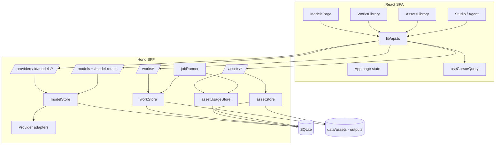
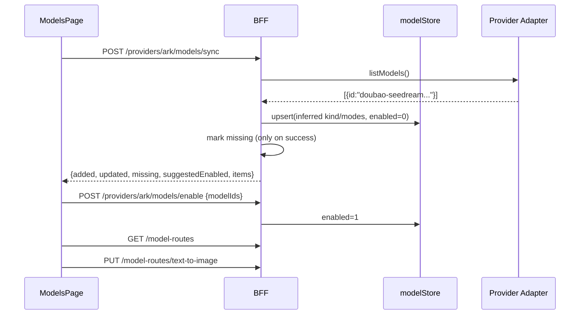
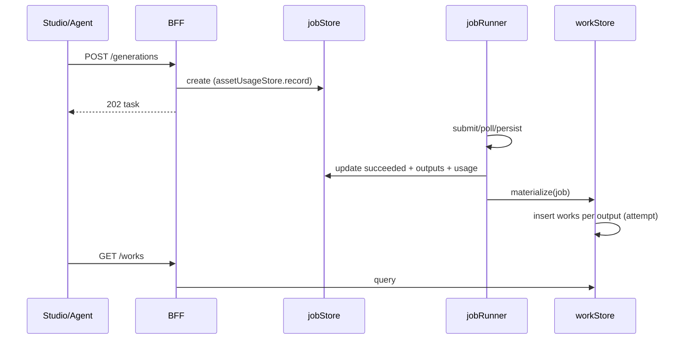
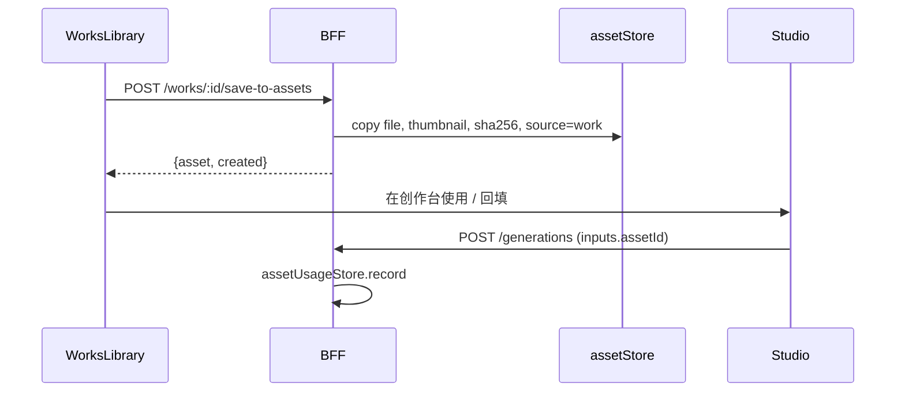

# 施工图 · 模型获取 / 作品库 / 素材库

> LUMEN 流明 · 三个模块的实现级技术方案  
> 版本：v0.1（设计已定稿，待实施）  
> 日期：2026-10-22  
> 配套：[设计稿](./04-model-works-assets-design.md) · [产品设计规范](./01-design-spec.md) · [总体施工图](./02-construction-blueprint.md) · [API 契约](./03-api-contract.yaml)

---

## 0. 技术结论（先看这里）

| 决策 | 选择 | 理由 |
| --- | --- | --- |
| 前端导航 | 扩展现有 `Page` 状态，不引入 React Router | 当前应用无路由；新增三页用同一套状态切换，风险最低 |
| 前端数据 | 现有 `api` 客户端 + 自定义列表 Hook | 不引入 TanStack Query；保持零新依赖 |
| 组件 | 新增 `src/library/` 共用库组件 | 作品与素材共享卡片、筛选、抽屉、批量条 |
| 样式 | 追加 `src/styles.css` 末尾的库样式段 | 沿用现有 token；不新造颜色与字号体系 |
| 数据库 | SQLite（`node:sqlite`）迁移 v2/v3/v4；手写 SQL | 与现有 [db.ts](../server/db.ts) 一致；无 ORM |
| 模型发现 | `ProviderAdapter.listModels?()` + 本地模型目录 | Ark/OpenAI 已有 `/models` 调用，可复用 |
| 模型路由 | `model_routes` 按五种模式存默认模型 | 与生成请求的 `providerId + modelId` 对齐 |
| 作品 | 新增 `works` 表，任务成功时物化快照 | 生成输出目前只在 `generations.outputs_json`，无法高效筛选/策展 |
| 素材 | 扩展 `assets` 表 + `asset_tags` + `asset_usages` | 现有上传表可平滑升级，不迁移文件 |
| 作品转素材 | 复制/硬链接到 `data/assets/`，独立记录 | 生命周期解耦，删除作品不破坏素材 |
| 删除 | 软删除 + 保留期清理 | 避免误删；文件清理前检查引用 |
| 分页 | 游标分页（`created_at + id`），默认 24，最大 100 | SQLite 大列表稳定；避免 offset 抖动 |
| 测试 | `node:test` 覆盖 store/迁移/规则；Playwright 只做断言不截图 | 遵循仓库既有验证方式 |

**核心原则：生成结果自动进作品库，输入素材显式进素材库；模型发现不自动消耗 tokens。**

### 0.1 与现有架构的兼容点

1. `shared/contracts.ts` 继续作为前后端唯一类型源；新增类型只加在这里。
2. `server/` 是 NodeNext：新增相对导入必须带 `.js`。
3. `SCHEMA_VERSION` 从 1 递增；不修改已应用的 v1 语句，新增 `current < 2/3/4` 分支。
4. 旧 `providers.image_model` / `video_model` 保留，作为模型目录的种子与降级来源。
5. `GET /models` 保持向后兼容：目录为空时继续合成图像/视频两条记录。
6. 当前 `GenerationRequest.modelId` 语义不变，仍是 Provider 侧模型 ID；目录用 `(providerId, modelId)` 复合定位。
7. 新页面不替换 StudioProvider；创作台/Agent 的状态在页面切换时保留。

### 0.2 实施顺序

| 阶段 | 内容 | 依赖 | 预估 |
| --- | --- | --- | --- |
| M4.1 | 模型目录、发现、路由、API 与模型页 | 无 | 3–4 天 |
| M4.2 | 作品表、物化、回填、API 与作品库 | 可与 M4.1 并行 | 3 天 |
| M4.3 | 素材扩展、标签、引用、作品转素材、素材页 | M4.2（作品转素材） | 4 天 |
| M4.4 | 创作台/项目页联动、响应式、可访问性、测试 | 前三阶段 | 2 天 |

---

## 1. 现状与改造点

| 模块 | 当前实现 | 改造 |
| --- | --- | --- |
| 模型配置 | [ApiModal.tsx](../src/components/ApiModal.tsx) 手填图像/视频模型；[providers.ts](../server/storage/providers.ts) 只存两个字段 | 增加模型目录存储、发现、启用、路由；弹窗保留快速连接 |
| 模型接口 | [server/index.ts](../server/index.ts) `GET /models` 用两个字段合成两条 | 改为目录查询；目录为空时降级合成 |
| 模型 UI | [Inspector.tsx](../src/studio/Inspector.tsx) 读取静态 `MODES` 文案 | 读取真实模型与路由；支持切换 |
| 生成请求 | `providerId + modelId` 由前端拼装 | 增加模型能力校验；缺省时按路由解析 |
| 作品 | 只在 `generations.outputs_json` 与本次会话缩略图 | 新增 `works` 表与物化逻辑、作品库页面 |
| 素材 | [assets.ts](../server/storage/assets.ts) 只有上传、列表、硬删；项目页缩略图 | 扩展哈希、来源、标签、引用、软删；新增素材库页面 |
| 导航 | [App.tsx](../src/App.tsx) 作品/素材按钮仅 toast | 新增 `works` / `assets` / `models` 页面 |
| CSS | `src/styles.css` 单文件 | 末尾追加 `library-*` / `models-*` 段；不改既有 token |

---

## 2. 总体架构



**数据流**

1. 模型发现：`ModelsPage → POST /providers/:id/models/sync → adapter.listModels() → modelStore.upsert → model_routes`。
2. 生成：`Studio → POST /generations → jobStore.create → assetUsageStore.record(job) → runner → complete → workStore.materialize`。
3. 作品转素材：`WorksLibrary → POST /works/:id/save-to-assets → 文件复制到 assets → assetStore.add(source=work)`。
4. 素材复用：`AssetsLibrary → 创作台 intent → StudioContext.attachAsset → GenerationRequest.inputs`。

---

## 3. 数据库设计

### 3.1 迁移版本

| 版本 | 内容 | 说明 |
| --- | --- | --- |
| v1 | 现有 providers / projects / assets / generations / agent_* / events | 保持不动 |
| v2 | `provider_models`、`model_routes`、providers 两个同步字段 | 模型目录 |
| v3 | `works` | 作品快照 |
| v4 | assets 扩展列、`asset_tags`、`asset_usages` | 素材库 |

实现方式：在 [db.ts](../server/db.ts) 中把 `SCHEMA_VERSION` 改为 4，迁移函数按 `current < 2`、`current < 3`、`current < 4` 分块；每块在同一个 `transaction()` 中执行。不要修改 v1 的 SQL。

### 3.2 DDL

```sql
-- ============ v2：模型目录 ============
ALTER TABLE providers ADD COLUMN models_synced_at TEXT;
ALTER TABLE providers ADD COLUMN models_sync_error TEXT;

CREATE TABLE IF NOT EXISTS provider_models (
  provider_id   TEXT NOT NULL,
  model_id      TEXT NOT NULL,              -- Provider 侧原始 ID，例如 doubao-seedream-4-0-250828
  label         TEXT NOT NULL DEFAULT '',
  kind          TEXT NOT NULL DEFAULT 'unknown', -- image | video | unknown
  modes_json    TEXT NOT NULL DEFAULT '[]',     -- GenerationMode[]
  capabilities_json TEXT NOT NULL DEFAULT '{}', -- ProviderCapabilities（按模型裁剪）
  source        TEXT NOT NULL DEFAULT 'discovered', -- discovered | manual | seed
  enabled       INTEGER NOT NULL DEFAULT 0,
  user_edited   INTEGER NOT NULL DEFAULT 0,     -- 1 时同步不覆盖 kind/modes/caps
  status        TEXT NOT NULL DEFAULT 'unverified', -- ready | unverified | missing
  last_synced_at TEXT,
  last_seen_at  TEXT,
  last_used_at  TEXT,
  last_error    TEXT,
  created_at    TEXT NOT NULL,
  updated_at    TEXT NOT NULL,
  PRIMARY KEY (provider_id, model_id)
);
CREATE INDEX IF NOT EXISTS idx_provider_models_provider
  ON provider_models(provider_id, enabled, kind);
CREATE INDEX IF NOT EXISTS idx_provider_models_status
  ON provider_models(status);

CREATE TABLE IF NOT EXISTS model_routes (
  mode          TEXT PRIMARY KEY,           -- 五种 GenerationMode
  provider_id   TEXT NOT NULL,
  model_id      TEXT NOT NULL,
  updated_at    TEXT NOT NULL
);

-- ============ v3：作品 ============
CREATE TABLE IF NOT EXISTS works (
  id             TEXT PRIMARY KEY,
  generation_id  TEXT NOT NULL,
  attempt        INTEGER NOT NULL DEFAULT 0,
  output_index   INTEGER NOT NULL DEFAULT 0,
  output_id      TEXT,
  kind           TEXT NOT NULL,             -- image | video
  mime           TEXT NOT NULL,
  size           INTEGER NOT NULL DEFAULT 0,
  width          INTEGER,
  height         INTEGER,
  duration_sec   REAL,
  url            TEXT NOT NULL,
  thumbnail_url  TEXT,
  title          TEXT NOT NULL DEFAULT '',
  prompt         TEXT NOT NULL DEFAULT '',
  mode           TEXT NOT NULL,
  provider_id    TEXT NOT NULL,
  model_id       TEXT NOT NULL,
  params_json    TEXT NOT NULL DEFAULT '{}',
  inputs_json    TEXT NOT NULL DEFAULT '[]',
  storyboard_json TEXT NOT NULL DEFAULT '[]',
  usage_tokens   INTEGER NOT NULL DEFAULT 0,
  usage_estimated INTEGER NOT NULL DEFAULT 0,
  project_id     TEXT,
  session_id     TEXT,
  source         TEXT NOT NULL DEFAULT 'studio', -- studio | agent
  favorite       INTEGER NOT NULL DEFAULT 0,
  deleted_at     TEXT,
  created_at     TEXT NOT NULL,
  updated_at     TEXT NOT NULL
);
CREATE UNIQUE INDEX IF NOT EXISTS idx_works_generation_attempt_output
  ON works(generation_id, attempt, output_index);
CREATE INDEX IF NOT EXISTS idx_works_created
  ON works(deleted_at, created_at DESC, id DESC);
CREATE INDEX IF NOT EXISTS idx_works_project
  ON works(project_id, created_at DESC);
CREATE INDEX IF NOT EXISTS idx_works_mode
  ON works(mode, created_at DESC);
CREATE INDEX IF NOT EXISTS idx_works_model
  ON works(provider_id, model_id, created_at DESC);
CREATE INDEX IF NOT EXISTS idx_works_favorite
  ON works(favorite, created_at DESC);

-- ============ v4：素材 ============
ALTER TABLE assets ADD COLUMN sha256 TEXT;
ALTER TABLE assets ADD COLUMN source TEXT NOT NULL DEFAULT 'upload'; -- upload | work | agent
ALTER TABLE assets ADD COLUMN source_ref TEXT;                      -- source=work 时为 work id
ALTER TABLE assets ADD COLUMN updated_at TEXT;
ALTER TABLE assets ADD COLUMN deleted_at TEXT;

UPDATE assets SET updated_at = created_at WHERE updated_at IS NULL;
CREATE INDEX IF NOT EXISTS idx_assets_created
  ON assets(deleted_at, created_at DESC);
CREATE INDEX IF NOT EXISTS idx_assets_sha256
  ON assets(sha256);
CREATE INDEX IF NOT EXISTS idx_assets_source
  ON assets(source, source_ref);

CREATE TABLE IF NOT EXISTS asset_tags (
  asset_id   TEXT NOT NULL,
  tag        TEXT NOT NULL,
  created_at TEXT NOT NULL,
  PRIMARY KEY (asset_id, tag)
);
CREATE INDEX IF NOT EXISTS idx_asset_tags_tag ON asset_tags(tag);

CREATE TABLE IF NOT EXISTS asset_usages (
  asset_id      TEXT NOT NULL,
  generation_id TEXT NOT NULL,
  role          TEXT NOT NULL,             -- reference | first_frame | last_frame | shot
  created_at    TEXT NOT NULL,
  PRIMARY KEY (asset_id, generation_id, role)
);
CREATE INDEX IF NOT EXISTS idx_asset_usages_asset ON asset_usages(asset_id);
CREATE INDEX IF NOT EXISTS idx_asset_usages_generation ON asset_usages(generation_id);
```

> 不新建 `tags` 表：单用户、标签量小，`asset_tags(tag)` 足够；大小写归一化在应用层完成。

### 3.3 启动回填

在 `server/index.ts` 的 `ensureDataDirs()` 之后、注册路由之前调用。所有回填必须幂等，并用 `settings` 标记完成。

| 回填 | 触发 | 逻辑 |
| --- | --- | --- |
| 模型种子 | 每次启动，目录为空时 | 只为**已配置** Provider（mock 视为已配置）用 `providers.image_model` / `video_model` 生成 `source=seed`、`enabled=1` 的两条记录；优先用 active Provider 为五种模式建路由 |
| 作品回填 | 首次（`works_backfill_v1` 未设置） | 扫描 `generations.status='succeeded' AND outputs_json != '[]'`，逐输出 `INSERT OR IGNORE` |
| 素材哈希 | 后台一次（`assets_hash_backfill_v1`） | 扫描 `sha256 IS NULL` 的素材，读文件计算；文件缺失跳过；每批 50 条 |
| 素材引用 | 首次（`asset_usage_backfill_v1`） | 扫描 generations 的 inputs/storyboard，写入 `asset_usages` |
| 启动对账 | 每次启动，最近 200 条 | 补物化 `succeeded` 但没有 works 的任务；补录有 inputs/storyboard 但没有 usages 的任务 |

**作品回填伪代码**

```ts
function backfillWorks() {
  if (getSetting("works_backfill_v1")) return;
  const rows = db.prepare(
    "SELECT * FROM generations WHERE status = 'succeeded' AND outputs_json != '[]'"
  ).all() as JobRow[];
  withTransaction(() => {
    for (const row of rows) {
      const job = rowToJob(row);
      for (const [index, output] of job.outputs.entries()) {
        insertWorkIfAbsent(job, output, index);
      }
    }
    setSetting("works_backfill_v1", new Date().toISOString());
  });
}
```

- 作品 ID 使用确定性：`wrk_${job.id.replace(/[^a-z0-9]/gi, "")}_${attempt}_${index}`。
- `attempt` 从 `generations.internal_json.attempts` 读取，缺省 0；保证重试成功产生新作品而不是覆盖旧作品。
- `created_at` 取 `job.finishedAt ?? output.createdAt ?? now`，保持作品时间与生成时间一致。
- 回填不覆盖用户已修改的标题、收藏、项目归属；使用 `INSERT OR IGNORE`。
- **对账不能只依赖一次性 flag**：`complete()` 更新任务成功后、物化作品前进程崩溃，会留下“成功任务但没有作品”的缺口。每次启动执行 `reconcile()`：

```ts
const rows = db.prepare(`
  SELECT * FROM generations g
  WHERE g.status = 'succeeded' AND g.outputs_json != '[]'
    AND NOT EXISTS (SELECT 1 FROM works w WHERE w.generation_id = g.id)
  ORDER BY g.created_at DESC LIMIT 200
`).all();
```

  对账同样使用确定性 ID + `INSERT OR IGNORE`；素材引用用相同方式补最近 200 条。
- `rowToJob` 目前是 [jobs/store.ts](../server/jobs/store.ts) 的私有函数。回填可给 `jobStore` 增加 `listStored({ status, limit })`，或导出 `rowToJob` 供回填复用；避免复制 JSON 解析逻辑。

### 3.4 生命周期与删除

| 对象 | 删除方式 | 文件 | 引用检查 |
| --- | --- | --- | --- |
| 作品 | `deleted_at` 软删 | 保留；清理任务检查是否有 `assets.source_ref=work.id` | 无 |
| 素材 | `deleted_at` 软删 | 保留；清理任务检查 `asset_usages` | 运行中任务阻止；历史引用需 force |
| 模型 | 硬删 | 无 | 被路由引用时 409 |
| Provider | 现有硬删 | 无 | 目录保留，标 missing |

**清理任务**（P1，可在实现 M4 时只留接口）：每天一次，删除 `deleted_at < now - MEDIA_RETENTION_DAYS` 且无引用的文件；v1 至少不物理删除仍被引用的文件。

### 3.5 共享类型

在 `shared/contracts.ts` 增加：

```ts
export type ModelKind = "image" | "video" | "unknown";
export type ModelSource = "discovered" | "manual" | "seed";
export type ModelStatus = "ready" | "unverified" | "missing";

export interface ModelInfo {
  providerId: string;
  id: string;                 // Provider 侧模型 ID，与 GenerationRequest.modelId 一致
  label: string;
  kind: ModelKind;
  modes: GenerationMode[];
  capabilities: ProviderCapabilities;
  source: ModelSource;
  enabled: boolean;
  status: ModelStatus;
  lastSyncedAt: string | null;
  lastSeenAt: string | null;
  lastUsedAt: string | null;
  lastError: string | null;
  createdAt: string;
  updatedAt: string;
}

export interface ModelSyncResult {
  providerId: string;
  supported: boolean;
  fetched: number;
  added: number;
  updated: number;
  missing: number;
  suggestedEnabled: string[];
  message: string;
  items: ModelInfo[];
}

export interface ModelRoute {
  mode: GenerationMode;
  providerId: string;
  modelId: string;
  model: ModelInfo | null;
  warning: string | null;
  updatedAt: string | null;
}

export type WorkSource = "studio" | "agent";

export interface Work {
  id: string;
  generationId: string;
  attempt: number;
  outputIndex: number;
  kind: "image" | "video";
  mime: string;
  size: number;
  width?: number;
  height?: number;
  durationSec?: number;
  url: string;
  thumbnailUrl?: string;
  title: string;
  prompt: string;
  mode: GenerationMode;
  providerId: string;
  modelId: string;
  params: GenerationParams;
  inputs: GenerationInput[];
  storyboard: StoryboardRow[];
  usage: { totalTokens: number; estimated: boolean };
  projectId?: string;
  sessionId?: string;
  source: WorkSource;
  favorite: boolean;
  createdAt: string;
  updatedAt: string;
}

export interface WorkFacets {
  total: number;
  kinds: Array<{ value: string; count: number }>;
  modes: Array<{ value: string; count: number }>;
  projects: Array<{ value: string; count: number }>;
}

export interface WorkListResponse {
  items: Work[];
  nextCursor: string | null;
  total: number;
}

export type AssetSource = "upload" | "work" | "agent";

export interface LibraryAsset extends MediaAsset {
  sha256?: string;
  source: AssetSource;
  sourceRef?: string;
  tags: string[];
  usageCount: number;
  updatedAt: string;
  duplicateOf?: string;
}

export interface AssetUsage {
  assetId: string;
  generationId: string;
  workId?: string;
  mode: GenerationMode;
  role: AssetRole;
  createdAt: string;
  thumbnailUrl?: string;
}

export interface AssetFacets {
  total: number;
  kinds: Array<{ value: string; count: number }>;
  sources: Array<{ value: string; count: number }>;
  projects: Array<{ value: string; count: number }>;
  tags: Array<{ value: string; count: number }>;
  used: number;
  unused: number;
}
```

`MediaAsset` 本身保持不变；列表接口返回 `LibraryAsset`。为避免破坏现有调用，`GET /projects/:id` 继续返回 `MediaAsset[]`。

---

## 4. 模型获取实现

### 4.1 Adapter 扩展

在 `server/providers/types.ts` 增加：

```ts
export interface RemoteModel {
  id: string;
  label?: string;
  ownedBy?: string;
}

export interface ProviderAdapter {
  readonly id: string;
  readonly capabilities: ProviderCapabilities;
  listModels?(): Promise<RemoteModel[]>;
  testConnection(): Promise<ProviderTestResult>;
  submit(request: ProviderRequest): Promise<ProviderTask>;
  poll(providerTaskId: string): Promise<ProviderTask>;
  cancel?(providerTaskId: string): Promise<void>;
}
```

实现：

| Adapter | `listModels()` | 说明 |
| --- | --- | --- |
| Ark | `GET {baseUrl}/models`，读取 `data[]` 或 `items[]` 的 `id` | 现有 `testConnection` 已调用；Ark 默认 Base URL 为 `/api/v3` |
| OpenAI 兼容 | `GET {baseUrl}/models`，读取 `data[].id` | 官方与多数兼容网关可用 |
| Mock | 返回 `lumen-mock-image` / `lumen-mock-video` | 无网络 |
| 自定义网关 404/405 | 抛出 `ProviderError(status=404/405)`，由上层转成“不支持”而不是失败 | 允许手工添加 |

`testConnection()` 改为复用 `listModels()`：

```ts
async testConnection() {
  const started = Date.now();
  try {
    const models = await this.listModels!();
    return { ok: true, latencyMs: Date.now() - started, message: ..., models: models.map(m => m.id) };
  } catch (error) {
    if (error instanceof ProviderError && (error.status === 404 || error.status === 405)) {
      return { ok: true, latencyMs: ..., message: "网关可达（未开放 /models，可手动添加模型）" };
    }
    ...
  }
}
```

**响应限制**：`requestText` 返回字符串后检查 `body.length > 2 * 1024 * 1024` 抛 `PROVIDER_BAD_RESPONSE`；模型 ID 截断到 200 字符，最多 500 个；sync 每 Provider 限流 10 次/分钟。

### 4.2 分类与能力裁剪

`server/storage/models.ts` 中实现纯函数，便于单测：

```ts
export function inferModelKind(modelId: string, providerKind: ProviderKind): {
  kind: ModelKind;
  confidence: "high" | "low";
} {
  const id = modelId.toLowerCase();
  const image = /(seedream|seededit|gpt-image|dall-e|flux|midjourney|image|sd[-_]?\d|stable-diffusion)/.test(id);
  const video = /(seedance|sora|veo|kling|runway|video|wanx|hunyuan-video)/.test(id);
  if (image && !video) return { kind: "image", confidence: "high" };
  if (video && !image) return { kind: "video", confidence: "high" };
  if (providerKind === "mock" && id.includes("image")) return { kind: "image", confidence: "high" };
  if (providerKind === "mock" && id.includes("video")) return { kind: "video", confidence: "high" };
  return { kind: "unknown", confidence: "low" };
}

export function modesFor(kind: ModelKind, providerKind: ProviderKind): GenerationMode[] {
  if (kind === "image") return ["text-to-image", "image-to-image"];
  if (kind === "video") {
    const caps = PROVIDER_CAPABILITIES[providerKind];
    return caps.multiImageToVideo
      ? ["text-to-video", "image-to-video", "multi-image-to-video"]
      : ["text-to-video", "image-to-video"];
  }
  return [];
}

export function capabilitiesFor(
  kind: ModelKind,
  providerKind: ProviderKind
): ProviderCapabilities {
  const base = PROVIDER_CAPABILITIES[providerKind];
  if (kind === "image") {
    return {
      ...base,
      textToImage: true,
      imageToImage: true,
      textToVideo: false,
      imageToVideo: false,
      multiImageToVideo: false,
      firstLastFrame: false,
      audio: false,
      animationModes: [],
    };
  }
  if (kind === "video") {
    return {
      ...base,
      textToImage: false,
      imageToImage: false,
      textToVideo: true,
      imageToVideo: true,
      multiImageToVideo: base.multiImageToVideo,
    };
  }
  return {
    ...base,
    textToImage: false,
    imageToImage: false,
    textToVideo: false,
    imageToVideo: false,
    multiImageToVideo: false,
    firstLastFrame: false,
    audio: false,
    animationModes: [],
    maxImageCount: 0,
    maxDurationSec: 0,
  };
}
```

**约束**

- 分类只生成“建议”，不覆盖 `user_edited=1` 的记录。
- `ep-...`、未知 ID、同时命中图像/视频关键词 → `unknown`，不自动启用。
- 手工添加时必须显式给 `kind`；`unknown` 不允许启用（UI 禁用）。
- Mock 的 `lumen-mock-image` / `lumen-mock-video` 走显式规则，避免正则误判。

### 4.3 同步算法

```ts
async sync(providerId: string): Promise<ModelSyncResult> {
  const provider = providerStore.getResolved(providerId);
  if (!provider?.configured) throw new ApiError(422, "PROVIDER_NOT_CONFIGURED", "请先保存并测试连接");
  const adapter = createAdapter(provider);
  if (!adapter.listModels) return unsupported(providerId, "该 Provider 不支持模型列表");

  const started = Date.now();
  const now = new Date().toISOString();
  let remote: RemoteModel[];
  try {
    remote = await adapter.listModels();
  } catch (error) {
    // 404/405 -> supported:false，不标记 missing
    // 401/403 -> MODEL_DISCOVERY_AUTH
    // 网络 -> MODEL_DISCOVERY_NETWORK
  }

  const deduped = new Map<string, RemoteModel>();
  for (const item of remote.slice(0, 500)) {
    const id = item.id.trim().slice(0, 200);
    if (id && !deduped.has(id)) deduped.set(id, { ...item, id });
  }

  const result = withTransaction(() => {
    let added = 0, updated = 0, missing = 0;
    const suggested: string[] = [];
    const existing = modelStore.listRaw(providerId);

    for (const remoteModel of deduped.values()) {
      const current = existing.get(remoteModel.id);
      const inferred = inferModelKind(remoteModel.id, provider.kind);
      const kind = current?.userEdited ? current.kind : inferred.kind;
      const modes = current?.userEdited ? current.modes : modesFor(kind, provider.kind);
      const caps = current?.userEdited ? current.capabilities : capabilitiesFor(kind, provider.kind);
      const isNew = !current;

      modelStore.upsert({
        providerId,
        modelId: remoteModel.id,
        label: remoteModel.label || remoteModel.id,
        kind,
        modes,
        capabilities: caps,
        source: current?.source === "manual" ? "manual" : "discovered",
        enabled: current?.enabled ?? 0,
        userEdited: current?.userEdited ?? 0,
        status: "ready",
        lastSyncedAt: now,
        lastSeenAt: now,
      });

      if (isNew) {
        added += 1;
        if (inferred.confidence === "high" && kind !== "unknown") suggested.push(remoteModel.id);
      } else {
        updated += 1;
      }
    }

    for (const current of existing.values()) {
      if (current.source !== "discovered") continue;
      if (!deduped.has(current.modelId)) {
        modelStore.markMissing(providerId, current.modelId, now);
        missing += 1;
      }
    }

    providerStore.markModelsSynced(providerId, now, null);
    return { added, updated, missing, suggested };
  });

  return {
    providerId,
    supported: true,
    fetched: deduped.size,
    ...result,
    suggestedEnabled: result.suggested,
    message: `已更新模型目录 · 新增 ${result.added}，更新 ${result.updated}，未再出现 ${result.missing}`,
    items: modelStore.list({ providerId }),
  };
}
```

**重要规则**

- 同步失败不修改目录、不标记 missing；只写 `providers.models_sync_error`。
- 已下架模型保留记录，`status='missing'`；创作台不显示；路由页警告。
- 新模型 `enabled=0`，由用户确认启用；`suggestedEnabled` 只用于 UI 预勾选。
- 手工添加的模型 `source='manual'`，同步时不自动删除、不覆盖用户能力。

**Store 方法**

```ts
// server/storage/models.ts
class ModelStore {
  list(filter?: { providerId?: string; mode?: GenerationMode; enabled?: boolean; includeMissing?: boolean }): ModelInfo[];
  find(providerId: string, modelId: string): ModelInfo | null;
  upsert(input: ModelUpsert): ModelInfo;
  markMissing(providerId: string, modelId: string, at: string): void;
  markUsed(providerId: string, modelId: string): void;
  setEnabled(providerId: string, modelIds: string[], enabled: boolean): number;
  update(providerId: string, modelId: string, patch: ModelPatch): ModelInfo;
  remove(providerId: string, modelId: string): void;
  listRoutes(): ModelRoute[];
  setRoute(mode: GenerationMode, providerId: string, modelId: string): ModelRoute;
  seedFromProvider(provider: ProviderInfo): void;
}

// server/storage/providers.ts 增加
markModelsSynced(id: string, at: string | null, error: string | null): void;
```

### 4.4 路由与生成校验

**路由解析**

```ts
function resolveRoute(mode: GenerationMode): ModelRoute | null {
  const row = db.prepare("SELECT * FROM model_routes WHERE mode = ?").get(mode);
  if (!row) return null;
  const model = modelStore.find(row.provider_id, row.model_id);
  const warning = !model
    ? "路由模型不存在"
    : !model.enabled
      ? "路由模型已停用"
      : model.status === "missing"
        ? "路由模型已下架"
        : !model.modes.includes(mode)
          ? "路由模型不支持当前模式"
          : null;
  return { mode, providerId: row.provider_id, modelId: row.model_id, model, warning, updatedAt: row.updated_at };
}
```

**生成请求校验**（`POST /generations`，在 Provider 校验之后）

```ts
const catalogModel = modelStore.find(parsed.providerId, requestModelId);
if (catalogModel) {
  if (!catalogModel.enabled) throw new ApiError(422, "MODEL_NOT_READY", "当前模型未启用，请在模型库启用");
  if (catalogModel.status === "missing") throw new ApiError(422, "MODEL_MISSING", "当前模型已下架，请重新获取或更换模型");
  if (!catalogModel.modes.includes(parsed.mode)) {
    throw new ApiError(422, "MODEL_MODE_UNSUPPORTED", "当前模型不支持该生成模式");
  }
}
// 目录中不存在时保留旧行为（兼容旧客户端/手工配置）；记录一条 warning 日志，不阻断。
```

**缺省模型解析**

- 前端仍显式传 `providerId + modelId`；M4.1 完成后，前端从模型选择器/路由取。
- 若 `modelId` 为空：`resolveRoute(mode)` 有值则使用；否则回退 `provider.imageModel/videoModel`。
- `modelStore.markUsed(providerId, modelId)` 在任务创建后调用。

**路由写入**

- `PUT /model-routes/:mode` 校验模型存在、启用、`modes.includes(mode)`；不满足返回 422，但允许 `?force=1` 保存并带 warning（设计稿要求可保存但警告）。
- “自动匹配”由前端选择候选后逐条 PUT；不做服务端批量隐式改写。

### 4.5 模型 API

| Method | Path | 用途 |
| --- | --- | --- |
| GET | `/api/v1/providers/:providerId/models` | 读取本地目录（可按 `enabled/kind/status` 过滤） |
| POST | `/api/v1/providers/:providerId/models/sync` | 拉取远程列表并写目录，返回差异 |
| POST | `/api/v1/providers/:providerId/models` | 手工添加模型 |
| PATCH | `/api/v1/providers/:providerId/models/:modelId` | 编辑标签/类型/模式/能力/启用 |
| POST | `/api/v1/providers/:providerId/models/enable` | 批量启用/停用（同步后确认） |
| POST | `/api/v1/providers/:providerId/models/:modelId/verify` | 只校验目录/远程列表，不生成 |
| DELETE | `/api/v1/providers/:providerId/models/:modelId` | 删除模型（被路由引用时 409） |
| GET | `/api/v1/models?mode=&providerId=&enabled=1` | 全局可用模型（创作台选择器） |
| GET | `/api/v1/model-routes` | 五种模式路由与 warning |
| PUT | `/api/v1/model-routes/:mode` | 设置某模式默认模型 |

**同步响应示例**

```json
{
  "providerId": "ark",
  "supported": true,
  "fetched": 12,
  "added": 3,
  "updated": 1,
  "missing": 2,
  "suggestedEnabled": ["doubao-seedream-4-0-250828"],
  "message": "已更新模型目录 · 新增 3，更新 1，未再出现 2",
  "items": [
    {
      "providerId": "ark",
      "id": "doubao-seedream-4-0-250828",
      "label": "doubao-seedream-4-0-250828",
      "kind": "image",
      "modes": ["text-to-image", "image-to-image"],
      "capabilities": { "textToImage": true, "imageToImage": true, "maxDurationSec": 0 },
      "source": "discovered",
      "enabled": false,
      "status": "ready",
      "lastSyncedAt": "2026-10-22T06:15:00.000Z",
      "lastSeenAt": "2026-10-22T06:15:00.000Z",
      "lastUsedAt": null,
      "lastError": null,
      "createdAt": "2026-10-22T06:15:00.000Z",
      "updatedAt": "2026-10-22T06:15:00.000Z"
    }
  ]
}
```

**错误码**

| Code | HTTP | 场景 |
| --- | --- | --- |
| `PROVIDER_NOT_CONFIGURED` | 422 | 未填 Key |
| `MODEL_DISCOVERY_UNSUPPORTED` | 200（supported:false） | 网关 404/405 |
| `MODEL_DISCOVERY_AUTH` | 502 | 401/403 |
| `MODEL_DISCOVERY_NETWORK` | 502 | 超时/断网 |
| `MODEL_DISCOVERY_BAD_RESPONSE` | 502 | 非 JSON/超大响应 |
| `MODEL_NOT_FOUND` | 404 | 目录无此模型 |
| `MODEL_NOT_READY` | 422 | 未启用 |
| `MODEL_MISSING` | 422 | 已下架 |
| `MODEL_MODE_UNSUPPORTED` | 422 | 模式不匹配 |
| `MODEL_IN_USE` | 409 | 被路由引用，不能删 |

### 4.6 模型页面实现

**文件**

```text
src/pages/ModelsPage.tsx
src/models/ProviderList.tsx
src/models/ProviderForm.tsx
src/models/ModelTable.tsx
src/models/ModelDetailPanel.tsx
src/models/ModelRouteTable.tsx
src/models/ModelPicker.tsx          # 创作台复用
src/models/useModels.ts
```

**状态**

```ts
type ModelsTab = "connections" | "catalog" | "routes";
const [tab, setTab] = useState<ModelsTab>("connections");
const [providerId, setProviderId] = useState<string>(runtime.activeProviderId || "ark");
const [syncState, setSyncState] = useState<"idle" | "syncing" | "review" | "error">("idle");
const [syncResult, setSyncResult] = useState<ModelSyncResult | null>(null);
const [selected, setSelected] = useState<string[]>([]); // 待启用模型 ID
```

**交互**

- 连接 Tab 复用现有 `ApiModal` 表单逻辑，抽成 `ProviderForm`；`ApiModal` 保留为快速入口，增加“打开模型库”按钮。
- Provider 表单保留图像/视频模型作为兼容默认值；保存后若目录为空则重建 seed，目录非空则不自动改路由，提示用户到路由页确认。
- 连接测试成功后，若目录为空，自动触发一次 sync（可取消）；已有目录则只提示“重新获取模型”。
- 同步完成后进入 `review`：列出新增模型，按 `suggestedEnabled` 预勾选；确认调用 `POST .../models/enable`。
- 模型行点击打开右侧详情；路由 Tab 使用 `ModelPicker`（仅同模式可用模型）。
- 模型目录变化后调用 `onRefreshRuntime()`，让创作台/顶栏同步。
- 空目录 + Provider 未配置：显示“连接并获取模型”；已配置但无模型：显示“获取模型 / 手动添加”。

**创作台 `ModelPicker`**

```ts
interface ModelPickerProps {
  mode: GenerationMode;
  providerId: string | null;
  modelId: string | null;
  models: ModelInfo[];
  onChange: (model: ModelInfo) => void;
  onManage: () => void;
}
```

- 只列 `enabled && status !== 'missing' && modes.includes(mode)`。
- 按“推荐 / 最近使用 / 其他”分组；当前项有勾选。
- 模型为空时显示“获取模型”入口。
- 切换模型后，`StudioContext` 清空不兼容参数（如视频模型 → 图像模型时清空时长、码率、运镜）。

### 4.7 模型测试

| 测试 | 内容 |
| --- | --- |
| `models-classify.test.ts` | 图像/视频/未知关键词；`ep-` 未知；Mock 明确规则 |
| `models-store.test.ts` | 新增/更新/missing；`user_edited` 不被覆盖；启用过滤 |
| `models-sync.test.ts` | 用 fake `listModels` 验证 diff；404 不标 missing；401 报错 |
| `models-routes.test.ts` | 路由校验；模型停用/下架 warning；删除被引用模型 409 |

---

## 5. 作品库实现

### 5.1 物化时机

`server/jobs/runner.ts` 的 `complete()` 末尾：

```ts
private complete(job: StoredJob, outputs: MediaAsset[], usage: TokenUsage | undefined, stage: string) {
  const finalUsage = usage || fallbackUsage(job, "heuristic");
  const updated = jobStore.update(job.id, {
    status: "succeeded",
    progress: 100,
    stage,
    outputs,
    usage: finalUsage,
    finishedAt: now(),
    shots: job.shots.map((shot) => ({ ...shot, status: "succeeded", progress: 100 })),
  });
  if (updated) {
    try {
      workStore.materialize(updated);
    } catch (error) {
      // 作品物化失败不能把已经成功的任务改成 failed；记录日志，交给启动对账。
      console.error(`[works] materialize failed for ${job.id}:`, (error as Error).message);
      jobStore.appendLog(job.id, `work materialize failed: ${(error as Error).message}`);
    }
  }
  jobStore.appendLog(job.id, `succeeded · ${finalUsage.totalTokens} tokens (${finalUsage.source})`);
}
```

**要求**

- `materialize` 必须在事务中完成；失败不能回滚任务状态，也不能抛出到 `run()` 的 catch（否则 `fail()` 会把 succeeded 覆盖成 failed）；由启动对账补偿（见 §3.3）。
- 只处理 `status === "succeeded"`、`outputs.length > 0`。
- 每输出一条作品；`attempt` 取 `job.internal.attempts`，保证重试产生新作品。
- 作业重试前旧作品保留；作品库按两次尝试分别展示。
- `source = job.sessionId ? "agent" : "studio"`。
- `inputs` / `storyboard` 快照写入 `inputs_json` / `storyboard_json`，便于素材被删后仍能查看来源。
- 标题：`deriveWorkTitle(prompt, index, total)`：去换行、截 24 字；多输出追加 `01`、`02`。
- 作品 ID 确定性：`wrk_${job.id.replace(/[^a-z0-9]/gi, "")}_${attempt}_${index}`；`INSERT OR IGNORE`，避免重启/重复完成产生重复。

### 5.2 查询与存储

`server/storage/works.ts`：

```ts
export class WorkStore {
  materialize(job: StoredJob): void;
  backfill(): void;
  get(id: string): Work | null;
  list(query: WorkQuery): { items: Work[]; nextCursor: string | null; total: number };
  facets(): WorkFacets;
  update(id: string, patch: WorkPatch): Work | null;
  softDelete(id: string): boolean;
  bulk(action: WorkBulkAction, ids: string[]): WorkBulkResult;
}
```

**查询参数**

```ts
interface WorkQuery {
  projectId?: string;
  mode?: GenerationMode;
  kind?: "image" | "video";
  providerId?: string;
  modelId?: string;
  favorite?: boolean;
  q?: string;
  from?: string;
  to?: string;
  cursor?: string;
  limit?: number;
  sort?: "newest" | "oldest" | "tokens" | "duration";
}
```

**SQL 要点**

- 基础条件：`deleted_at IS NULL`。
- 项目：`project_id = ?`；未归档用 `project_id IS NULL`。
- 搜索：`title LIKE ? OR prompt LIKE ?`（转义 `%`/`_`）；不搜索参数 JSON。
- 收藏：`favorite = 1`。
- 游标：默认 `(created_at, id)`；`WHERE (created_at < ? OR (created_at = ? AND id < ?))`；排序字段为 tokens/duration 时使用 `(sort_value, id)`，游标编码 `base64(JSON)`。
- `limit = Math.min(100, Math.max(1, query.limit || 24))`。
- `total` 用同一条件 `COUNT(*)`；大数据量可改为近似值，v1 先精确。
- 列表返回完整 `Work`（参数不大）；如后续提示词很长，可拆 `WorkSummary`。

### 5.3 作品 API

| Method | Path | 用途 |
| --- | --- | --- |
| GET | `/api/v1/works` | 列表：`projectId/mode/kind/providerId/modelId/favorite/q/from/to/cursor/limit/sort` |
| GET | `/api/v1/works/facets` | 类型/模式/项目计数 |
| GET | `/api/v1/works/:workId` | 详情（含 inputs/storyboard） |
| PATCH | `/api/v1/works/:workId` | 标题、收藏、项目归属 |
| DELETE | `/api/v1/works/:workId` | 软删除 |
| POST | `/api/v1/works/:workId/save-to-assets` | 另存为素材（幂等） |
| POST | `/api/v1/works/bulk` | 批量收藏/取消收藏/移动项目/删除/另存 |
| GET | `/api/v1/works/:workId/download` | 带文件名的原文件下载 |

**路由顺序**：`GET /works/facets` 必须注册在 `GET /works/:workId` 之前，否则 `facets` 会被当成作品 ID；`GET /assets/facets` 同理。`POST /works/bulk` 与 `GET /works/:id` 方法不同，不冲突。

**批量请求**

```json
{
  "action": "favorite" | "unfavorite" | "move_project" | "delete" | "save_to_assets",
  "ids": ["wrk_..."],
  "projectId": "proj_..."
}
```

**响应**

```json
{
  "updated": 3,
  "failed": [{ "id": "wrk_x", "code": "WORK_NOT_FOUND", "message": "作品不存在" }]
}
```

**下载**

- 解析 `work.url` 到 `paths.outputs` 的安全路径（复用 `safeMediaFile("outputs", ...)`）。
- 文件名：`sanitize(work.title || work.id) + ext`；`Content-Disposition: attachment; filename*=UTF-8''...`。
- 流式返回，避免大视频进内存；设置 `Content-Length`、`Content-Type`。
- 作品文件缺失返回 410 `WORK_FILE_MISSING`，UI 提示删除记录。

### 5.4 作品转素材

`server/media/asset-import.ts`：

```ts
export async function importWorkAsAsset(work: Work): Promise<{ asset: LibraryAsset; created: boolean }> {
  const existing = assetStore.findBySource("work", work.id);
  if (existing) return { asset: existing, created: false };

  const sourceFile = safeMediaFile("outputs", relativeOutputPath(work.url));
  if (!sourceFile) throw new ApiError(410, "WORK_FILE_MISSING", "作品文件不存在");

  const id = assetStore.newId();
  const relativeDir = monthDir(); // 从 upload.ts 导出，或抽到 media/paths.ts
  const ext = path.extname(sourceFile).slice(1).toLowerCase();
  const destination = path.join(paths.assets, relativeDir, `${id}.${ext}`);
  fs.mkdirSync(path.dirname(destination), { recursive: true, mode: 0o700 });
  fs.copyFileSync(sourceFile, destination);
  fs.chmodSync(destination, 0o600);

  const sha256 = sha256File(destination);
  await createThumbnail(destination, path.join(path.dirname(destination), `${id}_thumb.jpg`));
  const record = assetStore.addWithMeta({
    id,
    kind: work.kind,
    mime: work.mime,
    size: fs.statSync(destination).size,
    width: work.width,
    height: work.height,
    durationSec: work.durationSec,
    url: buildAssetUrl(path.join(relativeDir, `${id}.${ext}`)),
    thumbnailUrl: buildAssetUrl(path.join(relativeDir, `${id}_thumb.jpg`)),
    originalName: `${work.title || work.id}.${ext}`,
    createdAt: now(),
  }, {
    projectId: work.projectId ?? null,
    source: "work",
    sourceRef: work.id,
    sha256,
  });
  return { asset: record, created: true };
}
```

- 幂等：`assets(source='work', source_ref=work.id, deleted_at IS NULL)` 唯一（建议加部分唯一索引）。
- 复制而非移动：作品删除不影响素材。
- 大视频复制可能耗时；接口同步执行，前端显示“正在加入素材库…”。P1 可改异步任务。
- `thumbnail` 失败不阻断，使用原图/视频封面；与上传逻辑一致。
- `assetStore` 需要新增：`findBySource(source, sourceRef)`、`findBySha256(sha256)`、`addWithMeta(asset, meta)`、`getDetail(id)`、`search(query)`、`updateMeta(id, patch)`、`softDelete(id)`。现有 `add(asset, projectId)` 保留为薄封装，避免破坏旧调用。

### 5.5 作品前端

**文件**

```text
src/pages/WorksLibrary.tsx
src/library/LibraryPage.tsx
src/library/LibraryToolbar.tsx
src/library/MediaCard.tsx
src/library/MediaPreview.tsx
src/library/DetailDrawer.tsx
src/library/SelectionBar.tsx
src/library/EmptyState.tsx
src/library/useCursorQuery.ts
src/library/useDebouncedValue.ts
src/library/format.ts
src/works/useWorks.ts
src/works/WorkDetail.tsx
```

**页面状态**

- `projectId` 来自导航；`null` 表示全部。
- 筛选与排序保存在组件状态；从详情返回不重置。
- 搜索防抖 300ms；请求序号防止旧响应覆盖新响应。
- `favorite`、`title`、`delete` 使用乐观更新；失败回滚并 toast。
- 分页使用“加载更多”按钮 + 滚动触底；不做无限自动加载，避免误触。
- 详情抽屉选中项用 `workId` 保持；关闭后焦点回到卡片。

**复用参数**

```ts
function buildStudioIntent(work: Work): StudioIntent {
  const mode = MODE_BY_GENERATION_MODE[work.mode]; // t2i/t2v/i2i/i2v/multi
  return {
    mode,
    prompt: work.prompt,
    params: work.params,
    inputs: work.inputs,
    modelId: work.modelId,
    providerId: work.providerId,
    sourceWorkId: work.id,
  };
}
```

- `StudioProvider` 新增 `intent?: StudioIntent`；进入创作台时应用一次。
- 原模型不可用：保留参数，提示“原模型不可用，已切换到当前路由模型”，不阻断。
- 复用输入素材时，若素材已删除，显示“N 个输入素材不可用”，仍允许生成（视频模式可能要求首帧，按现有校验提示）。

**作品详情数据**

- 列表项已含 params/inputs；详情可直接使用列表数据，减少一次请求。
- 仍提供 `GET /works/:id` 作为刷新/深链兜底。

### 5.6 作品测试

| 测试 | 内容 |
| --- | --- |
| `works-materialize.test.ts` | 成功任务生成 N 条作品；失败/取消不生成；重试 attempt 产生新作品；幂等 |
| `works-backfill.test.ts` | 历史 generations 回填；不覆盖用户字段；重复运行不新增 |
| `works-query.test.ts` | 项目/模式/收藏/搜索/游标/排序 |
| `works-actions.test.ts` | 收藏、改名、移动、软删、批量结果 |
| `works-asset.test.ts` | 另存幂等、文件复制、源文件缺失 410 |

---

## 6. 素材库实现

### 6.1 上传改造

`server/media/upload.ts`：

1. 读取 buffer 后计算 `sha256`。
2. 查询 `assetStore.findBySha256(sha256)`（未删除）→ `duplicateOf`。
3. 保存原文件、缩略图、后台清理，逻辑不变。
4. `createAssetRecord` 增加 `sha256`、`source: "upload"`、`updated_at`。
5. 返回 `LibraryAsset`（含 `duplicateOf` 可选字段）。

**存储层改造**

- 新增 `addWithMeta(asset, meta)`；现有 `add(asset, projectId)` 改为调用 `addWithMeta(asset, { projectId })`，保持旧调用可用。
- `get/list/count/findByUrl/findBySource/findBySha256` 全部增加 `deleted_at IS NULL` 条件；项目统计的素材数也必须排除软删记录。
- `remove(id)` 改为 `softDelete(id)`；物理删除仅由清理任务使用。
- 后台 EXIF 清理完成后不要用 `add` 覆盖整行（会丢掉 `sha256/source/tags`）；新增 `updateFile(id, { url, mime, size })` 只更新文件字段。

**重复检测**

- 不做自动合并/阻止；返回 `duplicateOf: "ast_..."`，UI 提示“素材库已有相同文件，已保留本次上传”。
- 若用户希望复用，可在详情/提示中“打开已有素材”。
- 旧素材无 `sha256` 时，后台哈希回填完成后才参与检测。

**上传接口扩展**

- `POST /uploads` 支持可选 `tags`（multipart 中以 JSON 数组或逗号分隔字符串传递）与 `projectId`（已有）。
- `purpose` 保持兼容解析，但 v1 不单独持久化；素材的实际角色由 `asset_usages.role` 记录。
- 响应头 `X-Asset-Duplicate: true` 可选；body 内 `duplicateOf` 更直接。

### 6.2 引用记录

`server/storage/asset-usage.ts`：

```ts
export class AssetUsageStore {
  recordForJob(job: GenerationTask): void;
  listForAsset(assetId: string): Array<{ generationId: string; mode: string; role: string; createdAt: string; thumbnailUrl?: string }>;
  countForAsset(assetId: string): number;
  backfill(): void;
}
```

- 在 `jobStore.create()` 插入任务后调用 `assetUsageStore.recordForJob(job)`；Agent 直接调用 `jobStore.create` 也能覆盖。调用必须 `try/catch`：引用记录失败只记日志，不能让生成任务创建失败；启动对账会补录最近 200 条。
- 来源：
  - `job.inputs[].assetId` → `role = input.role`。
  - `job.storyboard[].assetId` → `role = "shot"`。
  - 仅有 `imageUrl` 时，用 `assetStore.findByUrl(url)` 解析；解析不到跳过。
- `INSERT OR IGNORE` 幂等；重试不重复。
- 删除任务当前无 API，引用记录保留。

**运行中引用检查**

```sql
SELECT COUNT(*) FROM asset_usages u
JOIN generations g ON g.id = u.generation_id
WHERE u.asset_id = ?
  AND g.status IN ('queued','submitting','running','postprocessing');
```

### 6.3 素材查询与 API

| Method | Path | 用途 |
| --- | --- | --- |
| GET | `/api/v1/assets` | 列表：`projectId/kind/source/tag/q/unused/duplicate/from/to/cursor/limit/sort` |
| GET | `/api/v1/assets/facets` | 类型/来源/项目/标签/使用状态计数 |
| GET | `/api/v1/assets/:assetId` | 详情：文件元信息、标签、引用数 |
| PATCH | `/api/v1/assets/:assetId` | 重命名、移动项目、替换标签 |
| DELETE | `/api/v1/assets/:assetId?force=1` | 软删除；运行中引用 409；历史引用需 force |
| POST | `/api/v1/assets/bulk` | 批量移动/加标签/移除标签/删除 |
| GET | `/api/v1/assets/:assetId/usage` | 引用它的任务/作品列表 |
| GET | `/api/v1/assets/:assetId/download` | 带文件名下载 |
| POST | `/api/v1/assets/:assetId/restore` | P1 恢复（可选） |

**列表响应**

```json
{
  "items": [
    {
      "id": "ast_8f2a...",
      "kind": "image",
      "mime": "image/jpeg",
      "size": 2457600,
      "width": 2048,
      "height": 2048,
      "url": "/media/assets/2026/10/ast_8f2a.jpg",
      "thumbnailUrl": "/media/assets/2026/10/ast_8f2a_thumb.jpg",
      "originalName": "产品主图.jpg",
      "createdAt": "2026-10-20T03:24:00.000Z",
      "updatedAt": "2026-10-20T03:24:00.000Z",
      "sha256": "8f2a...",
      "source": "upload",
      "tags": ["产品", "场景"],
      "usageCount": 3
    }
  ],
  "nextCursor": "eyJjIjoiMjAyNi0xMC0yMFQwMzoyNDowMC4wMDBaIiwiaWQiOiJhc3RfOGYyYSJ9",
  "total": 86
}
```

**查询细节**

- `deleted_at IS NULL`。
- 项目：`project_id = ?`；未归档 `project_id IS NULL`。
- 标签：`EXISTS (SELECT 1 FROM asset_tags t WHERE t.asset_id = assets.id AND t.tag = ?)`；多标签 AND。
- 搜索：`original_name LIKE ? ESCAPE '\' OR EXISTS (SELECT 1 FROM asset_tags t WHERE t.asset_id = assets.id AND t.tag LIKE ?)`。
- 未使用：`NOT EXISTS (SELECT 1 FROM asset_usages u WHERE u.asset_id = assets.id)`。
- 重复：`sha256 IN (SELECT sha256 FROM assets WHERE deleted_at IS NULL AND sha256 IS NOT NULL GROUP BY sha256 HAVING COUNT(*) > 1)`。
- 列表一次查询标签：

```sql
SELECT asset_id, tag FROM asset_tags WHERE asset_id IN (?, ?, ...) ORDER BY created_at;
```

在内存分组，避免 N+1。

- `usageCount` 同理一次聚合：

```sql
SELECT asset_id, COUNT(*) AS count FROM asset_usages
WHERE asset_id IN (...)
GROUP BY asset_id;
```

**标签规范化**

- 去首尾空格，连续空格折叠；大小写不敏感（存原文，查询用 `lower()`）。
- 长度 1–24；单素材最多 8 个；去重。
- 批量加标签时自动跳过重复与超限项，返回 `skipped`。

**删除**

```ts
delete(assetId, force: boolean) {
  const asset = get(assetId);
  if (!asset) return 404;
  const running = countRunning(assetId);
  if (running > 0) throw new ApiError(409, "ASSET_IN_USE", "有任务正在使用该素材");
  const used = countUsage(assetId);
  if (used > 0 && !force) {
    throw new ApiError(409, "ASSET_REFERENCED", `该素材被 ${used} 个作品使用，确认后再删除`, {
      details: { usageCount: used },
    });
  }
  db.prepare("UPDATE assets SET deleted_at = ?, updated_at = ? WHERE id = ?").run(now(), now(), assetId);
}
```

- 软删后列表/项目页不再返回。
- 不删除文件；清理任务检查引用。

### 6.4 素材前端

**文件**

```text
src/pages/AssetsLibrary.tsx
src/assets/UploadDropzone.tsx
src/assets/AssetGrid.tsx
src/assets/AssetDetail.tsx
src/assets/TagEditor.tsx
src/assets/AssetPickerDialog.tsx
src/assets/useAssets.ts
src/library/...                 # 复用 MediaCard/DetailDrawer/SelectionBar
```

**上传队列**

```ts
interface UploadTask {
  id: string;
  file: File;
  status: "queued" | "uploading" | "done" | "error";
  progress: number;
  asset?: LibraryAsset;
  error?: string;
}
```

- 顺序上传，避免同时打满 BFF；最多并发 2。
- 单项失败可重试；成功后插入列表顶部。
- 上传区可折叠；拖拽进入页面时高亮。
- 上传时可选择项目（默认当前筛选项目）与标签（可选）。

**详情操作**

- “在创作台使用”：调用 `onUseInStudio(asset, role)`；由 App 设置 `studioIntent` 与 `page="studio"`。
- “下载”：`/api/v1/assets/:id/download`。
- “删除”：若有引用，先弹确认并显示引用数；确认后带 `force=1`。
- “查看引用”：打开子列表，显示作品缩略图、模式、时间，可跳作品库详情。
- 标签编辑：回车添加、点击删除、联想已有标签（`facets.tags`）。

**与项目页/创作台集成**

- 项目页“项目素材”标题改为链接 → `assets?projectId=...`；保留现有上传按钮。
- 创作台上传槽旁增加“素材库”按钮，打开 `AssetPickerDialog`；选择后调用 `StudioContext.attachAsset(asset, role)`。
- `StudioContext` 新增：

```ts
attachAsset(asset: LibraryAsset, role: AssetRole): void;
applyIntent(intent: StudioIntent): void;
```

- `attachAsset` 把素材转为现有 `Attachment` 结构（`assetId`、`url`、`name`），不重新上传；分镜行绑定同理。
- `applyIntent` 在进入创作台时执行一次，应用模式、提示词、参数、模型与输入素材。

### 6.5 素材测试

| 测试 | 内容 |
| --- | --- |
| `assets-upload.test.ts` | SHA-256、重复提示、EXIF/缩略图不阻断 |
| `assets-tags.test.ts` | 标签规范化、8 个上限、多标签 AND 筛选 |
| `assets-usage.test.ts` | inputs/storyboard 引用记录；运行中阻止删除；force |
| `assets-list.test.ts` | 项目/来源/标签/未使用/游标/排序 |
| `assets-import.test.ts` | 作品转素材幂等、文件复制、源缺失 |
| `assets-delete.test.ts` | 软删后列表不返回；文件保留 |

---

## 7. 前端施工

### 7.1 页面与导航

`src/types.ts`：

```ts
export type Page =
  | "workspace"
  | "project"
  | "studio"
  | "agent"
  | "works"
  | "assets"
  | "models";
```

`src/App.tsx`：

```tsx
const [page, setPage] = useState<Page>("workspace");
const [libraryProjectId, setLibraryProjectId] = useState<string | null>(null);
const [studioIntent, setStudioIntent] = useState<StudioIntent | null>(null);

const railItems = [
  { page: "workspace", label: "工作区", icon: LayoutDashboard },
  { page: "works", label: "作品库", icon: LayoutGrid },
  { page: "assets", label: "素材库", icon: FolderOpen },
  { page: "models", label: "API 与模型", icon: Plug },
];
```

- 现有三个按钮的 toast 删除；按 `page` 设置 `is-active`。
- `PAGE_LABELS` 增加 `works: "作品库"`、`assets: "素材库"`、`models: "API 与模型"`。
- `crumbs` 增加三个页面的路径；作品/素材带当前项目筛选名。
- `jump` 保持“上一级”逻辑：从作品/素材回工作区；从模型回上一页（记录 `previousPage`）。
- 页面渲染：

```tsx
{page === "works" && (
  <WorksLibrary
    projectId={libraryProjectId}
    onProjectChange={setLibraryProjectId}
    onOpenStudio={(intent) => { setStudioIntent(intent); setPage("studio"); }}
    toast={toast}
  />
)}
{page === "assets" && (
  <AssetsLibrary
    projectId={libraryProjectId}
    onProjectChange={setLibraryProjectId}
    onUseInStudio={(asset, role) => {
      setStudioIntent({ mode: modeForRole(role), assetId: asset.id, role });
      setPage("studio");
    }}
    toast={toast}
  />
)}
{page === "models" && (
  <ModelsPage
    runtime={runtime}
    onRefresh={refreshRuntime}
    initialProviderId={runtime.activeProviderId}
    onOpenStudio={() => setPage("studio")}
    toast={toast}
  />
)}
```

- `StudioProvider` 增加 `intent={studioIntent}` 与 `onIntentApplied={() => setStudioIntent(null)}`；只在 `page === "studio"` 时应用。
- 三个库页面不卸载 StudioProvider，保持创作台状态。

### 7.2 Studio 运行时扩展

`src/types.ts`：

```ts
export interface StudioRuntime {
  online: boolean;
  activeProviderId: string | null;
  provider: ProviderInfo | null;
  providers: ProviderInfo[];
  models: ModelInfo[];
  routes: ModelRoute[];
  ffmpeg: boolean;
  version: string;
  loading: boolean;
}
```

`refreshRuntime` 分层请求，避免 30s 轮询反复拉整目录：

```ts
async function refreshRuntime(options: { catalog?: boolean } = {}) {
  const [providers, models, routes] = await Promise.all([
    api.providers(),
    options.catalog || isCatalogStale() ? api.models() : Promise.resolve({ items: runtime.models }),
    options.catalog || isCatalogStale() ? api.modelRoutes() : Promise.resolve({ items: runtime.routes }),
  ]);
  ...
}
```

- 现有 30s 定时器只刷新 providers；进入模型页、模型变更、打开模型选择器时传 `catalog: true`。
- `models/routes` 也可设 5 分钟 TTL；失败的目录请求不清空已有模型，标记 `catalogStale` 即可。
- 模型/路由请求失败不阻断连接状态：`models = []`，UI 回退到 `provider.imageModel/videoModel`。
- `StudioContext` 解析当前模型：

```ts
const route = runtime.routes.find((item) => item.mode === contractMode);
const override = modelOverrides[mode];
const selected = runtime.models.find((m) =>
  m.enabled && m.status !== "missing" && m.modes.includes(contractMode) &&
  (override ? m.id === override : m.providerId === route?.providerId && m.id === route.modelId)
) || runtime.models.find((m) => m.enabled && m.modes.includes(contractMode));

const providerId = selected?.providerId || provider?.id || "mock";
const modelId = selected?.id || (isImage ? provider?.imageModel : provider?.videoModel) || "lumen-mock-image";
```

- `modelOverrides: Partial<Record<Mode, string>>` 保存在组件状态；切换模式不串台。
- 选择模型时写 override；不修改全局路由（路由页才修改默认）。
- 生成请求仍发送 `providerId + modelId`。

### 7.3 共用库组件 API

```ts
interface LibraryPageProps {
  eyebrow: string;
  title: string;
  description: string;
  stats: ReactNode;
  toolbar: ReactNode;
  children: ReactNode;
  drawer?: ReactNode;
  drawerOpen: boolean;
  onCloseDrawer: () => void;
}

interface MediaCardProps {
  kind: "image" | "video";
  url: string;
  thumbnailUrl?: string;
  title: string;
  meta: string;
  badges?: ReactNode;
  favorite?: boolean;
  selected?: boolean;
  durationSec?: number;
  onOpen: () => void;
  onToggleFavorite?: () => void;
  onToggleSelect?: () => void;
}
```

- `MediaCard` 根部是 `article`，主点击区是 `button`；收藏/选择是独立按钮，不能嵌套在按钮内。
- 图片 `loading="lazy" decoding="async"`；视频只显示封面，详情才 `video`。
- `DetailDrawer` 使用 `<aside role="dialog" aria-modal="true">`；Esc 关闭；焦点圈定；关闭恢复焦点。
- `SelectionBar` 固定在内容区底部，`position: sticky; bottom: 16px`。

### 7.4 列表 Hook

```ts
export function useCursorQuery<T>(
  fetcher: (cursor: string | null) => Promise<{ items: T[]; nextCursor: string | null; total: number }>,
  deps: unknown[]
) {
  const [items, setItems] = useState<T[]>([]);
  const [nextCursor, setNextCursor] = useState<string | null>(null);
  const [total, setTotal] = useState(0);
  const [loading, setLoading] = useState(true);
  const [error, setError] = useState<string | null>(null);
  const requestId = useRef(0);

  const refresh = useCallback(async () => {
    const id = ++requestId.current;
    setLoading(true);
    try {
      const page = await fetcher(null);
      if (id !== requestId.current) return;
      setItems(page.items);
      setNextCursor(page.nextCursor);
      setTotal(page.total);
      setError(null);
    } catch (e) {
      if (id === requestId.current) setError((e as Error).message);
    } finally {
      if (id === requestId.current) setLoading(false);
    }
  }, deps);

  const loadMore = useCallback(async () => {
    if (!nextCursor) return;
    const id = ++requestId.current;
    try {
      const page = await fetcher(nextCursor);
      if (id !== requestId.current) return;
      setItems((prev) => [...prev, ...page.items]);
      setNextCursor(page.nextCursor);
      setTotal(page.total);
    } catch (e) {
      setError((e as Error).message);
    }
  }, [nextCursor, ...deps]);

  return { items, nextCursor, total, loading, error, refresh, loadMore, setItems };
}
```

- 搜索防抖：`useDebouncedValue(query, 300)`。
- 筛选变化调用 `refresh` 并清空选中。
- 乐观更新：收藏/标题直接改 `items`；失败调用 `refresh` 回滚并 toast。

### 7.5 API 客户端

`src/lib/api.ts` 增加：

```ts
models: (query = "") => request<{ items: ModelInfo[] }>(`/models${query}`),
providerModels: (providerId: string) => request<{ items: ModelInfo[] }>(`/providers/${id}/models`),
syncModels: (providerId: string) => request<ModelSyncResult>(`/providers/${id}/models/sync`, { method: "POST" }),
addModel: (providerId: string, input: ModelCreateInput) => request<ModelInfo>(...),
updateModel: (providerId: string, modelId: string, patch: ModelUpdateInput) => request<ModelInfo>(...),
enableModels: (providerId: string, modelIds: string[], enabled: boolean) => request<...>(...),
verifyModel: (providerId: string, modelId: string) => request<ModelVerifyResult>(...),
modelRoutes: () => request<{ items: ModelRoute[] }>("/model-routes"),
updateModelRoute: (mode: GenerationMode, input: ModelRouteInput) => request<ModelRoute>(...),

works: (query: string) => request<WorkListResponse>(`/works${query}`),
work: (id: string) => request<Work>(`/works/${id}`),
updateWork: (id: string, patch: WorkUpdateInput) => request<Work>(...),
deleteWork: (id: string) => request<void>(...),
saveWorkToAssets: (id: string) => request<{ asset: LibraryAsset; created: boolean }>(...),
bulkWorks: (input: WorkBulkInput) => request<WorkBulkResult>(...),

assets: (query: string) => request<AssetListResponse>(`/assets${query}`),
asset: (id: string) => request<LibraryAsset>(`/assets/${id}`),
updateAsset: (id: string, patch: AssetUpdateInput) => request<LibraryAsset>(...),
deleteAsset: (id: string, force = false) => request<void>(`/assets/${id}${force ? "?force=1" : ""}`, { method: "DELETE" }),
bulkAssets: (input: AssetBulkInput) => request<AssetBulkResult>(...),
assetUsage: (id: string) => request<{ items: AssetUsage[] }>(...),
```

- 现有 `upload` 返回类型改为 `LibraryAsset`（兼容 `MediaAsset`）。
- 列表查询用 `URLSearchParams` 构造，避免手拼。
- `request` 继续统一错误映射；新增错误码不需要前端 switch，显示 message 即可。

### 7.6 CSS 施工

在 `src/styles.css` **末尾**追加（保持既有 scoped override 块不变）：

```css
/* ---------- libraries: works / assets ---------- */
.library-page { ... }
.library-head { ... }
.library-stats { ... }
.library-toolbar { ... }
.library-grid { display: grid; grid-template-columns: repeat(4, minmax(0, 1fr)); gap: 14px; }
.media-card { ... }
.media-card-thumb { aspect-ratio: 16 / 9; border-radius: 12px; overflow: hidden; }
.media-card-meta { ... }
.library-drawer { width: 380px; ... }
.library-selection-bar { position: sticky; bottom: 16px; ... }
.tag-chip { ... }
.upload-dropzone { ... }

/* ---------- models ---------- */
.models-page { ... }
.models-tabs { ... }
.model-table { ... }
.model-row { ... }
.model-detail { ... }
.model-route-row { ... }
.model-picker-list { ... }

@media (max-width: 1279px) { .library-grid { grid-template-columns: repeat(3, minmax(0, 1fr)); } }
@media (max-width: 900px)  { .library-grid { grid-template-columns: repeat(2, minmax(0, 1fr)); } }
@media (max-width: 800px)  { .library-grid { grid-template-columns: 1fr; } .library-drawer { width: 100%; } }
```

- 字号沿用现有 12–13px 正文；库卡片标题 13px，元信息 11px，tokens/尺寸用 `var(--mono)`。
- 新增颜色只允许使用 `--accent` / `--green` / `--red` / `--muted` 等既有 token。
- 不修改 `.inspector` 等在用的字号覆盖块；模型选择器样式放在 `models-*` 段。

### 7.7 项目页与工作区联动

- `ProjectPage`：
  - “项目素材”标题改为按钮/链接，进入素材库并带 `projectId`。
  - 增加“项目作品”小统计或链接（作品数、tokens），进入作品库并带 `projectId`。
  - 素材缩略图点击改为打开素材详情（或在素材库中定位），不再直接新窗口打开原图。
- `WorkspaceHome`：
  - 右侧 storage 卡片的 `outputs/`、`assets/` 可点击进入对应库。
  - 项目卡统计增加作品数（如果 `ProjectStats` 扩展，见下）。
- `ProjectStats` 可选扩展：`works: number`；`GET /projects` 统计增加作品数。为了减少改动，v1 可先不扩展，项目页用作品库筛选链接；M4.4 再补 `works` 计数。
- `AgentWorkspace`：工具卡输出缩略图点击可进入作品详情（通过 `onOpenWork(workId)`）；P1。

### 7.8 可访问性与响应式

- 所有图标按钮 `aria-label`；当前导航 `aria-current="page"`。
- 筛选 chips `aria-pressed`；批量条 `role="region"` + `aria-live="polite"` 汇报结果。
- 抽屉焦点圈定、Esc 关闭、关闭后恢复焦点。
- 图片 `alt` 使用标题/提示词摘要；视频提供 `aria-label` 与控制器。
- 移动端抽屉全屏、批量条吸底、上传使用文件选择器。
- 无横向滚动；表格在窄屏卡片化。

---

## 8. API 契约汇总

> 以下为提案。实现时同步写入 `docs/03-api-contract.yaml`，并保持 `shared/contracts.ts` 与契约一致。

### 8.1 模型

| Method | Path | 说明 |
| --- | --- | --- |
| GET | `/api/v1/providers` | 已有；增加 `modelsSyncedAt` / `modelsSyncError` 可选字段 |
| GET | `/api/v1/providers/:providerId/models` | 本地目录 |
| POST | `/api/v1/providers/:providerId/models/sync` | 远程发现 |
| POST | `/api/v1/providers/:providerId/models` | 手工添加 |
| PATCH | `/api/v1/providers/:providerId/models/:modelId` | 编辑 |
| POST | `/api/v1/providers/:providerId/models/enable` | 批量启用/停用 |
| POST | `/api/v1/providers/:providerId/models/:modelId/verify` | 无费用校验 |
| DELETE | `/api/v1/providers/:providerId/models/:modelId` | 删除 |
| GET | `/api/v1/models` | 可用模型；兼容旧响应 |
| GET | `/api/v1/model-routes` | 五模式路由 |
| PUT | `/api/v1/model-routes/:mode` | 设置路由 |

### 8.2 作品

| Method | Path | 说明 |
| --- | --- | --- |
| GET | `/api/v1/works` | 游标列表 |
| GET | `/api/v1/works/facets` | 筛选计数 |
| GET | `/api/v1/works/:workId` | 详情 |
| PATCH | `/api/v1/works/:workId` | 标题/收藏/项目 |
| DELETE | `/api/v1/works/:workId` | 软删 |
| POST | `/api/v1/works/:workId/save-to-assets` | 另存素材 |
| POST | `/api/v1/works/bulk` | 批量 |
| GET | `/api/v1/works/:workId/download` | 下载 |

### 8.3 素材

| Method | Path | 说明 |
| --- | --- | --- |
| GET | `/api/v1/assets` | 游标列表（扩展查询参数） |
| GET | `/api/v1/assets/facets` | 计数 |
| GET | `/api/v1/assets/:assetId` | 详情 |
| PATCH | `/api/v1/assets/:assetId` | 重命名/项目/标签 |
| DELETE | `/api/v1/assets/:assetId` | 软删；`force=1` 跳过历史引用确认 |
| POST | `/api/v1/assets/bulk` | 批量 |
| GET | `/api/v1/assets/:assetId/usage` | 引用列表 |
| GET | `/api/v1/assets/:assetId/download` | 下载 |
| POST | `/api/v1/uploads` | 已有；返回 `sha256`/`source`/`duplicateOf` |

### 8.4 分页与错误

**分页响应**

```ts
interface CursorPage<T> {
  items: T[];
  nextCursor: string | null; // null 表示最后一页
  total: number;
}
```

- 游标 opaque：`base64(JSON.stringify({ createdAt, id }))`，前端不得解析。
- 默认 24，最大 100；非法 limit 回退默认，不报错。
- 空结果 `items: []`、`nextCursor: null`、`total: 0`。

**通用错误**

```json
{
  "error": {
    "code": "MODEL_NOT_READY",
    "message": "当前模型未启用，请在模型库启用",
    "retryable": false,
    "traceId": "...",
    "details": {}
  }
}
```

新增错误码：

| Code | HTTP | 说明 |
| --- | --- | --- |
| `MODEL_*` | 404/422/502 | 见 §4.5 |
| `WORK_NOT_FOUND` | 404 | 作品不存在 |
| `WORK_FILE_MISSING` | 410 | 作品文件丢失 |
| `ASSET_NOT_FOUND` | 404 | 素材不存在 |
| `ASSET_IN_USE` | 409 | 运行中任务引用 |
| `ASSET_REFERENCED` | 409 | 历史引用，需要 force |
| `ASSET_TAG_LIMIT` | 422 | 超过 8 个标签 |
| `INVALID_CURSOR` | 400 | 游标非法；也可回退第一页 |

---

## 9. 时序

### 9.1 模型发现



### 9.2 生成成功 → 作品



### 9.3 作品 → 素材 → 创作台



---

## 10. 安全与隐私

### 10.1 密钥与模型

- 模型发现只需 `Authorization` header；Key 不出现在 URL、响应、日志。
- `GET /providers/:id/models` 不返回 Key；错误消息沿用 Provider 归一化，最多 600 字符上游摘要。
- 同步响应体限制 2MB、模型数 500、ID 长度 200；防止恶意网关撑爆内存。
- 自定义 Base URL 允许本机/私网（本地网关场景）；这是现有行为。若未来暴露公网，需要在 Provider 保存时增加私网校验或允许列表。

### 10.2 文件与路径

- 作品下载：`safeMediaFile("outputs", relative)`；禁止 `..`/绝对路径。
- 素材下载：`safeMediaFile("assets", relative)`；文件名来自 DB，下载文件名经过 `sanitizeFilename`。
- 作品转素材：只复制 `paths.outputs` 内文件；目标在 `paths.assets`；权限 0600。
- 上传继续 magic bytes 校验、20MB 限制、EXIF 清理；不接受 SVG。

### 10.3 数据删除

- 软删只改 DB；文件清理任务必须检查 `assets.source_ref` 与 `asset_usages`。
- 删除素材不删除作品；删除作品不删除素材（复制模型）。
- 运行中引用素材阻止删除；历史引用需要显式 force。
- 任务 `outputs` 与作品快照保留，审计可查。

### 10.4 日志与遥测

- 不记录 prompt、API Key、媒体内容；继续现有日志策略。
- 模型同步日志记录 providerId、数量、耗时、错误码，不记录完整响应。
- 作品/素材删除日志记录 id 与引用数，便于排查。

---

## 11. 性能与容量

| 场景 | 策略 |
| --- | --- |
| 作品/素材列表 | 游标分页 + 索引；默认 24；缩略图懒加载 |
| 标签/引用计数 | 批量 `IN (...)` 聚合，避免 N+1 |
| 搜索 | `LIKE` + 索引有限；v1 数据 < 10k 可接受；P1 可加 FTS5 |
| 大视频 | 卡片只用封面；详情 `preload="metadata"`；下载流式 |
| 作品回填 | 一次性事务分批；大库按 500 条/批，避免长事务锁 |
| 素材哈希回填 | 后台分批 50 条，避免启动阻塞 |
| 模型同步 | 12s 超时，最多 1 次重试，限流 10 次/分钟 |
| 文件复制 | 作品转素材同步复制；大文件显示进度/禁用重复点击 |
| 列表统计 | `total` 精确查询；数据量大时 M5 改近似 |

**验收目标**

- 1,000 件作品 / 1,000 件素材：首屏 < 800ms（本机），滚动无明显掉帧。
- 10,000 件：筛选与分页 < 300ms；必要时加复合索引。
- 模型同步 12 个模型 < 2s（不含网络）。

---

## 12. 测试与验收

### 12.1 服务端

```bash
npm run typecheck
npm run test:server
```

新增测试文件：

```text
server/tests/models-classify.test.ts
server/tests/models-store.test.ts
server/tests/works-materialize.test.ts
server/tests/works-query.test.ts
server/tests/assets-upload.test.ts
server/tests/assets-tags.test.ts
server/tests/assets-usage.test.ts
```

**必须覆盖**

- 迁移 v1 → v4 后可启动；`GET /system` 统计不报错。
- 模型分类与能力裁剪；`user_edited` 不被同步覆盖；missing 只在成功同步时标记。
- 作品物化：成功/失败/取消/重试/幂等/多输出。
- 作品回填：重复运行不新增；不覆盖用户标题/收藏。
- 作品查询：项目、模式、收藏、搜索、游标、排序。
- 素材：哈希、重复、标签上限、引用记录、运行中阻止、force、软删。
- 作品转素材：幂等、文件复制、源缺失。

### 12.2 前端/端到端

仓库没有前端测试运行器；按现有方式执行：

```bash
npm run typecheck
npm run build
```

若环境有 Playwright（遵循 [AGENTS.md](../AGENTS.md)：**不截图**），断言：

1. 左侧作品库/素材库/API 与模型可进入，激活态正确。
2. 模型页：Mock Provider 同步 → 审核 → 启用 → 路由 → 创作台选中模型。
3. 创作台生成一张图 → 作品库出现 → 收藏 → 复用参数回到创作台。
4. 作品另存素材 → 素材库出现 → 在创作台使用 → 作为参考图提交。
5. 素材上传 → 标签 → 按标签筛选 → 详情显示引用。
6. 删除有引用的素材：出现确认；运行中引用被阻止。
7. 1440 / 1280 / 1024 / 390 四档无横向滚动；抽屉焦点正确。

验证方式使用 DOM 断言、`getBoundingClientRect()`、`getComputedStyle()`、网络请求断言；报告文字证据，不新增 PNG。

### 12.3 验收矩阵

| 模块 | 验收项 | 通过标准 |
| --- | --- | --- |
| 模型 | 发现 | 连接后可获取；404 可手动添加；401/网络错误分类 |
| 模型 | 目录 | 新模型默认不启用；未知类型需确认；同步不覆盖用户编辑 |
| 模型 | 路由 | 五模式可配置；停用/下架/能力不匹配有 warning |
| 模型 | 创作台 | 真实模型可选；模式不匹配被阻止；切换模型不串参数 |
| 作品 | 自动收录 | Studio/Agent/五模式成功均收录；失败/取消不收录 |
| 作品 | 管理 | 筛选/搜索/排序/收藏/改名/移动/批量/删除 |
| 作品 | 复用 | 参数回填；模型不可用有提示；输入缺失有提示 |
| 作品 | 转素材 | 幂等；文件独立；作品删除不影响素材 |
| 素材 | 上传 | 多选/进度/失败重试/重复提示 |
| 素材 | 组织 | 项目/标签/来源/未使用筛选；标签上限 |
| 素材 | 引用 | 详情显示引用；运行中阻止删除；历史引用确认 |
| 素材 | 复用 | 在创作台按模式填槽位，不自动生成 |
| 通用 | 响应式 | 四档无横向滚动；移动端 Sheet |
| 通用 | 可访问性 | 键盘主路径、焦点管理、aria 状态 |
| 通用 | 安全 | Key 不出服务端；路径穿越防护；无公开分享 |

---

## 13. 里程碑与任务拆分

### M4.1 模型获取（3–4 天）

| 任务 | 文件 |
| --- | --- |
| 迁移 v2 + 模型/路由 store | `server/db.ts`、`server/storage/models.ts` |
| Adapter `listModels` | `server/providers/types.ts`、`ark.ts`、`openai.ts`、`mock.ts` |
| 发现/分类/同步 API | `server/index.ts` |
| 类型与客户端 | `shared/contracts.ts`、`src/lib/api.ts`、`src/types.ts` |
| 模型页三 Tab | `src/pages/ModelsPage.tsx`、`src/models/*` |
| 创作台模型选择器 | `src/studio/Inspector.tsx`、`src/studio/StudioContext.tsx` |
| 测试 | `server/tests/models-*.test.ts` |

### M4.2 作品库（3 天）

| 任务 | 文件 |
| --- | --- |
| 迁移 v3 + works store + 回填 | `server/db.ts`、`server/storage/works.ts`、`server/index.ts` |
| 物化接入 | `server/jobs/runner.ts` |
| 作品 API | `server/index.ts` |
| 类型/客户端 | `shared/contracts.ts`、`src/lib/api.ts` |
| 作品库页面 | `src/pages/WorksLibrary.tsx`、`src/works/*`、`src/library/*` |
| 复用参数 | `src/App.tsx`、`src/studio/StudioContext.tsx` |
| 测试 | `server/tests/works-*.test.ts` |

### M4.3 素材库（4 天）

| 任务 | 文件 |
| --- | --- |
| 迁移 v4 + assets 扩展 | `server/db.ts`、`server/storage/assets.ts` |
| 哈希/重复/标签/引用 | `server/media/upload.ts`、`server/storage/asset-usage.ts` |
| 作品转素材 | `server/media/asset-import.ts` |
| 素材 API | `server/index.ts` |
| 素材库页面 | `src/pages/AssetsLibrary.tsx`、`src/assets/*`、`src/library/*` |
| 创作台素材选择 | `src/studio/StudioContext.tsx`、`src/studio/PromptComposer.tsx`、`src/studio/StoryboardTable.tsx` |
| 项目页联动 | `src/pages/ProjectPage.tsx` |
| 测试 | `server/tests/assets-*.test.ts` |

### M4.4 收尾（2 天）

- 响应式与可访问性检查。
- 空/错/离线/加载状态补齐。
- `npm run typecheck` + `npm run test:server` + `npm run build`。
- 可选 Playwright 断言（不截图）。
- 更新 `docs/03-api-contract.yaml` 与 `README.md` 的 API/文档表。

---

## 14. 风险与备选

| 风险 | 影响 | 缓解 |
| --- | --- | --- |
| 自定义网关 `/models` 不支持或格式不同 | 无法自动发现 | 404/405 降级手动添加；解析 `data[]`/`items[]`；不因发现失败阻断生成 |
| 模型分类误判 | 用户选错类型/能力 | 只作建议；未知不自动启用；用户编辑后不被覆盖 |
| 模型下架后路由失效 | 生成失败 | 路由 warning；创作台不显示 missing；生成前校验并提示更换 |
| 作品回填慢/重复 | 启动慢、重复作品 | 一次性 flag；`INSERT OR IGNORE`；确定性 ID；分批事务 |
| 重试覆盖旧作品 | 作品历史丢失 | `attempt` 纳入唯一键与 ID |
| 删除作品/素材导致文件断链 | 详情 404 | 软删 + 引用检查 + 复制而非移动 + 保留期 |
| 大视频复制阻塞请求 | 接口超时 | 前端禁用重复点击；P1 改异步任务；限制单文件大小 |
| SQLite JSON 查询慢 | 列表卡顿 | 作品/素材正规表 + 索引；引用正规表；搜索 LIKE 限 10k |
| 无路由导致刷新丢失页面 | 体验问题 | 本轮接受；P1 增加 hash 深链 |
| API 契约漂移 | 前后端不一致 | 实现时同步 `03-api-contract.yaml` 与 `shared/contracts.ts`；类型检查 |

**备选方案**

- 不建 `works` 表，直接查 `generations.outputs_json`：实现快，但无法高效分页/收藏/改名/多输出，否决。
- 作品转素材直接引用 `outputs` URL：省空间，但删除作品会断链；否决，采用复制/硬链接。
- 素材标签存 `tags_json`：少两张表，但筛选需 `json_each`，且无法高效计数；v1 数据小可接受，但正规表更稳，采用 `asset_tags`。
- 模型目录不落库，实时查 `/models`：每次打开都打 Provider，且无法保存启用/路由；否决。

---

## 15. 待确认决策

1. 自定义网关 `/models` 的非标准响应是否需要适配（`models[]`、`result[]`）？
2. 新模型默认启用策略：本文“默认不启用，高置信度预勾选”，是否接受多一步确认？
3. 是否允许“验证模型”做一次低成本真实生成？本文默认不做。
4. 作品是否需要在 v1 支持标签，还是只做收藏/项目？本文 v1 不做作品标签。
5. 素材重复文件：本文保留两份并提示；是否改为自动复用已有？
6. 作品/素材软删保留期是否沿用 `MEDIA_RETENTION_DAYS=7`？是否需要回收站？
7. 是否为三个库增加 hash 深链（`#/works`、`#/assets`、`#/models`）？
8. 文生图多输出时，作品按每张一份还是任务组合一份？本文每张一份。
9. 素材是否允许跨项目（多对多）？本文单项目 + 未归档。
10. 视频素材是否允许直接上传？本文 v1 仅图片上传，视频素材来自作品另存。

---

## 16. 附录

### 16.1 关键文件清单

```text
shared/contracts.ts                     # 新类型
server/db.ts                            # v2/v3/v4 迁移
server/storage/models.ts                # 模型目录/路由
server/storage/works.ts                 # 作品
server/storage/assets.ts                # 素材扩展
server/storage/asset-usage.ts           # 引用
server/providers/{types,ark,openai,mock}.ts
server/media/upload.ts                  # SHA-256/重复
server/media/asset-import.ts            # 作品转素材
server/jobs/runner.ts                   # 物化作品
server/index.ts                         # 路由

src/types.ts                            # Page/StudioRuntime
src/App.tsx                             # 导航/页面
src/lib/api.ts                          # API 客户端
src/pages/ModelsPage.tsx
src/pages/WorksLibrary.tsx
src/pages/AssetsLibrary.tsx
src/library/*                           # 共用库组件
src/models/*
src/works/*
src/assets/*
src/studio/Inspector.tsx                # 模型选择
src/studio/StudioContext.tsx            # 模型/素材 intent
src/pages/ProjectPage.tsx               # 项目素材/作品入口
src/styles.css                          # 末尾新增库样式
```

### 16.2 新 API 快速验证

```bash
# 模型
curl -s http://127.0.0.1:8787/api/v1/providers/ark/models
curl -s -X POST http://127.0.0.1:8787/api/v1/providers/ark/models/sync
curl -s -X POST http://127.0.0.1:8787/api/v1/providers/ark/models/enable \
  -H 'content-type: application/json' \
  -d '{"modelIds":["doubao-seedream-4-0-250828"],"enabled":true}'
curl -s http://127.0.0.1:8787/api/v1/model-routes

# 作品
curl -s 'http://127.0.0.1:8787/api/v1/works?limit=24'
curl -s 'http://127.0.0.1:8787/api/v1/works?projectId=proj_product&kind=video&favorite=1'
curl -s -X POST http://127.0.0.1:8787/api/v1/works/wrk_xxx/save-to-assets

# 素材
curl -s 'http://127.0.0.1:8787/api/v1/assets?tag=产品&unused=1'
curl -s -X PATCH http://127.0.0.1:8787/api/v1/assets/ast_xxx \
  -H 'content-type: application/json' \
  -d '{"tags":["产品","场景"]}'
curl -s -X DELETE 'http://127.0.0.1:8787/api/v1/assets/ast_xxx?force=1'
```

### 16.3 迁移检查 SQL

```sql
SELECT version, applied_at FROM schema_migrations ORDER BY version;
SELECT COUNT(*) FROM provider_models;
SELECT COUNT(*) FROM model_routes;
SELECT COUNT(*) FROM works WHERE deleted_at IS NULL;
SELECT COUNT(*) FROM assets WHERE deleted_at IS NULL;
SELECT COUNT(*) FROM asset_tags;
SELECT COUNT(*) FROM asset_usages;
```

### 16.4 与现有文档的边界

- [01-design-spec.md](./01-design-spec.md)：产品总规范；本文补充三个新模块，冲突时以本文为准。
- [02-construction-blueprint.md](./02-construction-blueprint.md)：总体技术蓝图；本文沿用其架构决策并修正“当前实现”差异（无 ORM、无 Router、无 TanStack）。
- [03-api-contract.yaml](./03-api-contract.yaml)：当前已实现接口；本文新增接口在实施时合并，未实施前以本文为设计提案。
